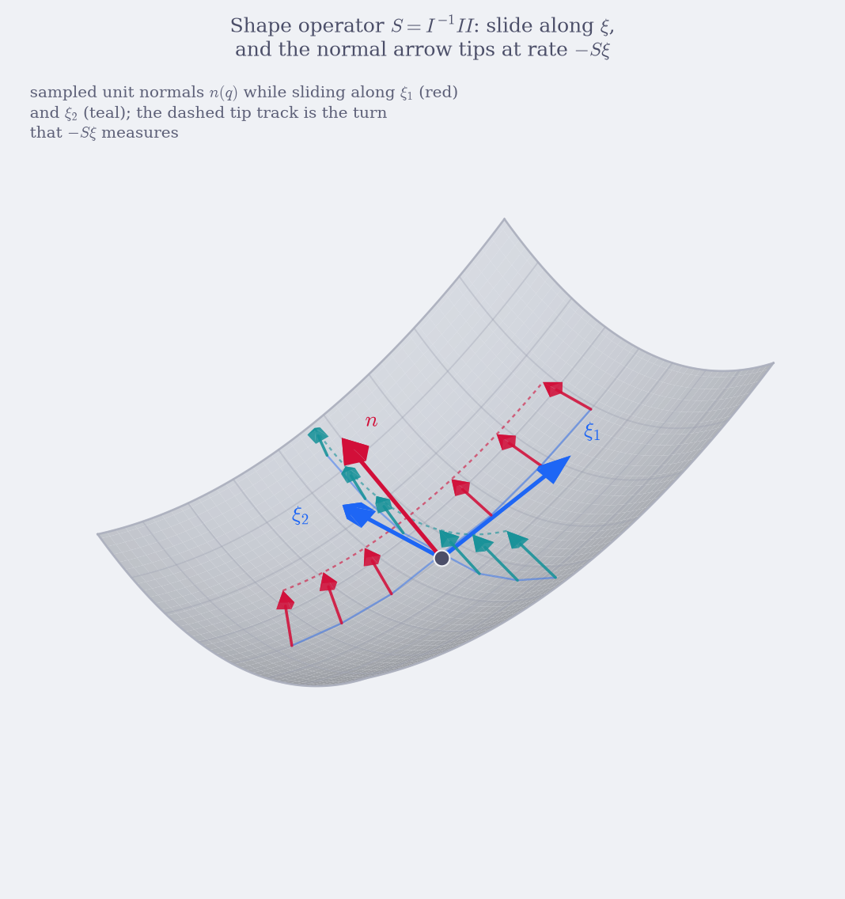
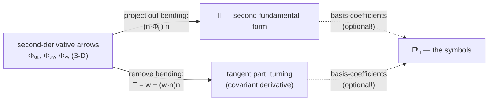

# Geodesia — the tangent space (Ch. 1–2)

> *The surface is curved; the tangent space is flat. This chapter lives in
> the flat world — and takes two measurements of how the curved world bends
> it.*

> **What this chapter is.** One object, seen from several sides: the
> **tangent space** of a parameterized surface — the flat 2-D vector world
> attached to each of its points. The classical "two fundamental forms" are
> two things you can do in that world: measure with its inner product
> ($I = J^{\mathsf T}J$), and record how acceleration leaves it
> ($II_{ij} = n\cdot\Phi_{ij}$). Everything is ordinary vector calculus:
> arrows, dot products, one subtraction. The chapter is written like the
> Lean documentation (as in the Verso-built Lean Manual and *Theorem
> Proving in Lean*): every boxed formula is followed by the **Lean
> declarations that compute it** — a **Signature** block — and every
> numeric claim is a **Checked example**: the Lean snippet together with
> the output it really prints. Nothing in an `Output:` block is
> hand-computed; each was produced by running the snippet against the
> library. The math notation is kept in full ($\Phi$, $I$, $II$, $T$,
> $\Gamma$, …); the Lean identifiers are the computational shadows of the
> same objects.
>
> It merges the former `01-fundamental-forms.md` and `02-tangent-parts.md`.
> The section numbers of both chapters are preserved (`§1.1–1.8`,
> `§2.1–2.9`), so the cross-references from Chapters 3–8, `index.md` and
> `GA_VIEW.md` still resolve. Three small declarations were added to the
> library for this chapter — `Surface.tangentVec`, `Surface.tangentialPart`,
> `Surface.normalPart` — so that the vector statements of §1.1 and §1.5 are
> executable, not just prose.

**Reproducing the checked examples.** All snippets run against this project:

```bash
cd projects/geodesia
lake build
lake exe geodesia                   # the demo printed in §1.6
lake env lean <your-scratch>.lean   # any snippet below (it begins with `import Geodesia`)
```

The dictionary that the whole chapter keeps re-deriving:

| Math object | Lean declaration | File |
|---|---|---|
| $\Phi(u,v)$ | `Surface.point` | `Geodesia/Surface.lean` |
| $\Phi_i = \partial\Phi/\partial i$ | `Surface.dPhi` | `Geodesia/Surface.lean` |
| $\Phi_{ij} = \partial^2\Phi/\partial i\,\partial j$ | `Surface.d2Phi` | `Geodesia/Surface.lean` |
| $n$ | `Surface.normalAt` | `Geodesia/Surface.lean` |
| $J\,d$ — the arrow of a parameter direction | `Surface.tangentVec` | `Geodesia/Surface.lean` |
| $I = J^{\mathsf T}J$ — the inner product of the tangent space | `Surface.metricI`, `Surface.firstForm` | `Geodesia/Curvature.lean` |
| $II_{ij} = n\cdot\Phi_{ij}$ — the acceleration table | `Surface.metricII`, `Surface.secondForm` | `Geodesia/Curvature.lean` |
| $T w = w - (w\cdot n)\,n$ — the tangent part of the split | `Surface.tangentialPart` | `Geodesia/Surface.lean` |
| $(w\cdot n)\,n$ — the normal part of the split | `Surface.normalPart` | `Geodesia/Surface.lean` |
| $\kappa(d) = II(d,d)/I(d,d)$ | `Surface.normalCurvature` | `Geodesia/Curvature.lean` |
| $S = I^{-1}II$ | `Surface.shapeOperator` | `Geodesia/Curvature.lean` |
| $K$, $H$, $\kappa_{1,2}$ | `Surface.gaussK`, `Surface.meanH`, `Surface.principalK` | `Geodesia/Curvature.lean` |
| $\Gamma^k_{\;ij}$ (coordinates of $T\Phi_{ij}$) | `Surface.christoffel` | `Geodesia/Curvature.lean` |
| $\partial_u\,(\Phi_j\cdot\Phi_k)$ | `Surface.dMetricEntry` | `Geodesia/Curvature.lean` |
| $\xi = I^{-1}J^{\mathsf T}w$ | `Geodesic.tangentVecToParams` | `Geodesia/Geodesic.lean` |
| exact derivative arrows | `Smooth2` + its combinators | `Geodesia/Diff.lean` |

**The notation bridge.** The Lean code uses short identifiers where the text
uses math symbols. Every occurrence is translatable by this table — and each
**Signature** block below is followed by the implementation and its
vector-calculus reading, so any formula can be checked against the code:

| Lean notation | Vector-calculus meaning |
|---|---|
| `s.sx`, `s.sy`, `s.sz` | the coordinate functions $x(u,v)$, $y(u,v)$, $z(u,v)$ of $\Phi$ |
| `i : Fin 2` with values `0`, `1` | the parameter index: $0 \leftrightarrow u$, $1 \leftrightarrow v$ |
| `u v : Float` | the point $(u, v)$ of the parameter plane |
| `Surface.dPhi s i u v` | the arrow $\Phi_i(u,v)$ |
| `Surface.d2Phi s i j u v` | the arrow $\Phi_{ij}(u,v)$ |
| `Surface.tangentVec s u v d` | the tangent arrow $J\,d = a\,\Phi_u + b\,\Phi_v$ of the parameter direction $d=(a,b)$ |
| `Surface.tangentialPart s u v w` | the tangent part $T\,w$ of the split of an ambient arrow $w$ |
| `Surface.normalPart s u v w` | the normal part $(w\cdot n)\,n$ of the split of $w$ |
| `v.dot w`, `v.cross w`, `v.norm` | $v\cdot w$, $v\times w$, $\lvert v\rvert$ |
| `Vec3.smul a v` | the scaled arrow $a\,v$ |
| `Mat2` with fields `a`, `b`, `c` | the symmetric matrix $\begin{bmatrix}a & b\\ b & c\end{bmatrix}$ |
| `metricI` / `metricII` | $I = J^{\mathsf T}J$ / $II = [\,n\cdot\Phi_{ij}\,]$ |
| `firstForm` / `secondForm` | the quadratic forms $I(w, w) = w^{\mathsf T}Iw$ / $II(w, w) = w^{\mathsf T}II\,w$ |
| `Surface.christoffel s x y k i j` | the coefficient $\Gamma^k_{\;ij}$ |
| `GeoState` fields `u v du dv` | $q(s) = (u,v)$ and $q'(s) = (u',v')$ along a curve |

(Implementations are shown verbatim from the sources, with the fully
qualified names they get from their `namespace`.)


---

## Part 1 — The tangent space: one flat world, two measurements

> **Goal.** Understand exactly what `metricI`, `metricII`, `gaussK`,
> `meanH` and `principalK` in `Curvature.lean` are computing — as three
> facts about one flat world: the tangent space has an inner product (that
> is $I$), acceleration has a normal component (that is $II$), and a linear
> operator compares the two (that is $S$, hence $K$ and $H$). Everything
> here is ordinary vector math: arrows, dot products, one subtraction.

### 1.1 The surface and its tangent space

> **Picture.** Take a sheet and bend it smoothly — no creases. At every
> point, lay a small flat plane against it, the way a coin rests on a ball.
> That little plane is the **tangent space** of the point: a complete 2-D
> vector world, flat as $\mathbb{R}^2$, with its own arrows, its own
> lengths and angles — and, because it sits inside 3-space, it *inherits*
> the dot products of the ambient world. The sheet is curved; its tangent
> spaces never are. Nearly everything in this chapter happens in those
> flat worlds.


A surface is a function

```math
\Phi : \mathbb{R}^2 \to \mathbb{R}^3,
\qquad \Phi(u,v) = \big(x(u,v),\ y(u,v),\ z(u,v)\big).
```

You feed it a point of the parameter plane and it returns a point of 3-space.
The two numbers $(u,v)$ are just coordinates — like row and column indices
painted on the surface.

Differentiate $\Phi$ with respect to each of its two inputs. Each derivative
is a genuine 3-D arrow:

```math
\Phi_u = \begin{bmatrix}\partial x/\partial u\\ \partial y/\partial u\\ \partial z/\partial u\end{bmatrix},
\qquad
\Phi_v = \begin{bmatrix}\partial x/\partial v\\ \partial y/\partial v\\ \partial z/\partial v\end{bmatrix}.
```

Put them side by side as the columns of a $3\times 2$ matrix, the
**Jacobian** $J$:

```math
J = \begin{bmatrix}\Phi_u & \Phi_v\end{bmatrix}.
```

**The tangent space.** Wherever you stand, the two arrows span a plane —
and this is the sentence the whole chapter stands on: *every linear
combination of them is again the velocity of a real curve on the surface.*
Lift the parameter-plane line $t \mapsto p + t\,(a,b)$ to
$\gamma(t) = \Phi\big(p + t\,(a,b)\big)$ and differentiate at $t = 0$: the
velocity is exactly $a\,\Phi_u + b\,\Phi_v$. So the span deserves the name

```math
T_pS \;=\; \{\, a\,\Phi_u + b\,\Phi_v \;:\; a, b \in \mathbb{R} \,\}
\;\subset\;\mathbb{R}^3,
```

the **tangent space** at $p$. It is a genuine vector space — sums and
scalings of tangent arrows stay tangent, because a span always is — and it
is *flat*: no curvature of the sheet leaks into it. Curvature will enter
only as how these flat worlds tilt relative to each other from point to
point (Part 2), never inside one of them.

> **Caution.** *Is it a problem that this flat world floats inside an extra
> dimension?* For embedded surfaces: none — the ambient $\mathbb{R}^3$ is a
> gift. The normal $n$, the projection $T$, the whole of §1.3 come free
> with it, and that is why this chapter can work in honest arrows. Physics
> is stricter, and for good reasons: spacetime comes with no surrounding
> space to project into, a hypothetical embedding would be unobservable
> scaffolding, and some perfectly honest surfaces have *no* embedding at
> all — Hilbert's theorem forbids the hyperbolic plane in $\mathbb{R}^3$,
> and the intrinsically flat torus needs $\mathbb{R}^4$. That is why
> Chapter 8 rebuilds everything from the ruler $I$ alone — not because the
> extra dimension is forbidden, but because it is not always there when you
> need it. And where physicists *do* assume one (brane worldvolumes, the
> ADM 3+1 split), the extrinsic objects of this chapter come right back.

**Signature** — `Geodesia/Surface.lean` stores the arrows, not approximations
of them (the `Fin 2` index `0, 1` plays the role of $u, v$):

```lean
structure Surface where
  sx : Smooth2          -- each coordinate function carries its own
  sy : Smooth2          -- exact partial derivatives
  sz : Smooth2

def Surface.ofHeight (h : Height) : Surface
    -- the terrain embedding Φ(x, y) = (x, y, h(x, y))
def Surface.point (s : Surface) (u v : Float) : Vec3
    -- Φ(u, v)
def Surface.dPhi (s : Surface) (i : Fin 2) (u v : Float) : Vec3
    -- Φ_u (i = 0) and Φ_v (i = 1)
def Surface.d2Phi (s : Surface) (i j : Fin 2) (u v : Float) : Vec3
    -- Φ_ij: the curvature arrows
```

**Implementation.** The arrows are built component-wise from the exact
partials stored in `Smooth2`:

```lean
def Surface.point (s : Surface) (u v : Float) : Vec3 :=
  ⟨s.sx.f u v, s.sy.f u v, s.sz.f u v⟩

def Surface.dPhi (s : Surface) (i : Fin 2) (u v : Float) : Vec3 :=
  match i with
  | 0 => ⟨s.sx.fx u v, s.sy.fx u v, s.sz.fx u v⟩
  | 1 => ⟨s.sx.fy u v, s.sy.fy u v, s.sz.fy u v⟩

def Surface.d2Phi (s : Surface) (i j : Fin 2) (u v : Float) : Vec3 :=
  match i, j with
  | 0, 0 => ⟨s.sx.fxx u v, s.sy.fxx u v, s.sz.fxx u v⟩
  | 0, 1 => ⟨s.sx.fxy u v, s.sy.fxy u v, s.sz.fxy u v⟩
  | 1, 0 => ⟨s.sx.fxy u v, s.sy.fxy u v, s.sz.fxy u v⟩
  | 1, 1 => ⟨s.sx.fyy u v, s.sy.fyy u v, s.sz.fyy u v⟩
```

**Vector-calculus reading.** Component $k$ of `dPhi s i` is $\partial_i x_k$:
e.g. $\Phi_u = (\partial_u x,\ \partial_u y,\ \partial_u z)$, the displayed
matrix column by column. Both mixed-partial rows read the same field `fxy`
because $\Phi_{uv} = \Phi_{vu}$ (Clairaut's theorem). Note what is *absent*:
the code never materializes the $3\times 2$ Jacobian $J$ itself — every
consumer below needs only its columns and their dot products. (Curves
$\gamma$ are carried by `GeoState` $= (q, q')$ and integrated in Chapter 4.)

#### What $J$ does to a direction

Introduce a real parameter $s \in \mathbb{R}$ and a differentiable
**parameter-plane curve**

```math
c(s) := \bigl(u(s),\, v(s)\bigr) \in \mathbb{R}^2,
```

where $u(s), v(s) \in \mathbb{R}$ are the parameter coordinates along the
curve. Composing with $\Phi$ gives the corresponding **surface curve**

```math
\gamma(s) := \Phi\!\bigl(c(s)\bigr) = \Phi\!\bigl(u(s),\, v(s)\bigr) \in \mathbb{R}^3.
```

Write derivatives with respect to $s$ using a prime,
$u'(s) := \frac{du}{ds}$, $v'(s) := \frac{dv}{ds}$, and
$\gamma'(s) := \frac{d\gamma}{ds}$. Differentiating $\gamma$ by the chain
rule gives

```math
\gamma'(s) = \frac{d\gamma}{ds}
= \Phi_u\, u'(s) + \Phi_v\, v'(s)
= J \begin{bmatrix}u'(s)\\ v'(s)\end{bmatrix}.
```

So $J$ converts a 2-D direction $(a,b)$ in the parameter plane into the
actual 3-D direction you move on the surface:

```math
\boxed{\;J\begin{bmatrix}a\\ b\end{bmatrix} = a\,\Phi_u + b\,\Phi_v
\;\in\; T_pS.\;}
```

That is all "parameter space" means here: the numbers $(a,b)$ live in the
flat plane, and $J$ carries them into the flat tangent world. No other
machinery.

**Signature** — the linear map from parameter directions to tangent arrows
now has a name in the code:

```lean
def Surface.tangentVec (s : Surface) (u v : Float) (d : Vec2) : Vec3
    -- the tangent arrow J d = d.x • Φu + d.y • Φv
```

**Checked example.** Handing it the coordinate directions reproduces the
basis arrows; a diagonal direction gives the diagonal arrow:

```lean
#eval show IO Unit from do
  IO.println s!"J(1,0) = {Surface.tangentVec surf 1 0 ⟨1, 0⟩}"
  IO.println s!"J(1,1) = {Surface.tangentVec surf 1 0 ⟨1, 1⟩}"
```

**Output:**
```text
J(1,0) = (1.000000, 0.000000, 0.600000)
J(1,1) = (1.000000, 1.000000, 0.600000)
```

`J(1,0)` is literally the $\Phi_x$ of the four-arrow table below — the same
arrow, now obtained by feeding the *direction* to the linear map. And
`J(1,1) = Φ_x + Φ_y`: the arrow of the diagonal direction, reused by the
angles example of §1.2.

#### A graph is a special case

For a height field $z = f(x,y)$ the surface is $\Phi(x,y) = (x, y, f(x,y))$,
and the two tangent vectors are

```math
\Phi_x = \begin{bmatrix}1\\ 0\\ f_x\end{bmatrix},
\qquad
\Phi_y = \begin{bmatrix}0\\ 1\\ f_y\end{bmatrix}.
```

This is the surface built by `Surface.ofHeight` in the code.

**Implementation.** The terrain embedding, and the two graph tangent arrows —
literally the displayed matrices:

```lean
def Surface.ofHeight (h : Height) : Surface :=
  ⟨Smooth2.coordX, Smooth2.coordY, h⟩       -- Φ(x, y) = (x, y, h(x, y))

def Surface.tangentX (h : Height) (x y : Float) : Vec3 := ⟨1, 0, hx h x y⟩
def Surface.tangentY (h : Height) (x y : Float) : Vec3 := ⟨0, 1, hy h x y⟩
```

i.e. $\Phi_x = (1, 0, f_x)$ and $\Phi_y = (0, 1, f_y)$, with $f_x$, $f_y$ the
exact partials of $h$.

**The running example.** Most checked examples in this chapter use the
paraboloid $z = 0.3\,(x^2+y^2)$, built from exact `Smooth2` combinators in
`Main.lean` (§1.7 explains the combinator machinery):

```lean
import Geodesia
open Geodesia

def paraboloid : Smooth2 :=
  Smooth2.smul 0.3
    (Smooth2.add (Smooth2.mul Smooth2.coordX Smooth2.coordX)
      (Smooth2.mul Smooth2.coordY Smooth2.coordY))

def surf : Surface := Surface.ofHeight paraboloid
```

**Checked example.** The four arrows at $(x,y) = (1,0)$ — compare
$f_x = 0.6$, $f_{xx} = 0.6$ below:

```lean
#eval show IO Unit from do
  IO.println s!"Φ    = {Surface.point surf 1 0}"
  IO.println s!"Φ_x  = {Surface.dPhi surf 0 1 0}"
  IO.println s!"Φ_y  = {Surface.dPhi surf 1 1 0}"
  IO.println s!"Φ_xx = {Surface.d2Phi surf 0 0 1 0}"
```

**Output:**
```text
Φ    = (1.000000, 0.000000, 0.300000)
Φ_x  = (1.000000, 0.000000, 0.600000)
Φ_y  = (0.000000, 1.000000, 0.000000)
Φ_xx = (0.000000, 0.000000, 0.600000)
```

### 1.2 The inner product of the tangent space — how to measure on a bent sheet

> **Picture.** Last section gave the tangent space its arrows. A vector
> space with arrows but no way to compare them is a dark room: you can hold
> things, not measure them. What turns $T_pS$ into a place where "length",
> "angle" and "area" mean something is one piece of equipment: an **inner
> product**. And here is the pleasant surprise — we don't have to invent
> one. The tangent space sits inside $\mathbb{R}^3$, and $\mathbb{R}^3$
> already owns the plain dot product $v \cdot w$. The tangent space simply
> *inherits* it.

Concretely: take the two basis arrows $\Phi_u, \Phi_v$ and record the three
dot products among them —

```math
\Phi_u\cdot\Phi_u, \qquad
\Phi_u\cdot\Phi_v, \qquad
\Phi_v\cdot\Phi_v.
```

Stacked into a symmetric $2\times 2$ matrix, this is the *matrix of the
inner product in the basis $\{\Phi_u,\Phi_v\}$* — the **Gram matrix** of two
vectors, the same object you meet as the normal-equation matrix
$J^{\mathsf T}J$ in least squares:

```math
\boxed{\;I = J^{\mathsf T}J
=
\begin{bmatrix}
\Phi_u\cdot\Phi_u & \Phi_u\cdot\Phi_v\\
\Phi_v\cdot\Phi_u & \Phi_v\cdot\Phi_v
\end{bmatrix}\;}
```

> **What the old books call it.** "The *first fundamental form*." The name
> sounds like a sacrament; the object is a Gram matrix. The three entries
> were historically named $E$, $F$, $G$ — letters which tell you nothing
> (the code keeps them as `MetricI.E`, `MetricI.Ff`, `MetricI.G` for
> cross-reading older texts). The content is one sentence: *to measure on
> the surface, dot the ambient arrows.*

**Signature** — `Geodesia/Curvature.lean`:

```lean
structure Mat2 where
  a : Float        -- the symmetric matrix [[a, b], [b, c]]
  b : Float
  c : Float

def Mat2.det (M : Mat2) : Float          -- det I = ac − b²
def Mat2.inv (M : Mat2) : Mat2           -- Cramer's rule (det > 0 here)

def Surface.metricEntry (s : Surface) (u v : Float) : Fin 2 → Fin 2 → Float
    -- I_ij = ⟨∂_iΦ, ∂_jΦ⟩, one dot product
def Surface.metricI (s : Surface) (u v : Float) : Mat2
    -- the whole Gram matrix I = JᵀJ
def Surface.firstForm (s : Surface) (x y : Float) (w : Vec2) : Float
    -- the quadratic form I(w, w)
```

**Implementation.** The symmetric matrix is stored as three `Float`s, and
every entry of the boxed matrix is one `metricEntry` dot product:

```lean
def Mat2.det (M : Mat2) : Float := M.a * M.c - M.b * M.b
    -- det [[a, b], [b, c]] = ac − b²

def Mat2.inv (M : Mat2) : Mat2 :=
  let d := M.det
  ⟨M.c / d, -M.b / d, M.a / d⟩
    -- Cramer's rule: I⁻¹ = (1/det I) [[c, −b], [−b, a]]

def Surface.metricEntry (s : Surface) (u v : Float) : Fin 2 → Fin 2 → Float :=
  fun i j => (dPhi s i u v).dot (dPhi s j u v)

def Surface.metricI (s : Surface) (u v : Float) : Mat2 :=
  ⟨metricEntry s u v 0 0, metricEntry s u v 0 1, metricEntry s u v 1 1⟩
```

**Vector-calculus reading.** `metricEntry s u v i j` is one entry of the
boxed matrix, $I_{ij} = \Phi_i\cdot\Phi_j$; `metricI` stacks the three
independent ones ($b = I_{12} = \Phi_u\cdot\Phi_v = I_{21}$, by symmetry of
the dot product). `Mat2.inv` is the closed-form inverse of a symmetric
$2\times 2$ matrix,

```math
I^{-1} = \frac{1}{\det I}\begin{bmatrix}c & -b\\ -b & a\end{bmatrix},
```

so every use of $I^{-1}$ below (the shape operator, the Christoffel symbols,
the $I^{-1}J^{\mathsf T}w$ solve) is four divisions — no linear-algebra
library anywhere.

#### What the inner product buys you

Three purchases, all of them plain expansions of $v\cdot w$.

**Lengths.** A parameter direction $(a,b)$ becomes the tangent arrow
$J\,(a,b) = a\Phi_u + b\Phi_v$, and its squared length is

```math
\bigl|J\begin{bmatrix}a\\ b\end{bmatrix}\bigr|^2
= \bigl(a\Phi_u + b\Phi_v\bigr)\cdot\bigl(a\Phi_u + b\Phi_v\bigr)
= \begin{bmatrix}a & b\end{bmatrix} I \begin{bmatrix}a\\ b\end{bmatrix}.
```

So $I$ is the **ruler** of the tangent space: it converts the flat
parameter-plane numbers into true lengths on the bent sheet.

**Implementation.** The quadratic form is that expansion, written out entry
by entry:

```lean
def Surface.firstForm (s : Surface) (x y : Float) (w : Vec2) : Float :=
  let I := metricI s x y
  I.a * w.x * w.x + 2 * I.b * w.x * w.y + I.c * w.y * w.y
```

i.e. for $w = (w_x, w_y)$:

```math
I(w, w) \;=\; a\,w_x^2 \,+\, 2\,b\,w_x w_y \,+\, c\,w_y^2
\;=\; w^{\mathsf T} I\, w.
```

**Angles.** Two tangent directions $\xi$, $\eta$ (2-vectors in the parameter
plane) meet at the angle of their arrows $J\xi$, $J\eta$ — and the inner
product computes it without ever forming the arrows:

```math
\cos\theta = \frac{(J\xi)\cdot(J\eta)}{|J\xi|\,|J\eta|}
= \frac{\xi^{\mathsf T} I\, \eta}{\sqrt{\xi^{\mathsf T} I\, \xi}\;\sqrt{\eta^{\mathsf T} I\, \eta}}.
```

**Checked example.** No dedicated function computes $\cos\theta$, but both
routes of the boxed formula are checkable with the library's pieces. Take
$\xi = (1,0)$, $\eta = (1,1)$ at $(1,0)$ on the paraboloid. The **arrow
route** forms $J\xi = \Phi_x$ and $J\eta = \Phi_x + \Phi_y$ and uses plain
dot products; the **ruler route** recovers the bilinear form by polarizing
the quadratic form, $\xi^{\mathsf T}I\eta = \tfrac12\bigl(I(\xi{+}\eta,\xi{+}\eta) - I(\xi,\xi) - I(\eta,\eta)\bigr)$,
using `firstForm` from above:

```lean
#eval show IO Unit from do
  -- the arrows: J ξ = Φ_x, J η = Φ_x + Φ_y for ξ = (1, 0), η = (1, 1)
  let Jxi : Vec3 := Surface.dPhi surf 0 1 0
  let Jeta : Vec3 := Vec3.add (Surface.dPhi surf 0 1 0) (Surface.dPhi surf 1 1 0)
  IO.println s!"cos θ (arrows) = {(Jxi.dot Jeta) / (Jxi.norm * Jeta.norm)}"
  -- the ruler route via polarization of I(w, w) = wᵀ I w
  let q : Vec2 → Float := fun w => Surface.firstForm surf 1 0 w
  let xi : Vec2 := ⟨1, 0⟩
  let eta : Vec2 := ⟨1, 1⟩
  let sum : Vec2 := Vec2.add xi eta
  let bil := (q sum - q xi - q eta) / 2
  IO.println s!"cos θ (ruler)   = {bil / (Float.sqrt (q xi) * Float.sqrt (q eta))}"
  -- the squared-length claim: I(w, w) = |J w|²
  IO.println s!"I((1,0),(1,0))  = {q xi}"
  IO.println s!"|Φ_x|²          = {Jxi.dot Jxi}"
```

**Output:**
```text
cos θ (arrows) = 0.759125
cos θ (ruler)   = 0.759125
I((1,0),(1,0))  = 1.360000
|Φ_x|²          = 1.360000
```

Two claims verified at once: the angle formula (the two routes agree) and
the squared-length formula ($I(w,w) = |Jw|^2$: here
$I((1,0),(1,0)) = 1.36 = |\Phi_x|^2 = 1 + f_x^2$).

**Area.** The two basis arrows span a parallelogram whose area is the norm
of their cross product — and that equals the determinant of the Gram matrix:

```math
|\Phi_u \times \Phi_v|^2 = \det I
\qquad\Longrightarrow\qquad
dA = \sqrt{\det I}\; du\, dv.
```

#### Recovering a 2-D direction from a 3-D arrow

> **By the way.** This subsection is really about *coordinates*: given an
> arrow $w$ that happens to live in $T_pS$, what are its components in the
> basis $\Phi_u, \Phi_v$? The answer needs the inner product — which is why
> it lives here and not in §1.1.

Expand $w$ in the basis:

```math
w = a\,\Phi_u + b\,\Phi_v = J\begin{bmatrix}a\\ b\end{bmatrix}.
```

$J$ is $3\times 2$, not square — but $w$ is known to lie in the span, so a
solution exists and the normal-equations trick finds it: multiply by
$J^{\mathsf T}$ and use $J^{\mathsf T}J = I$:

```math
\boxed{\;\begin{bmatrix}a\\ b\end{bmatrix} = I^{-1} J^{\mathsf T} w\;}
```

This is exactly what `Geodesic.tangentVecToParams` computes — give it a
tangent arrow $w$ and it returns the 2 coordinates whose arrows reproduce it:

```lean
def Geodesic.tangentVecToParams (s : Surface) (u v : Float) (w : Vec3) : Vec2
    -- ξ = I⁻¹ Jᵀ w
```

**Implementation.** Two dot products form $J^{\mathsf T}w$, then the stored
Cramer inverse applies $I^{-1}$:

```lean
def Geodesic.tangentVecToParams (s : Surface) (u v : Float) (w : Vec3) : Vec2 :=
  let gInv := (Surface.metricI s u v).inv
  let a := (Surface.dPhi s 0 u v).dot w        -- b₀ = Φ_u · w
  let b := (Surface.dPhi s 1 u v).dot w        -- b₁ = Φ_v · w
  ⟨gInv.a * a + gInv.b * b, gInv.b * a + gInv.c * b⟩
```

**Vector-calculus reading.** With $b := J^{\mathsf T}w =
\begin{bmatrix}\Phi_u\cdot w\\ \Phi_v\cdot w\end{bmatrix}$, the code returns
$I^{-1}b$ component-wise: $\xi_1 = (I^{-1})_{11}b_0 + (I^{-1})_{12}b_1$,
$\xi_2 = (I^{-1})_{21}b_0 + (I^{-1})_{22}b_1$ — the boxed solve
$\xi = I^{-1}J^{\mathsf T}w$, with no matrix product ever formed.

#### The graph metric again, by dot products

For $\Phi = (x, y, f)$ the three dot products are immediate:

```math
\Phi_x\cdot\Phi_x = 1 + f_x^2,\qquad
\Phi_x\cdot\Phi_y = f_x f_y,\qquad
\Phi_y\cdot\Phi_y = 1 + f_y^2,
```

so

```math
I=
\begin{bmatrix}
1+f_x^2 & f_x f_y\\
f_x f_y & 1+f_y^2
\end{bmatrix}.
```

Cross-check it the vector way: a plane step $(dx,dy)$ lifts to the arrow
$(dx, dy, f_x dx + f_y dy)$, whose squared norm is
$dx^2 + dy^2 + (f_x dx + f_y dy)^2$ — the same quadratic form.

**Checked example.** Three claims verified at once on `surf` at $(1,0)$:
the graph formula ($I_{11} = 1 + 0.6^2 = 1.36$), the determinant identity
$\det I = |\Phi_x\times\Phi_y|^2$ (Exercise 2), and the $I^{-1}J^{\mathsf T}w$
round-trip, fed the non-unit arrow $\Phi_x$ itself:

```lean
#eval show IO Unit from do
  let I := Surface.metricI surf 1 0
  IO.println s!"I            = [[{I.a}, {I.b}], [{I.b}, {I.c}]]"
  IO.println s!"det I        = {I.det}"
  let c := (Surface.dPhi surf 0 1 0).cross (Surface.dPhi surf 1 1 0)
  IO.println s!"|Φ_x × Φ_y|² = {c.dot c}"
  IO.println s!"I⁻¹ Jᵀ Φ_x   = {Geodesic.tangentVecToParams surf 1 0 (Surface.dPhi surf 0 1 0)}"
```

**Output:**
```text
I            = [[1.360000, 0.000000], [0.000000, 1.000000]]
det I        = 1.360000
|Φ_x × Φ_y|² = 1.360000
I⁻¹ Jᵀ Φ_x   = (1.000000, 0.000000)
```

The round-trip returns $(1, 0)$: $\Phi_x$ is indeed the first basis arrow.

### 1.3 The normal, and how acceleration leaves the tangent space

> **Picture.** §1.2 equipped the tangent space with a ruler. But the
> tangent space can't tell you *everything* about the bent sheet it sits
> on — a flat plane has no opinion about bending. The missing information
> lives in one extra arrow, the **unit normal** $n$: the direction that
> points *away* from the flat world, perpendicular to everything in $T_pS$.
> With $T_pS$ and $n$ together, 3-space splits cleanly in two: every ambient
> arrow is *tangent part plus normal part*. The normal is the gatekeeper of
> that split — and, one derivative later, the yardstick of bending: an
> acceleration can move you along the surface freely, but the piece of it
> that leaves the tangent plane must go in the $n$ direction, and $n$ alone
> measures how much.

```math
n = \frac{\Phi_u \times \Phi_v}{|\Phi_u \times \Phi_v|}.
```

Differentiate $\Phi$ once more. Besides the two tangent arrows $\Phi_u$,
$\Phi_v$, the surface now has three **curvature arrows**:

```math
\Phi_{uu} = \frac{\partial^2\Phi}{\partial u^2},\qquad
\Phi_{uv} = \frac{\partial^2\Phi}{\partial u\,\partial v},\qquad
\Phi_{vv} = \frac{\partial^2\Phi}{\partial v^2}.
```

Each is an ordinary 3-D arrow, and each can be tested the same way: *how
much of it points along $n$?* That is one dot product. Three arrows, three
dot products, one symmetric table:

```math
\boxed{\;II =
\begin{bmatrix}
n\cdot\Phi_{uu} & n\cdot\Phi_{uv}\\
n\cdot\Phi_{uv} & n\cdot\Phi_{vv}
\end{bmatrix}\;}
```

> **What the old books call it.** The "*second fundamental form*", entries
> $e$, $f$, $g$. Again the object is simpler than the ceremony: it is the
> table of *normal components of the curvature arrows* — dot each
> $\Phi_{ij}$ with $n$, write it down. (The code's other second-form entry
> names live in `MetricII`.) Note the deep symmetry with §1.2: there,
> tangent arrows dotted with *each other*; here, curvature arrows dotted
> with the *gatekeeper*.

**Signature** — `Geodesia/Surface.lean` and `Geodesia/Curvature.lean`:

```lean
def Surface.normalAt (s : Surface) (u v : Float) : Vec3
    -- n = Φ_u × Φ_v / |Φ_u × Φ_v|
def Surface.secondFormEntry (s : Surface) (x y : Float) : Fin 2 → Fin 2 → Float
    -- II_ij = ⟨n, ∂²_ij Φ⟩, one dot product
def Surface.metricII (s : Surface) (x y : Float) : Mat2
    -- the whole bending matrix II
def Surface.secondForm (s : Surface) (x y : Float) (w : Vec2) : Float
    -- the quadratic form II(w, w)
def Surface.normalCurvature (s : Surface) (x y : Float) (w : Vec2) : Float
    -- κ_n = II(w, w) / I(w, w)
```

**Implementation.** The gatekeeper and the bending table:

```lean
def Surface.normalAt (s : Surface) (u v : Float) : Vec3 :=
  let c := (dPhi s 0 u v).cross (dPhi s 1 u v)
  Vec3.smul (1 / c.norm) c

def Surface.secondFormEntry (s : Surface) (x y : Float) : Fin 2 → Fin 2 → Float :=
  fun i j => (normalAt s x y).dot (d2Phi s i j x y)

def Surface.metricII (s : Surface) (x y : Float) : Mat2 :=
  ⟨secondFormEntry s x y 0 0, secondFormEntry s x y 0 1,
    secondFormEntry s x y 1 1⟩
```

**Vector-calculus reading.** `cross` is the determinant expansion
$u\times v = (u_yv_z - u_zv_y,\ u_zv_x - u_xv_z,\ u_xv_y - u_yv_x)$, so
`normalAt` is the boxed $n = \dfrac{\Phi_u\times\Phi_v}{|\Phi_u\times\Phi_v|}$
(the `smul (1 / c.norm)` scales to unit length). `secondFormEntry s x y i j`
is one entry of the boxed bending table, $II_{ij} = n\cdot\Phi_{ij}$; the
quadratic form mirrors §1.2's `firstForm`:

```lean
def Surface.secondForm (s : Surface) (x y : Float) (w : Vec2) : Float :=
  let II := metricII s x y
  II.a * w.x * w.x + 2 * II.b * w.x * w.y + II.c * w.y * w.y

def Surface.normalCurvature (s : Surface) (x y : Float) (w : Vec2) : Float :=
  secondForm s x y w / firstForm s x y w
```

That is $II(w,w) = e\,w_x^2 + 2f\,w_xw_y + g\,w_y^2$, and the normal
curvature is the boxed ratio in one line,

```math
\kappa(d) \;=\; \frac{II(d,d)}{I(d,d)}
\;=\; \frac{n\cdot\gamma''(s)}{|J\,d|^2}\qquad (d = \gamma'(s)\ \text{in parameters}),
```

so `normalCurvature` **is** the $n\cdot\gamma''(s)$ formula of this section,
normalized — the code never differentiates $\gamma$; it just evaluates the
two quadratic forms.

#### The acceleration test, done by hand

Take the same surface curve $\gamma(s) = \Phi(u(s), v(s)) \in \mathbb{R}^3$
and differentiate it twice with respect to $s$, writing
$u''(s) := \frac{d^2u}{ds^2}$, $v''(s) := \frac{d^2v}{ds^2}$, and
$\gamma''(s) := \frac{d^2\gamma}{ds^2}$ — the **acceleration arrow**:

```math
\gamma''(s) = \frac{d^2\gamma}{ds^2}
= \Phi_u\, u''(s) + \Phi_v\, v''(s)
+ \Phi_{uu}\,u'(s)^2 + 2\,\Phi_{uv}\,u'(s)v'(s) + \Phi_{vv}\,v'(s)^2.
```

Now dot it with $n$. The first two terms die ($n \perp \Phi_u, \Phi_v$ —
the gatekeeper again), and what survives is exactly the bending table
applied to the velocity:

```math
\boxed{\;n\cdot\gamma''(s) = n\cdot\frac{d^2\gamma}{ds^2}
= \begin{bmatrix}u'(s) & v'(s)\end{bmatrix} II \begin{bmatrix}u'(s)\\ v'(s)\end{bmatrix}\;}
```

Let $d := \begin{bmatrix}u'(s)\\ v'(s)\end{bmatrix} \in \mathbb{R}^2$ be the
parameter velocity. So $II(d,d)$ *is* the normal component of the
acceleration when you move in surface direction $d$. Dividing by the
squared speed $|J\,d|^2$ normalizes it — that ratio is the **normal
curvature** `Surface.normalCurvature`:

```math
\kappa(d) = \frac{II(d,d)}{|J\, d|^2}.
```

In plain vector terms it answers: *if I walk across the surface in the
direction of arrow $J d$, how fast does my acceleration arrow bend away
from the tangent plane?* The sign depends on which way $n$ points, but the
product of the two principal curvatures below does not.


**Local height above the tangent plane.** Put a point at the origin, make
the tangent plane the $xy$-plane so $n = (0,0,1)$. Then the third coordinate
of $\Phi_{uu}$ is exactly $n\cdot\Phi_{uu} = II_{11}$ etc., and Taylor's
theorem gives

```math
z(u,v) = \tfrac12\,\bigl(II_{11}u^2 + 2\,II_{12}uv + II_{22}v^2\bigr) + O(3).
```

So $II$ **is** the quadratic approximation of the surface above its tangent
plane: a bowl, a saddle, or flat in one direction — you can read all three
straight off the signs of $II$.

#### Second equivalent formula: derivative of the normal

Differentiate $n \cdot \Phi_u = 0$ with respect to $v$:

```math
\frac{\partial n}{\partial v}\cdot\Phi_u + n\cdot\Phi_{uv} = 0
\qquad\Longrightarrow\qquad
II_{12} = -\frac{\partial n}{\partial v}\cdot\Phi_u.
```

The same holds entry by entry. So $II$ also measures **how fast the normal
arrow turns as you move** — two ways of seeing the same bending. (This is
the identity the shape operator of §1.4 is built on.)

> **What stays paper-only here.** The Taylor development
> $z(u,v) = \tfrac12\,(II_{11}u^2 + 2\,II_{12}uv + II_{22}v^2) + O(3)$ and
> the identity $II_{12} = -(\partial_v n)\cdot\Phi_u$ have no code: the
> library differentiates the *coordinate functions* (`Smooth2`), never
> `normalAt` itself, so there is no stored $\partial_v n$ arrow to dot
> with. Both remain checkable from printed arrows: the Taylor model by
> comparing `Surface.point` against $\Phi$ plus the quadratic model near the
> tangency point, the derivative-of-normal sign by finite-differencing
> `Surface.normalAt`.

**Checked example.** The normal, $II$, and the two normal curvatures along
the coordinate directions — the two extremes of the polar plot above:

```lean
#eval show IO Unit from do
  let II := Surface.metricII surf 1 0
  IO.println s!"II     = [[{II.a}, {II.b}], [{II.b}, {II.c}]]"
  IO.println s!"n      = {Surface.normalAt surf 1 0}"
  IO.println s!"κ(1,0) = {Surface.normalCurvature surf 1 0 ⟨1, 0⟩}"
  IO.println s!"κ(0,1) = {Surface.normalCurvature surf 1 0 ⟨0, 1⟩}"
```

**Output:**
```text
II     = [[0.514496, 0.000000], [0.000000, 0.514496]]
n      = (-0.514496, 0.000000, 0.857493)
κ(1,0) = 0.378306
κ(0,1) = 0.514496
```

Exactly the §1.6 paraboloid arithmetic: $II_{11} = 0.6/\sqrt{1.36} = 0.5145$,
and $\kappa(1,0) = 0.5145/1.36 = 0.3783$.

### 1.4 The shape operator — one linear map on the tangent space

> **Picture.** Two tables now sit on the same flat world: $I$, the ruler
> (§1.2), and $II$, the bending table (§1.3). Comparing matrices is
> bookkeeping; comparing *maps* is geometry. There is one linear map from
> the tangent space to itself that does the comparison in one stroke:

```math
\boxed{\;II = I\,S
\qquad\Longleftrightarrow\qquad
S = I^{-1} II\;}
```

$S$ takes a tangent direction and returns a tangent direction — an
**endomorphism of $T_pS$** — and it encodes exactly one question: *if I
slide in surface direction $\xi$, how fast and in which way does the normal
arrow turn?* Concretely, $-S\xi$ is the rate of change of $n$ along $\xi$:

```math
-\,S\,\begin{bmatrix}a\\ b\end{bmatrix}
= a\,\frac{\partial n}{\partial u} + b\,\frac{\partial n}{\partial v},
\qquad \bigl(a,b\bigr)\ \text{a parameter direction}.
```



$S$ is a $2\times 2$ map acting on the 2-D tangent space, so it has two
eigenvalues, the **principal curvatures** $\kappa_1, \kappa_2$, and two
eigendirections — the directions of greatest and least bending. Its two
basic invariants get the historical names:

```math
K = \det S = \frac{\det II}{\det I}
\qquad\text{(Gaussian curvature)},
```

```math
H = \tfrac12\,\mathrm{tr}\,S = \tfrac12\,\mathrm{tr}\!\bigl(I^{-1}II\bigr)
\qquad\text{(mean curvature)}.
```

The eigenvalues come back from the trace/determinant pair:

```math
\kappa_{1,2} = H \pm \sqrt{H^2 - K}.
```

- $K>0$: both directions bend the same way (bowl, ellipsoid).
- $K<0$: directions bend oppositely (saddle).
- $K=0$: at least one direction is straight (plane, cylinder, cone).
- $H=0$: the two bendings cancel (soap films).


> **What the old books call it.** The map $S$ is usually introduced as
> $-Dn$, "*the Weingarten map*", and the identity $II = IS$ is buried under
> the name. The code states it the honest way: $S$ is defined as the map
> that makes $II = IS$ true, and the normal-turning picture is a theorem
> about it, not its definition. (Which came first is a matter of taste;
> that they agree is Exercise 7.)

**Signature** — `Geodesia/Curvature.lean`:

```lean
def Surface.shapeOperator (s : Surface) (x y : Float) (w : Vec2) : Vec2
    -- S w = I⁻¹ (II w); its eigenvalues are the principal curvatures
def Surface.gaussK (s : Surface) (x y : Float) : Float
    -- K = det II / det I — intrinsic
def Surface.meanH (s : Surface) (x y : Float) : Float
    -- H = (eG − 2fF + gE) / 2(EG − F²)
def Surface.principalK (s : Surface) (x y : Float) : Float × Float
    -- (κ_min, κ_max) = H ± √(H² − K)
```

One wrinkle worth knowing: `Surface.principalK` computes
$\kappa_{1,2} = H \pm \sqrt{H^2-K}$ rather than calling an eigensolver —
with a $2\times 2$ map the eigenvalues come from trace and determinant,
which is all `Mat2` needs.

**Implementation.** All four curvature numbers are closed-form $2\times 2$
algebra — no eigensolver, no SVD:

```lean
def Surface.shapeOperator (s : Surface) (x y : Float) (w : Vec2) : Vec2 :=
  let II := metricII s x y
  let gInv := (metricI s x y).inv
  let b1 := II.a * w.x + II.b * w.y
  let b2 := II.b * w.x + II.c * w.y
  ⟨gInv.a * b1 + gInv.b * b2, gInv.b * b1 + gInv.c * b2⟩

def Surface.gaussK (s : Surface) (x y : Float) : Float :=
  (metricII s x y).det / (metricI s x y).det

def Surface.meanH (s : Surface) (x y : Float) : Float :=
  let E := MetricI.E s x y
  let Ff := MetricI.Ff s x y
  let G := MetricI.G s x y
  let II := metricII s x y
  let denom := 2 * (E * G - Ff * Ff)
  (II.a * G - 2 * II.b * Ff + II.c * E) / denom

def Surface.principalK (s : Surface) (x y : Float) : Float × Float :=
  let H := meanH s x y
  let K := gaussK s x y
  let disc0 := H * H - K
  let disc := Float.sqrt (if disc0 < 0 then 0 else disc0)
  (H - disc, H + disc)
```

**Vector-calculus reading.**

- `shapeOperator` computes $Sw = I^{-1}(II\,w)$ in the two natural steps:
  first the bending table acts on $w$,
  $b = II\,w = \begin{bmatrix}e\,w_x + f\,w_y\\ f\,w_x + g\,w_y\end{bmatrix}$
  (`b1`, `b2`), then the ruler inverse acts, $Sw = I^{-1}b$ (the same
  Cramer expansion as §1.2). The defining property $II = IS$ is then
  automatic: $I\,(Sw) = I\,I^{-1}(II\,w) = II\,w$, which is Exercise 7.
- `gaussK` is the boxed ratio $K = \det II/\det I$ — one line.
- `meanH` looks like a different formula because it *is* the trace,
  expanded. From
  $I^{-1} = \dfrac{1}{EG-F^2}\begin{bmatrix}G & -F\\ -F & E\end{bmatrix}$:

  ```math
  \mathrm{tr}\,\bigl(I^{-1}II\bigr)
  = \frac{G\,e \,-\, 2F\,f \,+\, E\,g}{EG - F^2}
  \qquad\Longrightarrow\qquad
  H = \frac{eG - 2fF + gE}{2\,(EG - F^2)},
  ```

  which is literally the code line — the code never builds the matrix
  $I^{-1}II$, only its trace.
- `principalK` is the boxed $\kappa_{1,2} = H \pm \sqrt{H^2 - K}$; the `if`
  clamps a tiny negative discriminant (a `Float` rounding artifact) to zero.

**Checked example.** $S$ applied to the two coordinate directions, then
$K$, $H$ and the eigenvalue pair — note $S(1,0)$ and $S(0,1)$ reproduce
`normalCurvature` from §1.3 (here $S$ is diagonal, so $\Phi_x$, $\Phi_y$
are the eigendirections):

```lean
#eval show IO Unit from do
  IO.println s!"S(1,0)       = {Surface.shapeOperator surf 1 0 ⟨1, 0⟩}"
  IO.println s!"S(0,1)       = {Surface.shapeOperator surf 1 0 ⟨0, 1⟩}"
  IO.println s!"K, H         = {Surface.gaussK surf 1 0}, {Surface.meanH surf 1 0}"
  let (kmin, kmax) := Surface.principalK surf 1 0
  IO.println s!"κ_min, κ_max = {kmin}, {kmax}"
```

**Output:**
```text
S(1,0)       = (0.378306, 0.000000)
S(0,1)       = (0.000000, 0.514496)
K, H         = 0.194637, 0.446401
κ_min, κ_max = 0.378306, 0.514496
```

### 1.5 The split of an arrow — tangent part and normal part

> **Picture.** Put §1.1 and §1.3 together: at a point, 3-space is exactly
> the flat world $T_pS$ plus one extra direction, $n$. Two flat pieces, one
> arrow to be placed — so every ambient arrow $w$ splits **uniquely** into a
> piece that stays in the flat world and a piece that leaves it:

```math
\boxed{\;
\begin{aligned}
T &: \mathbb{R}^3 \to \mathbb{R}^3, & T(w) &:= w - (w\cdot n)\,n, \qquad w \in \mathbb{R}^3,\\[6pt]
&& \Phi_{ij} &= T(\Phi_{ij}) + II_{ij}\,n, \qquad i,j \in \{u,v\}.
\end{aligned}\;}
```

$T$ — the **tangential projection** — subtracts exactly the normal
component: $T(w)$ is the **tangent part** of $w$, $(w\cdot n)\,n$ its
**normal part**. Applied to a curvature arrow $\Phi_{ij}$, the second line
is the classical **Gauss split**: the tangent part $T(\Phi_{ij})$ is the
turning data, the normal coefficient $II_{ij}$ the bending data (§1.3).
Expanding $T(\Phi_{ij})$ in the basis $\{\Phi_u,\Phi_v\}$ yields the
coefficients textbooks call Christoffel symbols; Part 2 works with the
arrows directly.

**Signature.** The split now has named declarations in the library —
this is the vector machinery of the chapter, made executable:

```lean
def Surface.tangentialPart (s : Surface) (u v : Float) (w : Vec3) : Vec3
    -- T w = w − (w·n) n, the tangent part of the split
def Surface.normalPart (s : Surface) (u v : Float) (w : Vec3) : Vec3
    -- (w·n) n, the normal part of the split

Vec3.sub w (Vec3.smul (w.dot n) n)   -- T w = w − (w·n) n, in bare primitives
```

**Implementation.** Each part is one `Vec3` line, verbatim from
`Geodesia/Surface.lean` (the `namespace Surface` supplies the prefix):

```lean
def normalPart (s : Surface) (u v : Float) (w : Vec3) : Vec3 :=
  Vec3.smul (w.dot (normalAt s u v)) (normalAt s u v)

def tangentialPart (s : Surface) (u v : Float) (w : Vec3) : Vec3 :=
  Vec3.sub w (normalPart s u v w)
```

**Vector-calculus reading.** The three `Vec3` primitives underneath
(`Geodesia/Vec.lean`) are the textbook definitions — `dot` is the
coordinate expansion of $u\cdot v = u_xv_x + u_yv_y + u_zv_z$, `smul` is
scalar multiplication $a\,u$, `sub` is the component-wise difference
$u - v$:

```lean
def Vec3.dot (u v : Vec3) : Float := u.x * v.x + u.y * v.y + u.z * v.z
def Vec3.smul (a : Float) (u : Vec3) : Vec3 := ⟨a * u.x, a * u.y, a * u.z⟩
def Vec3.sub (u v : Vec3) : Vec3 := ⟨u.x - v.x, u.y - v.y, u.z - v.z⟩
```

So `normalPart s u v w` is $(w\cdot n)\,n$ coordinate by coordinate, and
`tangentialPart s u v w` is the boxed $T(w) = w - (w\cdot n)\,n$:

```math
T(w) = w - (w\cdot n)\,n
= \begin{bmatrix}w_x\\ w_y\\ w_z\end{bmatrix}
- (w_xn_x + w_yn_y + w_zn_z)\begin{bmatrix}n_x\\ n_y\\ n_z\end{bmatrix},
```

It lands in the tangent plane by construction:

```math
T(w)\cdot n = w\cdot n - (w\cdot n)\,(n\cdot n) = 0
\qquad (\text{since } |n| = 1).
```

No test is needed that the result stays tangent — the algebra forbids
anything else. The same three primitives build `Surface.normalAt` (§1.3,
where `smul` rescales the cross product to unit length) and the orthonormal
shooting frame `Geodesic.tangentFrame` (a Gram–Schmidt step).

**Checked example.** Split the arrow $w = (0, 0, 0.6)$ — the paraboloid's
$\Phi_{vv}$ at $(1,0)$ — using the named parts, and check the reconstruction:

```lean
#eval show IO Unit from do
  let w : Vec3 := ⟨0, 0, 0.6⟩
  IO.println s!"w·n         = {w.dot (Surface.normalAt surf 1 0)}"
  IO.println s!"T(w)        = {Surface.tangentialPart surf 1 0 w}"
  IO.println s!"(w·n)n      = {Surface.normalPart surf 1 0 w}"
  IO.println s!"T(w) + (w·n)n = {Vec3.add (Surface.tangentialPart surf 1 0 w) (Surface.normalPart surf 1 0 w)}"
```

**Output:**
```text
w·n         = 0.514496
T(w)        = (0.264706, 0.000000, 0.158824)
(w·n)n      = (-0.264706, 0.000000, 0.441176)
T(w) + (w·n)n = (0.000000, 0.000000, 0.600000)
```

The last line returns $w$ exactly: tangent part plus normal part *is* the
arrow — the split is lossless, as it must be. The normal coefficient
$0.514496$ is the $II_{22}$ entry of §1.3, and the $\Phi_u$-coefficient
$0.264706$ of the tangent part is a Christoffel symbol — §2.7 reads this
same arrow out of the code.

**Checked example (in raw primitives).** The same split written with bare
`Vec3` lines — what you would compute before the named declarations existed:

```lean
#eval show IO Unit from do
  let n := Surface.normalAt surf 1 0
  let w : Vec3 := ⟨0, 0, 0.6⟩
  let Tw := Vec3.sub w (Vec3.smul (w.dot n) n)
  IO.println s!"w·n  = {w.dot n}"
  IO.println s!"T(w) = {Tw}"
```

**Output:**
```text
w·n  = 0.514496
T(w) = (0.264706, 0.000000, 0.158824)
```

> **One sentence summary.** $J=[\Phi_u\;\Phi_v]$, $I=J^{\mathsf T}J$ (ruler),
> $II_{ij}=n\cdot\Phi_{ij}$ (bending), and every arrow — curvature arrows
> included — splits as $w = T(w) + (w\cdot n)\,n$, so
> $\Phi_{ij}=T(\Phi_{ij})+II_{ij}n$ delivers the turning data $T(\Phi_{ij})$
> in the same sweep.

---

### 1.6 Worked examples as vector computations

Four classical surfaces, all measured with the same three moves: tangent
arrows → dot products ($I$), curvature arrows → dot products with $n$
($II$), and $S = I^{-1}II$.

#### Plane

```math
\Phi(u,v) = (u,v,0):\quad
\Phi_u = \begin{bmatrix}1\\0\\0\end{bmatrix},\quad
\Phi_v = \begin{bmatrix}0\\1\\0\end{bmatrix},\quad
\Phi_{uu}=\Phi_{uv}=\Phi_{vv}=0.
```

Then $I = J^{\mathsf T}J$ is the identity and every dot product with the
(curvature) vectors vanishes, so $II = 0$, $K=H=0$. Flatness is the
statement "all second derivatives are zero vectors".

#### Cylinder of radius $R$

```math
\Phi(\theta,z) = (R\cos\theta,\,R\sin\theta,\,z).
```

Tangent arrows:

```math
\Phi_\theta = \begin{bmatrix}-R\sin\theta\\ R\cos\theta\\ 0\end{bmatrix},
\qquad
\Phi_z = \begin{bmatrix}0\\ 0\\ 1\end{bmatrix},
```

so $I = \begin{bmatrix}R^2 & 0\\ 0 & 1\end{bmatrix}$. The single nonzero
curvature arrow is

```math
\Phi_{\theta\theta} = \begin{bmatrix}-R\cos\theta\\ -R\sin\theta\\ 0\end{bmatrix}
= -R\,\frac{\Phi_\theta\times\Phi_z}{|\Phi_\theta\times\Phi_z|},
```

which is parallel to the normal — so $n\cdot\Phi_{\theta\theta} = -R$ and
$n\cdot\Phi_{zz} = 0$, giving

```math
II = \begin{bmatrix}-R & 0\\ 0 & 0\end{bmatrix}.
```

Hence one direction bends ($-1/R$) and one is straight ($0$): $K = 0$. That
is why a cylinder can be cut and unrolled flat — nothing forces it to bend.

#### Sphere of radius $R$

```math
\Phi(\theta,\varphi)
= R\,(\sin\theta\cos\varphi,\ \sin\theta\sin\varphi,\ \cos\theta).
```

Tangent arrows have lengths $|R\Phi_\theta| = R$ and
$|\Phi_\varphi| = R\sin\theta$, perpendicular to each other, so

```math
I = \begin{bmatrix}R^2 & 0\\ 0 & R^2\sin^2\theta\end{bmatrix}.
```

The normal here is simply $n = \Phi/R$ (the arrow from the center to the
point). The curvature arrows all point along $-n$:

```math
\Phi_{\theta\theta} = -R\,n,
\qquad
\Phi_{\varphi\varphi} = -R\sin^2\theta\,n,
```

so

```math
II = \begin{bmatrix}-R & 0\\ 0 & -R\sin^2\theta\end{bmatrix}.
```

Then $S = I^{-1}II = -(1/R)$ times identity, so
$\kappa_1 = \kappa_2 = -1/R$, $K = 1/R^2$, $H = -1/R$. The sphere bends
equally in every direction; only the *sign* of the first order bending
depends on choosing the outward $n$. (The code's unit-sphere demo checks
exactly this: $K = 1$.)

#### Paraboloid graph $z = 0.3(x^2+y^2)$ at $(1,0)$

Here $f_x = 0.6$, $f_y = 0$, $f_{xx} = 0.6$, $f_{yy}=0.6$, $f_{xy}=0$, so

```math
\Phi_x = \begin{bmatrix}1\\0\\0.6\end{bmatrix},
\qquad
\Phi_y = \begin{bmatrix}0\\1\\0\end{bmatrix},
\qquad
n = \frac{1}{\sqrt{1.36}}\begin{bmatrix}-0.6\\0\\1\end{bmatrix}.
```

Dot products:

```math
I
= \begin{bmatrix}1.36 & 0\\ 0 & 1\end{bmatrix},
\qquad
II
= \frac{1}{\sqrt{1.36}}\begin{bmatrix}0.6 & 0\\ 0 & 0.6\end{bmatrix}
= \begin{bmatrix}0.5145&0\\ 0&0.5145\end{bmatrix}.
```

Notice $II$ is a multiple of the identity while $I$ is not, so

```math
S = I^{-1}II
=
\begin{bmatrix}
0.3783 & 0\\
0 & 0.5145
\end{bmatrix}.
```

The two bending rates differ — the **metric** decides which direction is
more curved, not $II$ alone. Then

```math
K = \frac{\det II}{\det I} = \frac{0.5145^2}{1.36} = 0.1946,
\qquad
H = \tfrac12(0.3783 + 0.5145) = 0.4464.
```

Every number in this example is a dot product of four 3-D arrows — exactly
what `lake exe geodesia` prints:

```text
Geodesia — exact differential geometry (no finite differences)
paraboloid z = 0.3(x² + y²) at (x, y) = (1.000000, 0.000000)
  Φ            = (1.000000, 0.000000, 0.300000)
  I            = [[1.360000, 0.000000], [0.000000, 1.000000]]
  Γ¹₁₁, Γ¹₁₂, Γ¹₂₂ = 0.264706, 0.000000, 0.264706
  Γ²₁₁, Γ²₁₂, Γ²₂₂ = 0.000000, 0.000000, 0.000000
  K, H          = 0.194637, 0.446401
  κ_min, κ_max  = 0.378306, 0.514496
geodesic from (1, 0) with parameter velocity (1, 0), s ∈ [0, 1]
  endpoint      = (1.879182, 0.000000, 1.059398)
  E(0), E(1)    = 0.680000, 0.680000
  shoot(angle=0.6, length=1) = (1.606884, 0.550855, 0.865655)
unit sphere at (θ, φ) = (1.000000, 0.200000)
  K (should be 1) = 1.000000
```

### 1.7 How the code represents this (exact derivatives)

> **By the way.** This section is about the *plumbing*, and it can be
> skipped on a first pass. But it answers the question every reader of the
> checked examples eventually asks: *where do the exact numbers come
> from?* The answer is pleasingly old-fashioned: derivatives stored as
> functions, combined by the product and chain rules — a calculus course
> in four lines of code.

`Geodesia/Diff.lean` defines

```lean
structure Smooth2 where
  f   : Float → Float → Float
  fx  : Float → Float → Float
  fy  : Float → Float → Float
  fxx : Float → Float → Float
  fxy : Float → Float → Float
  fyy : Float → Float → Float
```

Each derivative is a **function**, so there is no finite-difference step in
the main path — the derivative arrows above are exact. You build a surface
from exact combinators:

```lean
def paraboloid : Smooth2 :=
  Smooth2.smul 0.3
    (Smooth2.add (Smooth2.mul Smooth2.coordX Smooth2.coordX)
                 (Smooth2.mul Smooth2.coordY Smooth2.coordY))
```

`Smooth2.mul` implements the product rule in both variables, `Smooth2.sin`
implements the chain rule twice, etc. If you only have a bare
`Float → Float → Float`, use `Smooth2.ofFiniteDiff` as a fallback; that is
the only place an `ε` appears.

**Implementation.** The product rule, verbatim from `Geodesia/Diff.lean` —
each of the six fields is one textbook identity:

```lean
def Smooth2.mul (a b : Smooth2) : Smooth2 :=
  { f := fun x y => a.f x y * b.f x y
    fx := fun x y => a.fx x y * b.f x y + a.f x y * b.fx x y
    fy := fun x y => a.fy x y * b.f x y + a.f x y * b.fy x y
    fxx := fun x y =>
      a.fxx x y * b.f x y + 2 * a.fx x y * b.fx x y + a.f x y * b.fxx x y
    fxy := fun x y =>
      a.fxy x y * b.f x y + a.fx x y * b.fy x y
        + a.fy x y * b.fx x y + a.f x y * b.fxy x y
    fyy := fun x y =>
      a.fyy x y * b.f x y + 2 * a.fy x y * b.fy x y + a.f x y * b.fyy x y }
```

**Vector-calculus reading.** With $f, g$ the two factors:

```math
(fg)_x = f_x\,g + f\,g_x,
\qquad
(fg)_{xx} = f_{xx}\,g + 2\,f_x g_x + f\,g_{xx},
```

```math
(fg)_{xy} = f_{xy}\,g + f_x\,g_y + f_y\,g_x + f\,g_{xy},
\qquad
(fg)_{yy} = f_{yy}\,g + 2\,f_y g_y + f\,g_{yy}.
```

The `fxy` field differentiates $(fg)_x$ once more in $y$, which is why it has
**four** summands — the two middle ones, $f_x g_y$ and $f_y g_x$, are the
cross terms that a single-variable product rule never shows. The chain rule,
likewise — here $\sin$ composed with an arbitrary arrow field $a(x,y)$:

```lean
def Smooth2.sin (a : Smooth2) : Smooth2 :=
  { f := fun x y => Float.sin (a.f x y)
    fx := fun x y => Float.cos (a.f x y) * a.fx x y
    fy := fun x y => Float.cos (a.f x y) * a.fy x y
    fxx := fun x y =>
      -Float.sin (a.f x y) * a.fx x y * a.fx x y
        + Float.cos (a.f x y) * a.fxx x y
    fxy := fun x y =>
      -Float.sin (a.f x y) * a.fx x y * a.fy x y
        + Float.cos (a.f x y) * a.fxy x y
    fyy := fun x y =>
      -Float.sin (a.f x y) * a.fy x y * a.fy x y
        + Float.cos (a.f x y) * a.fyy x y }
```

```math
(\sin a)_x = \cos(a)\,a_x,
\qquad
(\sin a)_{xx} = -\sin(a)\,a_x^2 + \cos(a)\,a_{xx},
```

```math
(\sin a)_{xy} = -\sin(a)\,a_xa_y + \cos(a)\,a_{xy},
\qquad
(\sin a)_{yy} = -\sin(a)\,a_y^2 + \cos(a)\,a_{yy}.
```

The sphere of §2.6 is built from exactly these combinators — `sin` and `cos`
composed with `coordX`/`coordY`, multiplied with `mul` — so its metric and
Christoffel symbols are exact to the last bit of `Float`. And the fallback,
with its single `ε`:

```lean
def Smooth2.eps : Float := 1e-5

def Smooth2.fd1 (g : Float → Float) (t : Float) : Float :=
  (g (t + eps) - g (t - eps)) / (2 * eps)

def Smooth2.fd2 (g : Float → Float) (t : Float) : Float :=
  (g (t + eps) - 2 * g t + g (t - eps)) / (eps * eps)

def Smooth2.ofFiniteDiff (f : Float → Float → Float) : Smooth2 :=
  { f := f
    fx := fun x y => fd1 (fun u => f u y) x
    fy := fun x y => fd1 (fun v => f x v) y
    fxx := fun x y => fd2 (fun u => f u y) x
    fxy := fun x y => fd1 (fun u => fd1 (fun v => f u v) y) x
    fyy := fun x y => fd2 (fun v => f x v) y }
```

i.e. the central differences

```math
f'(t) \approx \frac{f(t+\varepsilon) - f(t-\varepsilon)}{2\varepsilon},
\qquad
f''(t) \approx \frac{f(t+\varepsilon) - 2f(t) + f(t-\varepsilon)}{\varepsilon^2},
```

with the mixed partial `fxy` built by nesting two `fd1`s. Every other
declaration in the library differentiates **exactly**.

A general (non-graph) surface is just three `Smooth2` coordinate functions —
that is how the sphere and the polar plane of Part 2 are built:

```lean
def sphere : Surface where
  sx := Smooth2.mul (Smooth2.sin Smooth2.coordX) (Smooth2.cos Smooth2.coordY)
  sy := Smooth2.mul (Smooth2.sin Smooth2.coordX) (Smooth2.sin Smooth2.coordY)
  sz := Smooth2.cos Smooth2.coordX
```

Then, in `Surface.lean` / `Curvature.lean`, the whole toolbox of this part —
ending with the three vector declarations this chapter added, so that every
arrow in the story has a name:

```lean
Surface.dPhi s 0 x y         -- the tangent arrow Φ_u
Surface.dPhi s 1 x y         -- the tangent arrow Φ_v
Surface.d2Phi s 0 0 x y      -- the curvature arrow Φ_uu
Surface.normalAt s x y       -- n
Surface.tangentVec s x y d   -- the arrow J d of parameter direction d
Surface.tangentialPart s x y w   -- T w = w − (w·n) n
Surface.normalPart s x y w       -- (w·n) n
Surface.metricI s x y        -- I  = Gram matrix of the tangent arrows
Surface.metricII s x y       -- II = normal dot products of curvature arrows
Surface.gaussK s x y         -- K = det II / det I
Surface.meanH s x y          -- H = ½ tr(I⁻¹ II)
Surface.principalK s x y     -- (κ_min, κ_max)
Surface.shapeOperator s x y w
```

### 1.8 Exercises

1. **Cone.** Take $\Phi(r,\theta) = (r\cos\theta, r\sin\theta, r)$.
   Compute the tangent arrows $\Phi_r$, $\Phi_\theta$ and $I = J^{\mathsf T}J$.
   Show that one bending direction is zero and hence $K = 0$.
2. **Determinant identity.** Prove $\det I = |\Phi_u\times\Phi_v|^2$ using
   only the cross-product identity
   $(a\times b)\cdot(c\times d) = (a\cdot c)(b\cdot d) - (a\cdot d)(b\cdot c)$.
   *(The §1.2 checked example verifies it numerically on the paraboloid.)*
3. **Graph curvature.** From the dot-product formulas in §1.2–§1.3 for
   $\Phi=(x,y,f)$, derive

   ```math
   K=\frac{f_{xx}f_{yy}-f_{xy}^2}{\bigl(1+f_x^2+f_y^2\bigr)^2}.
   ```

4. **Normal-turning sign.** Differentiate $n\cdot\Phi_u = 0$ with respect
   to $v$ and show $n\cdot\Phi_{uv} = -(\partial n/\partial v)\cdot\Phi_u$
   — the identity behind $-S\xi$ being the normal-turning rate (§1.4).
   What changes if you choose $-n$ instead of $n$?
5. **Cylinder vs sphere.** In §1.6, the cylinder's non-straight direction
   had $n\cdot\Phi_{\theta\theta}=-R$ and the straight one had $0$. Point
   out which matrix entry of $II$ encodes each, and why $K=0$ follows.
6. **Code experiment.** In `Main.lean`, move the paraboloid point from
   $(1,0)$ to $(2,0)$ and predict which of $I$, $II$, $K$, $\kappa_1$,
   $\kappa_2$ change and in which direction before running.
7. **Shape operator.** Verify numerically on the paraboloid that
   $II(d,d) = I(Sd, d)$ holds for several parameter directions $d$ — the
   defining property of $S = I^{-1}II$. *(Starter: `Surface.secondForm s 1 0 d`
   vs `Surface.firstForm s 1 0 (Surface.shapeOperator s 1 0 d)`.)*
8. **The split, probed.** Using `Surface.tangentialPart` and
   `Surface.normalPart`, check on the paraboloid at $(1,0)$ that
   (a) splitting the basis arrows gives
   $T(\Phi_x) = \Phi_x$, $(\Phi_x\cdot n)\,n \ne 0$, and
   (b) splitting twice changes nothing:
   $T(T(w)) = T(w)$ and $(T(w)\cdot n) = 0$ — $T$ is a projection, so
   splitting an already-split arrow is the identity. *(Starter: feed
   `Surface.tangentialPart surf 1 0 w` back into itself for some `w`.)*

---

## Part 2 — How tangent arrows turn: the tangential projection

> **Goal.** Express everything in **pure vector calculus**: the derivative of
> any surface-bound arrow is an ordinary 3-D arrow, and the *surface-visible*
> part is obtained by the tangential projection $T w = w - (w\cdot n)\,n$
> (defined in §1.5, computable in one `Vec3` line — and named in the code as
> `Surface.tangentialPart`). Coefficients — the Christoffel symbols — appear
> only as the *coordinate bookkeeping* of that projection (§2.8), because
> that is what the Lean code stores.

### 2.1 The problem: basis arrows turn as you walk

In the $xy$-plane the basis arrows $e_1=(1,0)$, $e_2=(0,1)$ are the same
everywhere, so differentiating a vector field is component-wise. On a
parameterized surface, the tangent basis arrows are the *columns of the
Jacobian*, $\Phi_u$ and $\Phi_v$, and these genuinely change from point to
point. Differentiate them: each derivative $\Phi_{ui},\Phi_{vi},\dots$ (more
generally $\Phi_{ij}$) is again a 3-D arrow in $\mathbb{R}^3$.

Here is the central **vector** move — the split of §1.5, applied to exactly
the arrows that appear when you differentiate. At any point, 3-space
decomposes into the tangent plane plus the normal arrow $n$, so every 3-D
arrow splits uniquely:

```math
\boxed{\;
\Phi_{ij} \;=\; \underbrace{T\,\Phi_{ij}}_{\text{stays in the surface}}
\;+\; \underbrace{(n\cdot\Phi_{ij})\, n}_{\text{bending out of the surface}},
\qquad
T w \;=\; w - (w\cdot n)\,n
\;}
```

$T$ — *tangential projection* — is a linear map from 3-D arrows back onto the
tangent plane. Everything in this part is one of exactly two statements about
the arrows $\Phi_{ij}$:

- the **normal part** $(n\cdot\Phi_{ij})$ is the second fundamental form $II$
  (§1.3 — surface bending);
- the **tangent part** $T\Phi_{ij}$ is how much the surface-bound derivative
  of an arrow *unexpectedly* turns. That is the subject of this part.

No coefficients yet — these are honest arrows. Keep it that way as long as
possible. (§1.5's checked example already did one split:
$\Phi_{vv} = (0.264706, 0, 0.158824) + 0.514496\,n$.)

### 2.2 Why not Christoffels? (and why this track uses vectors)

You will meet $\Gamma^k_{\;ij}$ everywhere in textbooks, and it is fair to ask
why this track relegates them to a sub-role.

**Why the literature is symbol-heavy.** Classical surface theory and general
relativity grew up with *intrinsic* geometry: work with a quantity that lives
on a manifold with no ambient space at all. Inside a manifold with only
coordinates, there is nothing to project onto — no ambient derivative exists
— so you *must* track how the coordinate basis itself twists, and that means
carrying a 3-index array of correction numbers, $\Gamma^k_{\;ij}$, into every
derivative. They are the price of computing without an embedding. Index
gymnastics ($\nabla_i V^k = \partial_i V^k + \Gamma^k_{\;ij}V^j$ and the
higher contractions) is then a full telescope for that correction.

**Why vectors are preferable here.** This course always has the embedding
$\Phi : \mathbb{R}^2 \to \mathbb{R}^3$ in hand, and for embedded surfaces the
covariant derivative has a **one-line vector formula**:

```math
\boxed{\;\nabla_v \, w \;=\; D_v w - \bigl((D_v w)\cdot n\bigr)\,n \;=\; T(D_v w)\;}
```

i.e. differentiate the ambient arrows with the ordinary $\mathbb{R}^3$
derivative, then drop the normal piece. "Tangent + projection" replaces every
$\Gamma$ contraction. Concretely:

| | symbol route | vector route (this track) |
|---|---|---|
| what you differentiate | coordinate *coefficients* $V^k$ | the arrows $V$ themselves |
| correction mechanism | the $\Gamma$ terms (3-index bookkeeping) | subtract the normal part (`tangentialPart`) |
| geometry read out | after summing repeated indices | directly, by looking at arrows |
| works without embedding | ✅ (its super-power) | needs $\Phi$ (fine — we have it) |
| code cost | build $\Gamma$ array, then contract | project + dot with basis arrows |

Where the symbols *are* the right tool, this track says so honestly: when you
only have the ruler $I$ (an abstract surface, a higher-dimensional manifold,
relativity), or when the textbook source you are following (Eberly's notes)
exploits the pure-$I$ formulas. And — since the Lean code does implement
`Surface.christoffel` — its job in the code is precisely to *store the
coordinates of $T\Phi_{ij}$* (§2.8, and see `Geodesia/Curvature.lean`). The
vector statement stays primary; the symbol array is a derived container.

> **Caution — the embedding question, again.** §1.1 asked whether it is a
> problem that the flat world floats in an extra dimension. Part 2 sharpens
> the answer: the vector route *needs* the embedding (`tangentialPart` is
> literally a subtraction in $\mathbb{R}^3$), the symbol route does not.
> That is not a defect of the vector route — it is its scope. Chapter 8
> audits what survives when the embedding is taken away, and where that
> matters (Hilbert's theorem, the flat torus, general relativity).

### 2.3 The covariant derivative is the correction-free rate of turn

> **Picture.** A surface-bound arrow field $V$ — think of the wind arrows
> painted on the sheet. To ask "how does $V$ change as I move?" you
> differentiate it in ambient 3-space, as ordinary calculus. But part of
> that derivative is *fake*: it records the ambient space's opinion about
> which way is "up", not any change of $V$ relative to the sheet. The
> covariant derivative is the ambient derivative with the fake part
> subtracted — one projection, the split of §1.5, nothing more.

Take a surface-bound arrow field $V = V^u\,\Phi_u + V^v\,\Phi_v$. Its
ambient derivative in direction $i$ is ordinary calculus:

```math
\frac{\partial V}{\partial u_i}
= \frac{\partial V^u}{\partial u_i}\Phi_u
+ \frac{\partial V^v}{\partial u_i}\Phi_v
+ V^u\,\Phi_{ui} + V^v\,\Phi_{vi}.
```

The first two terms are expected changes of the arrow; the last two are the
surprise — *the basis arrows themselves turn* as the field's coefficients
move with the point. The surface-visible rate of turn is: project the whole
thing back.

```math
\boxed{\;\nabla_i V \;=\; T\!\left(\frac{\partial V}{\partial u_i}\right)\;}
```

Since $V^u\Phi_u+V^v\Phi_v$ is already tangent ($T$ passes through it
unchanged), the correction is exactly "differentiate the arrows, project".
In pencil-and-paper coordinates the same statement becomes the familiar
textbook pair

```math
\nabla_i V^k \;=\; \frac{\partial V^k}{\partial u_i}
+ \Gamma^k_{\;ij}\,V^j,
```

with the $\Gamma$-correction terms coming straight from
$T(\Phi_{ki}) = \Gamma^\cdot_{ki}\Phi_u + \cdots$ (i.e., from expanding
$T\Phi_{ij}$ in $\{\Phi_u,\Phi_v\}$). On a flat plane in standard coordinates
the basis arrows never turn: $\Gamma^k_{\;ij}=0$ and every $\nabla$ is an
ordinary partial. The same plane *in polar coordinates* does need
corrections; on a sphere every direction needs them (§2.5–2.6). This is the
whole narrative of the Christoffel story — but written in arrow-language it
is simply $T(\partial\text{-derivative})$, with the $\Gamma$ terms surfacing
only when a pencil demands them.

> **This formula is executable.** The arrow statement is not just a slogan:
> `Surface.tangentialPart s u v (ambient derivative)` *is* $\nabla_i V$ —
> one call of the named split of §1.5. What the library additionally stores
> is the coefficient form, because an ODE integrator needs numbers, not
> arrows. Both describe the same projection; the code below implements the
> coefficient form of its most important case.

**Signature.** The library's consumer of the $\Gamma$ array is the geodesic
equation: a geodesic is a curve whose *tangent part* of $\gamma''$ vanishes,
$T\gamma'' = 0$ (Chapter 3). `Geodesia/Geodesic.lean` implements the
coordinate form of that single projection:

```lean
def Geodesic.accel (s : Surface) (st : GeoState) : Vec2
    -- (u″, v″) = −Γ^k_ij q′ⁱ q′ʲ: the coefficient form of T γ″ = 0
```

**Implementation.** Verbatim from `Geodesia/Geodesic.lean`:

```lean
def Geodesic.accel (s : Surface) (st : GeoState) : Vec2 :=
  let Γ := Surface.christoffel s st.u st.v
  let g1uu := Γ 0 0 0
  let g1uv := Γ 0 0 1
  let g1vv := Γ 0 1 1
  let g2uu := Γ 1 0 0
  let g2uv := Γ 1 0 1
  let g2vv := Γ 1 1 1
  let du := st.du
  let dv := st.dv
  ⟨-(g1uu * du * du + 2 * g1uv * du * dv + g1vv * dv * dv),
   -(g2uu * du * du + 2 * g2uv * du * dv + g2vv * dv * dv)⟩
```

**Vector-calculus reading.** Start from the arrow statement
$T\gamma''(s) = 0$ and expand it in the basis $\{\Phi_u, \Phi_v\}$, using
$\gamma'' = u''\,\Phi_u + v''\,\Phi_v + u'^2\,\Phi_{uu} + 2u'v'\,\Phi_{uv} + v'^2\,\Phi_{vv}$
(§1.3) and $T\Phi_{ij} = \Gamma^k_{\;ij}\,\Phi_k$ (§2.8):

```math
T\gamma''
= \Bigl(u'' + \Gamma^1_{\;uu}\,u'^2 + 2\Gamma^1_{\;uv}\,u'v' + \Gamma^1_{\;vv}\,v'^2\Bigr)\Phi_u
+ \Bigl(v'' + \Gamma^2_{\;uu}\,u'^2 + 2\Gamma^2_{\;uv}\,u'v' + \Gamma^2_{\;vv}\,v'^2\Bigr)\Phi_v.
```

$\Phi_u$ and $\Phi_v$ are independent arrows, so each coefficient must vanish
on its own — the arrow statement becomes **two scalar ODEs** for the
coordinates:

```math
u'' = -\bigl(\Gamma^1_{\;uu}\,p^2 + 2\,\Gamma^1_{\;uv}\,pq + \Gamma^1_{\;vv}\,q^2\bigr),
\qquad
v'' = -\bigl(\Gamma^2_{\;uu}\,p^2 + 2\,\Gamma^2_{\;uv}\,pq + \Gamma^2_{\;vv}\,q^2\bigr),
\qquad (p,q) := (u', v').
```

The code is exactly this: the six `let`s name the six independent symbols
(the symmetry $\Gamma^k_{\;ij} = \Gamma^k_{\;ji}$ means $\Gamma 0\ 1\ 0$ never
needs its own name), `du`/`dv` are $p$ and $q$, and each returned component
is one negated quadratic — the factor $2$ on the $pq$ term comes from merging
the $(uv)$ and $(vu)$ contributions. Note what the return value is: a
`Vec2` in the **parameter plane**, the acceleration of the coordinates — not
an ambient arrow. That is the price of the coefficient form; §2.1's $\gamma''$
was the honest arrow, this is its coordinate shadow. `Geodesic.rhs` packages
these two components with $\dot u = p,\ \dot v = q$ into the first-order
system that Chapter 4 integrates with RK4.

### 2.4 The Gauss formula, in arrow form

The one-sentence motto of the whole part:
*the second-derivative arrows split into tangent part $+$ normal part, and
every formula is one of those two projections.*



Both routes — the "project-out" route and the "differentiate-the-metric"
route of §2.8 — measure the same arrows and agree numerically; they are the
same computation with and without coordinates. (§2.8's checked example makes
"agree numerically" exact: the gap is `0.000000`.)

### 2.5 Example: the flat plane in polar coordinates

Flat plane, wrapped geometry — the perfect test that tangent parts are about
the *basis arrows*, not about bending:

```math
\Phi(r,\theta) = (r\cos\theta,\ r\sin\theta,\ 0).
```

Basis arrows and Gram matrix:

```math
\Phi_r = (\cos\theta,\ \sin\theta,\ 0),\quad
\Phi_\theta = (-r\sin\theta,\ r\cos\theta,\ 0),\quad
I = \begin{bmatrix}1&0\\0&r^2\end{bmatrix}.
```

Differentiate the arrows (all ordinary $\mathbb{R}^3$ calculus):

```math
\frac{\partial\Phi_r}{\partial r}=0,\qquad
\frac{\partial\Phi_r}{\partial\theta}=\frac{1}{r}\,\Phi_\theta,\qquad
\frac{\partial\Phi_\theta}{\partial r}=\frac{1}{r}\,\Phi_\theta,\qquad
\frac{\partial\Phi_\theta}{\partial\theta}=-r\,\Phi_r.
```

The plane's normal is a constant vector $n=(0,0,1)$, so these derivatives are
*entirely tangent*: $T(\text{each row}) = $ each row. Two consequences worth
pausing over:

- the *basis arrows turn* — $\Phi_r$ turns into a $\Phi_\theta$ arrow when
  pushed around $\theta$ — despite the *plane being flat*;
- and the *arrow turning is exactly what cancels a curve's own turning*:
  for a trajectory that stays geometrically straight, the coordinate parts
  $\ddot r$, $\ddot\theta$ must push against these turning arrows so that
  the *surface arrow* $\gamma''$ ends up purely normal (Chapter 3 makes
  this precise).

For comparison, in coordinates: these arrow equations *are*
$\Gamma^\theta_{\;\theta r} = \Gamma^\theta_{\;r\theta} = 1/r$ and
$\Gamma^r_{\;\theta\theta}=-r$ — read off the same displayed rows, with
coefficients recorded in the basis. The vector statement comes first; the
coefficients are nothing more than these rows written as slips of paper.
The cross-check with the pure-$I$ Gram-derivative formula (§2.8) gives the
same numbers, as it must.

**Signature + Checked example.** The polar plane is three exact `Smooth2`
combinators — then the code's pure-$I$ route reproduces every coefficient of
the hand-derived rows above (at $r = 1.5$: $-r = -1.5$, $1/r = 0.666667$),
while $II = 0$ confirms the plane is flat:

```lean
def polarPlane : Surface where
  sx := Smooth2.mul Smooth2.coordX (Smooth2.cos Smooth2.coordY)
  sy := Smooth2.mul Smooth2.coordX (Smooth2.sin Smooth2.coordY)
  sz := Smooth2.const 0

#eval show IO Unit from do
  let I := Surface.metricI polarPlane 1.5 0.7
  IO.println s!"I (r = 1.5) = [[{I.a}, {I.b}], [{I.b}, {I.c}]]"
  let II := Surface.metricII polarPlane 1.5 0.7
  IO.println s!"II          = [[{II.a}, {II.b}], [{II.b}, {II.c}]]"
  let Γ := Surface.christoffel polarPlane 1.5 0.7
  IO.println s!"Γ^r_θθ      = {Γ 0 1 1}"
  IO.println s!"Γ^θ_rθ, Γ^θ_θr = {Γ 1 0 1}, {Γ 1 1 0}"
  IO.println s!"Γ^r_rr, Γ^r_rθ, Γ^θ_θθ = {Γ 0 0 0}, {Γ 0 0 1}, {Γ 1 1 1}"
```

**Output:**
```text
I (r = 1.5) = [[1.000000, 0.000000], [0.000000, 2.250000]]
II          = [[0.000000, 0.000000], [0.000000, 0.000000]]
Γ^r_θθ      = -1.500000
Γ^θ_rθ, Γ^θ_θr = 0.666667, 0.666667
Γ^r_rr, Γ^r_rθ, Γ^θ_θθ = 0.000000, 0.000000, 0.000000
```

Flat plane, nonzero $\Gamma$: the *arrows* turn, the *plane* does not bend.

### 2.6 Example: the unit sphere

Sphere $\Phi(\theta,\varphi)=
(\sin\theta\cos\varphi, \sin\theta\sin\varphi,\cos\theta)$,
normal $n = \Phi$ (the radial arrow), and Gram matrix
$I = \operatorname{diag}(1, \sin^2\theta)$.

Now differentiate the basis arrows — keeping the split intact:

```math
\frac{\partial\Phi_\theta}{\partial\theta}
= -\Phi \;=\; -\,n\quad (\text{entirely normal — } T\text{-part is 0}),
```

```math
\frac{\partial\Phi_\varphi}{\partial\theta}
= \cot\theta\,\Phi_\varphi\quad (\text{purely tangent}),
\qquad
\frac{\partial\Phi_\varphi}{\partial\varphi}
= -\sin\theta\cos\theta\,\Phi_\theta - \sin^2\theta\,n.
```

(Run the dot-product check yourself: $n\cdot\Phi_\theta = 0$ shows the first
split is clean, and $n\cdot \partial_\varphi\Phi_\varphi = -\sin^2\theta$
agrees with $-\sin^2\theta\,n$.)

This single row-set explains all the geometry the $\Gamma$ table used to
mumble about:

- a **meridian** ($\varphi$ fixed): its second-derivative arrow is
  $\Phi_{\theta\theta} = -n$ — normal only, tangent part zero → geodesic.
- around the **equator** ($\theta = \pi/2$):
  $\partial_\varphi\Phi_\varphi = -n$ too, so latitude circles at $\pi/2$
  are geodesics but no other latitudes are: at $\theta\ne\pi/2$ the tangent
  part $-\sin\theta\cos\theta\,\Phi_\theta$ is nonzero (the circle must
  accelerate inward, and the surface can only supply the normal fraction).
- general great circles are combinations, in the ordinary sense.

**Checked example.** The sphere's $I$ and its two nontrivial
$\Gamma$-coefficients at $(\theta,\varphi) = (1.0, 0.2)$ — exactly the two
arrow rows above ($\sin^2 1.0 = 0.708073$,
$-\sin\theta\cos\theta = -0.454649$, $\cot\theta = 0.642093$):

```lean
#eval show IO Unit from do
  let I := Surface.metricI sphere 1.0 0.2
  IO.println s!"I_sphere = [[{I.a}, {I.b}], [{I.b}, {I.c}]]"
  let Γ := Surface.christoffel sphere 1.0 0.2
  IO.println s!"Γ^θ_φφ   = {Γ 0 1 1}"  -- should be −sin θ cos θ
  IO.println s!"Γ^φ_θφ   = {Γ 1 0 1}"  -- should be cot θ
```

**Output:**
```text
I_sphere = [[1.000000, 0.000000], [0.000000, 0.708073]]
Γ^θ_φφ   = -0.454649
Γ^φ_θφ   = 0.642093
```

(`Γ^θ_θθ`, `Γ^θ_θφ`, `Γ^φ_θθ`, `Γ^φ_φφ` all come out $0$ — the $\Gamma$
table here is as sparse as the arrow rows.)

### 2.7 Example: the paraboloid

For $z = 0.3(x^2+y^2)$ at $(x,y)=(1,0)$ the code prints

```math
I=\begin{bmatrix}1.36&0\\0&1\end{bmatrix},
\qquad
\Gamma^u_{\;uu}=0.2647,\quad\Gamma^u_{\;uv}=0,\quad\Gamma^u_{\;vv}=0.2647.
```

Vector reading: the $v$-coordinate curve $x=\text{const}$ has second-derivative
arrow $(0,0,0.6)$, while the normal there is
$n=(-0.6,0,1)/\sqrt{1.36}$. Since $(0,0,0.6)$ is **not** parallel to $n$,
exactly the leftover — the tangent part $T(0,0,0.6)$ — has a nonzero
$\Phi_u$ component, and $0.2647$ is that arrow's coefficient in the user
direction (the coefficient of $\Phi_u$ inside $T\Phi_{vv}$, which in
coordinates is labelled $\Gamma^u_{\;vv}$). The same arrow's *normal*
coefficient is the $II_{22}$ entry from §1.3. One arrow, two
projections — that split pattern is the *entire subject*.

**Checked example.** Both halves of that story, printed by the code:
the $\Gamma^u$ row (§1.6 demo) and the explicit split of the same arrow
(§1.5):

```text
Γ¹₁₁, Γ¹₁₂, Γ¹₂₂ = 0.264706, 0.000000, 0.264706     -- coordinates of T Φ_vv (and T Φ_uu)
T(w) = (0.264706, 0.000000, 0.158824)               -- the arrow T Φ_vv itself, w = (0, 0, 0.6)
w·n  = 0.514496                                     -- the normal coefficient = II₂₂
```

### 2.8 The coordinate bookkeeping (what the code stores)

Everything above was arrow language. When you (or the Lean code) want actual
**numbers to feed an ODE**, the tangent parts have to be expressed in the
basis $\{\Phi_u,\Phi_v\}$ and the *coefficients* recorded. That's what the
following code computes — the coefficients are what tradition calls the
Christoffel symbols:

```lean
Surface.dPhi  s i x y   -- the basis arrows Φ_i
Surface.d2Phi s i j x y -- the second-derivative arrows Φ_ij
Surface.dMetricEntry s u i j x y
                        -- exact Gram-matrix derivative ∂_u (Φ_i·Φ_j)
Surface.metricI s x y   -- the Gram matrix I
Surface.christoffel s x y
                        -- coordinates of T(Φ_ij) in {Φ_u, Φ_v}:
                        -- Fin 2 → Fin 2 → Fin 2 → Float
```

Two equivalent coordinate formulas, both implemented exactly:

**(a) Direct projection.** For an unknown expansion
$T\Phi_{ij} = a\,\Phi_u + b\,\Phi_v$, dot each row with the basis arrows;
the normal-part drops, and the Gram matrix $I=J^{\mathsf T}J$ remains:

```math
I\begin{bmatrix}a\\b\end{bmatrix} =
\begin{bmatrix}\Phi_u\cdot\Phi_{ij}\\ \Phi_v\cdot\Phi_{ij}\end{bmatrix}
\;\;\Longrightarrow\;\;
\Gamma^k_{\;ij}=\bigl(I^{-1}\bigr)^{k\ell}
\bigl(\Phi_\ell\cdot\Phi_{ij}\bigr).
```

**(b) From the ruler alone.** Differentiate $I_{ij} = \Phi_i\cdot\Phi_j$,
cancel shared terms cyclically, and get the pure-$I$ formula

```math
\Gamma^k_{\;ij}
= \tfrac12\bigl(I^{-1}\bigr)^{k\ell}
\bigl(\partial_i I_{j\ell}+\partial_j I_{i\ell}-\partial_\ell I_{ij}\bigr),
```

which `Curvature.lean` computes with **exact** second partials
(`Surface.dMetricEntry`):

```math
\partial_u\,(\Phi_j\cdot\Phi_k)
= \Phi_{uj}\cdot\Phi_k + \Phi_j\cdot\Phi_{uk}.
```

**Implementation.** One product rule and one contraction, verbatim from
`Geodesia/Curvature.lean`:

```lean
def Surface.dMetricEntry (s : Surface) (u i j : Fin 2) (x y : Float) : Float :=
  (d2Phi s u i x y).dot (dPhi s j x y)
    + (dPhi s i x y).dot (d2Phi s u j x y)

def Surface.christoffel (s : Surface) (x y : Float) :
    Fin 2 → Fin 2 → Fin 2 → Float :=
  fun k i j =>
    let gInv := (metricI s x y).inv
    let term0 :=
      dMetricEntry s i j 0 x y + dMetricEntry s j i 0 x y
        - dMetricEntry s 0 i j x y
    let term1 :=
      dMetricEntry s i j 1 x y + dMetricEntry s j i 1 x y
        - dMetricEntry s 1 i j x y
    0.5 * gInv.entry k 0 * term0 + 0.5 * gInv.entry k 1 * term1
```

**Vector-calculus reading.** `dMetricEntry s u i j x y` is the displayed
product rule, $\partial_u I_{ij} = \Phi_{ui}\cdot\Phi_j + \Phi_i\cdot\Phi_{uj}$:
two stored arrows dotted together, no finite differences anywhere. Each
`term` gathers one index $\ell \in \{0,1\}$ — that is, $\ell \in \{u,v\}$ — of
the cyclic combination in the boxed formula; reading the argument order off
the call sites, `dMetricEntry s i j ℓ` $= \partial_i I_{j\ell}$,
`dMetricEntry s j i ℓ` $= \partial_j I_{i\ell}$, and
`dMetricEntry s ℓ i j` $= \partial_\ell I_{ij}$, so

```math
\mathrm{term}_\ell
\;=\; \partial_i I_{j\ell} + \partial_j I_{i\ell} - \partial_\ell I_{ij},
\qquad
\Gamma^k_{\;ij} = \tfrac12\,\bigl(I^{-1}\bigr)^{k\ell}\,\mathrm{term}_\ell.
```

The final line is the boxed formula with the sum over $\ell$ unrolled into
`term0` + `term1` and the `0.5 *` prefactors matching the $\tfrac12$; the
inverse is the stored Cramer inverse of §1.2. (Argument order inside
`dMetricEntry` never matters beyond the symmetry swap $I_{ij} = I_{ji}$.)

This bare-$I$ route is the one the historical notes favor, since it works for
absolutely-intrinsic data (a metric alone, no embedding). The code implements
(b); route (a) is three dot products and a $2\times 2$ solve, so it makes a
portable independent check:

```lean
/-- Route (a): Γ^k_ij = (I⁻¹)^kℓ (Φ_ℓ · Φ_ij), straight from the projection. -/
def gammaDirect (s : Surface) (x y : Float) : Fin 2 → Fin 2 → Fin 2 → Float :=
  fun k i j =>
    let Iinv := (Surface.metricI s x y).inv
    let b0 := (Surface.dPhi s 0 x y).dot (Surface.d2Phi s i j x y)
    let b1 := (Surface.dPhi s 1 x y).dot (Surface.d2Phi s i j x y)
    Iinv.entry k 0 * b0 + Iinv.entry k 1 * b1

/-- Squared gap between the two routes, over all eight (k, i, j). -/
def gammaGap (s : Surface) (x y : Float) : Float :=
  let Γ := Surface.christoffel s x y
  let d := gammaDirect s x y
  (Γ 0 0 0 - d 0 0 0) * (Γ 0 0 0 - d 0 0 0)
    + (Γ 0 0 1 - d 0 0 1) * (Γ 0 0 1 - d 0 0 1)
    + (Γ 0 1 0 - d 0 1 0) * (Γ 0 1 0 - d 0 1 0)
    + (Γ 0 1 1 - d 0 1 1) * (Γ 0 1 1 - d 0 1 1)
    + (Γ 1 0 0 - d 1 0 0) * (Γ 1 0 0 - d 1 0 0)
    + (Γ 1 0 1 - d 1 0 1) * (Γ 1 0 1 - d 1 0 1)
    + (Γ 1 1 0 - d 1 1 0) * (Γ 1 1 0 - d 1 1 0)
    + (Γ 1 1 1 - d 1 1 1) * (Γ 1 1 1 - d 1 1 1)
```

**Checked example.** The two routes agree exactly on every surface of this
chapter — the arrow statement (a) and the ruler statement (b) are the same
computation:

```lean
#eval show IO Unit from do
  IO.println s!"paraboloid:  gap = {gammaGap surf 1 0}"
  IO.println s!"polar plane: gap = {gammaGap polarPlane 1.5 0.7}"
  IO.println s!"sphere:      gap = {gammaGap sphere 1.0 0.2}"
```

**Output:**
```text
paraboloid:  gap = 0.000000
polar plane: gap = 0.000000
sphere:      gap = 0.000000
```

> One sentence to keep both views in place: *the Christoffel symbols are the
> coordinates of the tangent part of the second-derivative arrows: numbers
> read off by whichever formula is convenient, never required by the vector
> story itself.*

### 2.9 Exercises

1. **Polar, both ways.** From §2.5's arrow rows read
   $T(\partial_\theta\Phi_r) = (1/r)\Phi_\theta$ and
   $T(\partial_\theta\Phi_\theta) = -r\,\Phi_r$; then check the same numbers
   via the pure-$I$ formula of §2.8 with $I=\mathrm{diag}(1,r^2)$.
   *(The §2.5 checked example already ran the second half for you.)*
2. **Standard coordinates.** Show that every tangent-part coefficient
   vanishes for the plane in standard $(x,y)$ coordinates — and explain why
   that matches §2.5's nonzero polar numbers: the *plane* is flat in both;
   the *arrows* turn only after polar wrapping.
3. **Symmetry.** Use $\Phi_{uv}=\Phi_{vu}$ to show the tangent-part
   coordinates are symmetric in $i,j$: $\Gamma^k_{\;ij}=\Gamma^k_{\;ji}$.
   *(Check: `Surface.christoffel s x y k 0 1 == Surface.christoffel s x y k 1 0`.)*
4. **First-kind identity.** Prove
   $\partial_k\,(\Phi_i\cdot\Phi_j)
    = \Phi_{ik}\cdot\Phi_j + \Phi_i\cdot\Phi_{jk}$
   and use it to derive the pure-$I$ formula of §2.8(b) in full.
5. **Cylinder.** For $\Phi(\theta,z)=(R\cos\theta,R\sin\theta,z)$, compute
   each of $\partial_\theta\Phi_\theta=(-R\,n)$,
   $\partial_\theta\Phi_z = 0$-type rows and deduce that *every* tangent
   part vanishes. Is that consistent with the cylinder being flat?
6. **Sphere check.** Verify the three arrow splits of §2.6 from
   $I=\mathrm{diag}(1,\sin^2\theta)$ and the pure-$I$ route.
   *(The §2.6 checked example did the pure-$I$ half.)*
7. **Conserved pairing.** Show that on the sphere
   $\sin^2\theta\,\dot\varphi$ stays constant along any curve whose tangent
   part of $\gamma''$ vanishes (Chapter 3). Hint: differentiate
   $\sin^2\theta\,\dot\varphi$ in $s$ and substitute the two component
   equations.
8. **Code experiment.** Evaluate `Surface.christoffel` on the paraboloid at
   $(0,0)$ and $(2,0)$; translate the printed numbers back into
   *which arrow turned how much*, using §2.7's vector reading.

---

> **Where the outputs come from.** Every `Output:` block in this chapter was
> produced by running the adjacent snippet with `lake env lean` against the
> library, in the spirit of the Lean documentation (Verso): the examples are
> part of the build, not decoration. If the project ever adopts Verso, these
> ```lean blocks are exactly the pieces that would become checked examples.
> The three vector declarations this chapter added — `Surface.tangentVec`,
> `Surface.tangentialPart`, `Surface.normalPart` — live in
> `Geodesia/Surface.lean` alongside the arrows they are built from.

<!-- §APPEND -->
