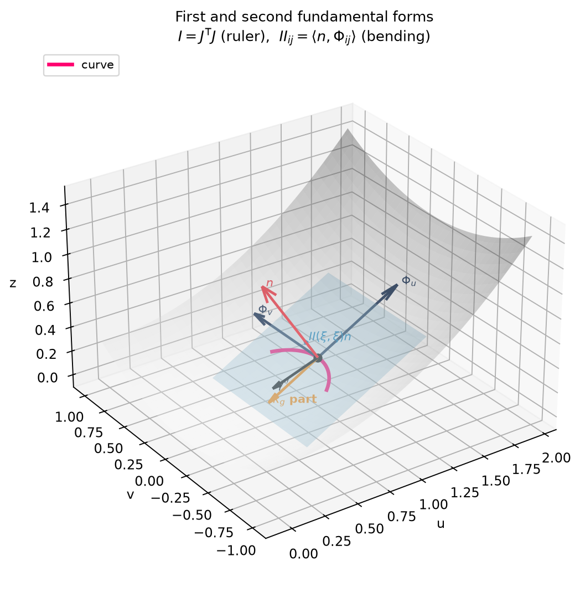

# 1️⃣ The two fundamental forms — dot products of tangent vectors

> **Goal.** Understand exactly what `metricI`, `metricII`, `gaussK`, `meanH`
> and `principalK` in `Curvature.lean` are computing. Everything here is
> ordinary vector math: a surface is a function, its derivatives are vectors,
> and the two forms are just dot products between those vectors.



---

## 1.1 The surface and its derivative matrix

A surface is a function

```math
\Phi : \mathbb{R}^2 \to \mathbb{R}^3,
\qquad \Phi(u,v) = \big(x(u,v),\ y(u,v),\ z(u,v)\big).
```

You feed it a point of the parameter plane and it returns a point of 3-space.
The two numbers $(u,v)$ are just coordinates — like row and column indices
painted on the surface.

Differentiate $\Phi$ with respect to each of its two inputs. Each derivative
is a genuine 3-D arrow (a "world-space" vector):

```math
\Phi_u = \begin{bmatrix}\partial x/\partial u\\ \partial y/\partial u\\ \partial z/\partial u\end{bmatrix},
\qquad
\Phi_v = \begin{bmatrix}\partial x/\partial v\\ \partial y/\partial v\\ \partial z/\partial v\end{bmatrix}.
```

Put them side by side as the columns of a $3\times 2$ matrix, the
**Jacobian** $J$:

```math
J = \begin{bmatrix}\Phi_u & \Phi_v\end{bmatrix}.
```

These two columns are the whole story of the chapter. Wherever you stand on
the surface, they are the two arrows that span the **tangent plane** at that
point. Everything else is dot products between them, between their
derivatives, and between their derivatives and a normal.

### What $J$ does to a direction

Take a curve in the parameter plane, $s \mapsto (u(s), v(s))$, run it through
$\Phi$, and differentiate by the chain rule:

```math
\frac{d\gamma}{ds}
= \Phi_u\, u'(s) + \Phi_v\, v'(s)
= J \begin{bmatrix}u'(s)\\ v'(s)\end{bmatrix}.
```

So $J$ converts a 2-D direction $(a,b)$ in the parameter plane into the
actual 3-D direction you move on the surface:

```math
J\begin{bmatrix}a\\ b\end{bmatrix} = a\,\Phi_u + b\,\Phi_v.
```

That is all "parameter space" means here: the numbers $(a,b)$ live in the
flat plane, and $J$ carries them onto the surface. No other machinery.

### A graph is a special case

For a height field $z = f(x,y)$ the surface is $\Phi(x,y) = (x, y, f(x,y))$,
and the two tangent vectors are

```math
\Phi_x = \begin{bmatrix}1\\ 0\\ f_x\end{bmatrix},
\qquad
\Phi_y = \begin{bmatrix}0\\ 1\\ f_y\end{bmatrix}.
```

This is the surface built by `Surface.ofHeight` in the code.

---

## 1.2 The first fundamental form $I$ — the Gram matrix of the tangent vectors

Given two tangent vectors $\Phi_u, \Phi_v$, the most basic vector quantity
you can form from them is their collection of dot products:

```math
\Phi_u\cdot\Phi_u, \qquad
\Phi_u\cdot\Phi_v, \qquad
\Phi_v\cdot\Phi_v.
```

Stack them into a symmetric $2\times 2$ matrix and you have the **first
fundamental form**:

```math
\boxed{\;I = J^{\mathsf T}J
=
\begin{bmatrix}
\Phi_u\cdot\Phi_u & \Phi_u\cdot\Phi_v\\
\Phi_v\cdot\Phi_u & \Phi_v\cdot\Phi_v
\end{bmatrix}\;}
```

It is simply the **Gram matrix** of the two tangent vectors — the same thing
you compute when you build a least-squares normal-equation matrix $J^{\mathsf T}J$.
(Older books name the three entries $E$, $F$, $G$; we never need those names,
because the entries are just dot products.)

### What the dot products buy you

**Squared length on the surface.** A direction $(a,b)$ in the parameter
plane becomes the 3-D arrow $a\Phi_u + b\Phi_v$, and its squared length is

```math
\bigl|J\begin{bmatrix}a\\ b\end{bmatrix}\bigr|^2
= \bigl(a\Phi_u + b\Phi_v\bigr)\cdot\bigl(a\Phi_u + b\Phi_v\bigr)
= \begin{bmatrix}a & b\end{bmatrix} I \begin{bmatrix}a\\ b\end{bmatrix}.
```

so $I$ is the **ruler**: it turns parameter-plane directions into true
lengths on the bent surface. Notice how the formula is pure expansion of a
dot product.

**Angles.** Two surface directions $\xi$, $\eta$ (both 2-vectors) meet at
the angle of their arrows $J\xi$, $J\eta$:

```math
\cos\theta = \frac{(J\xi)\cdot(J\eta)}{|J\xi|\,|J\eta|}
= \frac{\xi^{\mathsf T} I\, \eta}{\sqrt{\xi^{\mathsf T} I\, \xi}\;\sqrt{\eta^{\mathsf T} I\, \eta}}.
```

**Area.** The two arrows $\Phi_u$, $\Phi_v$ span a parallelogram whose area
is the norm of their cross product, and that equals the determinant of $I$:

```math
|\Phi_u \times \Phi_v|^2 = \det I
\qquad\Longrightarrow\qquad
dA = \sqrt{\det I}\; du\, dv.
```

### Recovering a 2-D direction from a 3-D arrow

Suppose you are handed a world-space tangent arrow $w$ (3 components) and
want its coordinates $(a,b)$ in the tangent basis. Expand:

```math
w = a\,\Phi_u + b\,\Phi_v = J\begin{bmatrix}a\\ b\end{bmatrix}.
```

$J$ is not square, so solve it by multiplying both sides by $J^{\mathsf T}$ —
the normal-equations trick. Using $J^{\mathsf T}J = I$:

```math
\boxed{\;\begin{bmatrix}a\\ b\end{bmatrix} = I^{-1} J^{\mathsf T} w\;}
```

This is exactly what `Geodesic.tangentVecToParams` computes: give it a unit
arrow $w$ on the surface, get back the 2 numbers whose arrows reproduce it.

### The graph metric again, by dot products

For $\Phi = (x, y, f)$ the dot products are immediate:

```math
\Phi_x\cdot\Phi_x = 1 + f_x^2,\qquad
\Phi_x\cdot\Phi_y = f_x f_y,\qquad
\Phi_y\cdot\Phi_y = 1 + f_y^2,
```

so

```math
I=
\begin{bmatrix}
1+f_x^2 & f_x f_y\\
f_x f_y & 1+f_y^2
\end{bmatrix}.
```

Cross-check it the vector way: a plane step $(dx,dy)$ lifts to the arrow
$(dx, dy, f_x dx + f_y dy)$, whose squared norm is
$dx^2 + dy^2 + (f_x dx + f_y dy)^2$ — the same quadratic form.

---

## 1.3 The second fundamental form $II$ — dot products with the normal

The tangent vectors describe the surface **locally flat**. To describe how
it bends we need, besides the tangent plane, the **unit normal** arrow:

```math
n = \frac{\Phi_u \times \Phi_v}{|\Phi_u \times \Phi_v|}.
```

Now differentiate once more. Besides the two tangent vectors $\Phi_u$,
$\Phi_v$, the surface has three **curvature vectors**:

```math
\Phi_{uu} = \frac{\partial^2\Phi}{\partial u^2},\qquad
\Phi_{uv} = \frac{\partial^2\Phi}{\partial u\,\partial v},\qquad
\Phi_{vv} = \frac{\partial^2\Phi}{\partial v^2}.
```

Each is a 3-D arrow. The part of such an arrow that bends away from the
tangent plane is its component along the normal, that is, its dot product
with $n$. Collect those three dot products into a matrix — the **second
fundamental form**:

```math
\boxed{\;II =
\begin{bmatrix}
n\cdot\Phi_{uu} & n\cdot\Phi_{uv}\\
n\cdot\Phi_{uv} & n\cdot\Phi_{vv}
\end{bmatrix}\;}
```

(Again, old books call the entries $e$, $f$, $g$; the entries are just
"curvature vector dotted with the normal", which is easier to remember.)

### What the normal dot products buy you

**The bending of a curve.** Take a curve on the surface obtained from a
parameter-plane path $s \mapsto (u(s), v(s))$ and differentiate twice:

```math
\frac{d^2\gamma}{ds^2}
= \Phi_u\, u'' + \Phi_v\, v''
+ \Phi_{uu}\,u'^2 + 2\,\Phi_{uv}\,u'v' + \Phi_{vv}\,v'^2.
```

Dot this with the normal $n$. The $\Phi_u$, $\Phi_v$ terms die because
$n\perp\Phi_u,\Phi_v$, and what survives is

```math
\boxed{\;n\cdot\frac{d^2\gamma}{ds^2}
= \bigl(u',v'\bigr)^{\mathsf T} II\, \bigl(u',v'\bigr)\;}
```

a quadratic form again. So $II(d,d)$ is the normal component of the second
derivative when you move in surface direction $d$. Dividing by the speed
$|J\, d|^2$ normalizes it: that ratio is the **normal curvature**

```math
\kappa(d) = \frac{II(d,d)}{|J\, d|^2}.
```

It answers, in plain vector terms: *if I walk across the surface in the
direction of arrow $J d$, how fast does my arrow bend away from the tangent
plane?* The sign depends on which way $n$ points, but the product of the two
principal curvatures below does not.

**Local height above the tangent plane.** Put a point at the origin, make
the tangent plane the $xy$-plane so $n = (0,0,1)$. Then the third coordinate
of $\Phi_{uu}$ is exactly $n\cdot\Phi_{uu} = II_{11}$ etc., and Taylor's
theorem gives

```math
z(u,v) = \tfrac12\,\bigl(II_{11}u^2 + 2\,II_{12}uv + II_{22}v^2\bigr) + O(3).
```

So $II$ **is** the quadratic approximation of the surface above its tangent
plane: a bowl, a saddle, or flat in one direction — you can read all three
straight off the signs of $II$.

### Second equivalent formula: derivative of the normal

Differentiate $n \cdot \Phi_u = 0$ with respect to $v$:

```math
\frac{\partial n}{\partial v}\cdot\Phi_u + n\cdot\Phi_{uv} = 0
\qquad\Longrightarrow\qquad
II_{12} = -\frac{\partial n}{\partial v}\cdot\Phi_u.
```

The same holds entry by entry. So $II$ also measures **how fast the normal
arrow turns as you move** — two ways of seeing the same bending.

---

## 1.4 The shape operator, principal curvatures, $K$ and $H$

Both forms are matrices on the same 2-D tangent space: $I$ is the metric
(gram) matrix, $II$ is the bending matrix. To compare them directly, relate
both to one linear map $S$:

```math
\boxed{\;II = I\,S
\qquad\Longleftrightarrow\qquad
S = I^{-1} II\;}
```

$S$ is the **shape operator**. Geometrically, $S$ encodes: "if I move in
surface direction $\xi$, how fast and in which way does the normal arrow
turn?" Concretely, negative $S\xi$ is the rate of change of the normal as
you slide in direction $\xi$:

```math
-\,S\,\begin{bmatrix}a\\ b\end{bmatrix}
= a\,\frac{\partial n}{\partial u} + b\,\frac{\partial n}{\partial v},
\qquad \bigl(a,b\bigr)\ \text{a parameter direction}.
```

$S$ is a $2\times 2$ matrix acting on tangent directions, so it has two
eigenvalues, the **principal curvatures** $\kappa_1, \kappa_2$, and two
eigendirections — the directions of greatest and least bending. And its two
basic invariants get the historical names:

```math
K = \det S = \frac{\det II}{\det I}
\qquad\text{(Gaussian curvature)},
```

```math
H = \tfrac12\,\mathrm{tr}\,S = \tfrac12\,\mathrm{tr}\!\bigl(I^{-1}II\bigr)
\qquad\text{(mean curvature)}.
```

The eigenvalues come back from the trace/determinant pair:

```math
\kappa_{1,2} = H \pm \sqrt{H^2 - K}.
```

- $K>0$: both directions bend the same way (bowl, ellipsoid).
- $K<0$: directions bend oppositely (saddle).
- $K=0$: at least one direction is straight (plane, cylinder, cone).
- $H=0$: the two bendings cancel (soap films).

---

## 1.5 Splitting each curvature vector into tangent + normal parts

Every curvature vector is a 3-D arrow, and 3-space is spanned by the tangent
plane plus $n$. Split each one accordingly:

```math
\boxed{\;
\begin{aligned}
\Phi_{uu} &= (\text{tangent-plane part}) + (n\cdot\Phi_{uu})\, n,\\
\Phi_{uv} &= (\text{tangent-plane part}) + (n\cdot\Phi_{uv})\, n,\\
\Phi_{vv} &= (\text{tangent-plane part}) + (n\cdot\Phi_{vv})\, n.
\end{aligned}\;}
```

The normal coefficients are precisely the entries of $II$ — dotting with $n$
reads them straight off. The tangent parts are honest surface-bound arrows;
*coefficients* for those arrows in the basis $\{\Phi_u,\Phi_v\}$ are what
textbooks record as Christoffel symbols, but Chapter 2 shows the entire
story can be run on the arrows themselves — with the projected arrows
$T\,\Phi_{ij}$, not their coordinates, as the primary object. So the whole
chapter-1 picture is: **take the second-derivative arrows and project them
onto the tangent basis and the normal** — two pieces, $II$ and
$T\Phi_{ij}$, out of one geometric operation.

> **One sentence summary.** $J$'s columns are the tangent arrows;
> $I = J^{\mathsf T}J$ is their Gram matrix (the ruler); the curvature
> arrows dotted with $n$ form $II$ (the bending); and splitting each
> curvature arrow into a tangent part and an $n$-part delivers both $II$
> and the "turning" part — the covariant-derivative data — in one sweep.

---

## 1.6 Worked examples as vector computations

### Plane

```math
\Phi(u,v) = (u,v,0):\quad
\Phi_u = \begin{bmatrix}1\\0\\0\end{bmatrix},\quad
\Phi_v = \begin{bmatrix}0\\1\\0\end{bmatrix},\quad
\Phi_{uu}=\Phi_{uv}=\Phi_{vv}=0.
```

Then $I = J^{\mathsf T}J$ is the identity and every dot product with the
(curvature) vectors vanishes, so $II = 0$, $K=H=0$. Flatness is the
statement "all second derivatives are zero vectors".

### Cylinder of radius $R$

```math
\Phi(\theta,z) = (R\cos\theta,\,R\sin\theta,\,z).
```

Tangent arrows:

```math
\Phi_\theta = \begin{bmatrix}-R\sin\theta\\ R\cos\theta\\ 0\end{bmatrix},
\qquad
\Phi_z = \begin{bmatrix}0\\ 0\\ 1\end{bmatrix},
```

so $I = \begin{bmatrix}R^2 & 0\\ 0 & 1\end{bmatrix}$. The single nonzero
curvature arrow is

```math
\Phi_{\theta\theta} = \begin{bmatrix}-R\cos\theta\\ -R\sin\theta\\ 0\end{bmatrix}
= -R\,\frac{\Phi_\theta\times\Phi_z}{|\Phi_\theta\times\Phi_z|},
```

which is parallel to the normal — so $n\cdot\Phi_{\theta\theta} = -R$ and
$n\cdot\Phi_{zz} = 0$, giving

```math
II = \begin{bmatrix}-R & 0\\ 0 & 0\end{bmatrix}.
```

Hence one direction bends ($-1/R$) and one is straight ($0$): $K = 0$. That
is why a cylinder can be cut and unrolled flat — nothing forces it to bend.

### Sphere of radius $R$

```math
\Phi(\theta,\varphi)
= R\,(\sin\theta\cos\varphi,\ \sin\theta\sin\varphi,\ \cos\theta).
```

Tangent arrows have lengths $|R\Phi_\theta| = R$ and
$|\Phi_\varphi| = R\sin\theta$, perpendicular to each other, so

```math
I = \begin{bmatrix}R^2 & 0\\ 0 & R^2\sin^2\theta\end{bmatrix}.
```

The normal here is simply $n = \Phi/R$ (the arrow from the center to the
point). The curvature arrows all point along $-n$:

```math
\Phi_{\theta\theta} = -R\,n,
\qquad
\Phi_{\varphi\varphi} = -R\sin^2\theta\,n,
```

so

```math
II = \begin{bmatrix}-R & 0\\ 0 & -R\sin^2\theta\end{bmatrix}.
```

Then $S = I^{-1}II = -(1/R)$ times identity, so
$\kappa_1 = \kappa_2 = -1/R$, $K = 1/R^2$, $H = -1/R$. The sphere bends
equally in every direction; only the *sign* of the first order bending
depends on choosing the outward $n$.

### Paraboloid graph $z = 0.3(x^2+y^2)$ at $(1,0)$

Here $f_x = 0.6$, $f_y = 0$, $f_{xx} = 0.6$, $f_{yy}=0.6$, $f_{xy}=0$, so

```math
\Phi_x = \begin{bmatrix}1\\0\\0.6\end{bmatrix},
\qquad
\Phi_y = \begin{bmatrix}0\\1\\0\end{bmatrix},
\qquad
n = \frac{1}{\sqrt{1.36}}\begin{bmatrix}-0.6\\0\\1\end{bmatrix}.
```

Dot products:

```math
I
= \begin{bmatrix}1.36 & 0\\ 0 & 1\end{bmatrix},
\qquad
II
= \frac{1}{\sqrt{1.36}}\begin{bmatrix}0.6 & 0\\ 0 & 0.6\end{bmatrix}
= \begin{bmatrix}0.5145&0\\ 0&0.5145\end{bmatrix}.
```

Notice $II$ is a multiple of the identity while $I$ is not, so

```math
S = I^{-1}II
=
\begin{bmatrix}
0.3783 & 0\\
0 & 0.5145
\end{bmatrix}.
```

The two bending rates differ — the **metric** decides which direction is
more curved, not $II$ alone. Then

```math
K = \frac{\det II}{\det I} = \frac{0.5145^2}{1.36} = 0.1946,
\qquad
H = \tfrac12(0.3783 + 0.5145) = 0.4464.
```

Every number in this example is a dot product of four 3-D arrows — exactly
what `lake exe geodesia` prints.

---

## 1.7 How the code represents this (exact derivatives)

`Geodesia/Diff.lean` defines

```lean
structure Smooth2 where
  f   : Float → Float → Float
  fx  : Float → Float → Float
  fy  : Float → Float → Float
  fxx : Float → Float → Float
  fxy : Float → Float → Float
  fyy : Float → Float → Float
```

Each derivative is a **function**, so there is no finite-difference step in
the main path — the derivative arrows above are exact. You build a surface
from exact combinators:

```lean
def paraboloid : Smooth2 :=
  Smooth2.smul 0.3
    (Smooth2.add (Smooth2.mul Smooth2.coordX Smooth2.coordX)
                 (Smooth2.mul Smooth2.coordY Smooth2.coordY))
```

`Smooth2.mul` implements the product rule in both variables, `Smooth2.sin`
implements the chain rule twice, etc. If you only have a bare
`Float → Float → Float`, use `Smooth2.ofFiniteDiff` as a fallback; that is
the only place an `ε` appears.

Then, in `Surface.lean` / `Curvature.lean`:

```lean
Surface.dPhi s 0 x y         -- the tangent arrow Φ_u
Surface.dPhi s 1 x y         -- the tangent arrow Φ_v
Surface.d2Phi s 0 0 x y      -- the curvature arrow Φ_uu
Surface.normalAt s x y       -- n
Surface.metricI s x y        -- I  = Gram matrix of the tangent arrows
Surface.metricII s x y       -- II = normal dot products of curvature arrows
Surface.gaussK s x y         -- K = det II / det I
Surface.meanH s x y          -- H = ½ tr(I⁻¹ II)
Surface.principalK s x y     -- (κ_min, κ_max)
Surface.shapeOperator s x y w
```

One wrinkle worth knowing: `Surface.principalK` computes
$\kappa_{1,2} = H \pm \sqrt{H^2-K}$ rather than calling an eigensolver —
with a $2\times 2$ matrix the eigenvalues come from trace and determinant,
which is all `Mat2` needs.

---

## 1.8 Exercises

1. **Cone.** Take $\Phi(r,\theta) = (r\cos\theta, r\sin\theta, r)$.
   Compute the tangent arrows $\Phi_r$, $\Phi_\theta$ and $I = J^{\mathsf T}J$.
   Show that one bending direction is zero and hence $K = 0$.
2. **Determinant identity.** Prove $\det I = |\Phi_u\times\Phi_v|^2$ using
   only the cross-product identity
   $(a\times b)\cdot(c\times d) = (a\cdot c)(b\cdot d) - (a\cdot d)(b\cdot c)$.
3. **Graph curvature.** From the dot-product formulas in §1.2–§1.3 for
   $\Phi=(x,y,f)$, derive

   ```math
   K=\frac{f_{xx}f_{yy}-f_{xy}^2}{\bigl(1+f_x^2+f_y^2\bigr)^2}.
   ```

4. **Weingarten sign.** Differentiate $n\cdot\Phi_u = 0$ with respect to $v$
   and show $n\cdot\Phi_{uv} = -(\partial n/\partial v)\cdot\Phi_u$. What
   changes if you choose $-n$ instead of $n$?
5. **Cylinder vs sphere.** In §1.6, the cylinder's non-straight direction
   had $n\cdot\Phi_{\theta\theta}=-R$ and the straight one had $0$. Point
   out which matrix entry of $II$ encodes each, and why $K=0$ follows.
6. **Code experiment.** In `Main.lean`, move the paraboloid point from
   $(1,0)$ to $(2,0)$ and predict which of $I$, $II$, $K$, $\kappa_1$,
   $\kappa_2$ change and in which direction before running.
7. **Shape operator.** Verify numerically on the paraboloid that
   $II(d,d) = I(Sd, d)$ holds for several parameter directions $d$ — the
   defining property of $S = I^{-1}II$.
```
