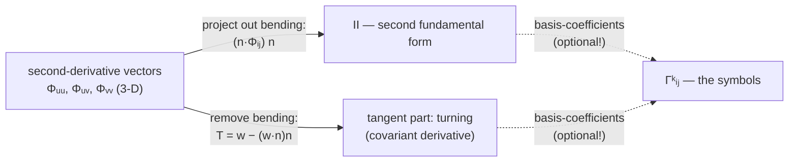
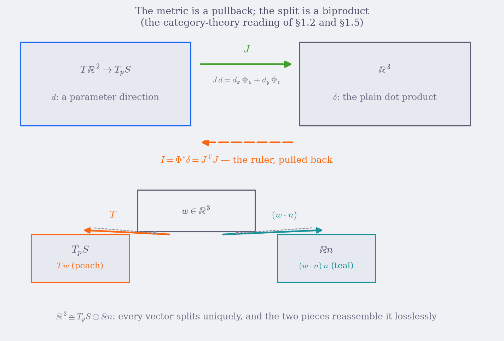

# Geodesia — how tangent vectors turn (Ch. 2)

> *Chapter 1 built the flat world and took two measurements of how the
> curved world bends it. This chapter walks: the basis vectors themselves
> turn from point to point — and their turning is exactly what a shortest
> path has to cancel.*

> **What this chapter is.** One idea, one formula, many surfaces: the
> **covariant derivative** — the rate of turn of a vector field with the
> "expected" turning subtracted, computed as an ordinary projection into
> the tangent plane (§2.3). Everything stays vector calculus: the basis
> vectors $\Phi_u, \Phi_v$ turn, so a derivative needs the correction term
> that tradition calls the Christoffel symbol (§2.8 computes it from
> stored vectors only). The chapter is written like the Lean
> documentation: every boxed formula is followed by the **Lean
> declarations that compute it** — a **Signature** block — and every
> numeric claim is a **Checked example**: the Lean snippet together with
> the output it really prints. Nothing in an `Output:` block is
> hand-computed; each was produced by running the snippet against the
> library. The math notation is kept in full ($\Gamma$, $T$, $\nabla$,
> …); the Lean identifiers are the computational shadows of the same
> objects.
>
> This is Chapter 2 of a pair; Chapter 1 (`01-fundamental-forms.md`)
> builds the tangent space, the inner product $I$ and the acceleration
> table $II$. Section numbers are preserved (`§1.1–1.8` over there,
> `§2.1–2.11` here), so cross-references from Chapters 3–8, `index.md`
> and `GA_VIEW.md` still resolve.
>
> **A note on words.** This chapter never says "arrow" for a mathematical
> object: each vector is called by what it *is* — tangent vector, velocity,
> acceleration vector, curvature vector, unit normal, ambient vector —
> reserving "arrow" for the drawn glyphs in the figures.

**Reproducing the checked examples.** All snippets run against this project:

```bash
cd projects/geodesia
lake build
lake exe geodesia                   # the demo printed in Ch. 1 §1.6
lake env lean <your-scratch>.lean   # any snippet below (it begins with `import Geodesia`)
```

The dictionary that this chapter keeps re-deriving:

| Math object | Lean declaration | File |
|---|---|---|
| $\Phi(u,v)$ | `Surface.point` | `Geodesia/Surface.lean` |
| $\Phi_i = \partial\Phi/\partial i$ | `Surface.dPhi` | `Geodesia/Surface.lean` |
| $\Phi_{ij} = \partial^2\Phi/\partial i\,\partial j$ | `Surface.d2Phi` | `Geodesia/Surface.lean` |
| $n$ | `Surface.normalAt` | `Geodesia/Surface.lean` |
| $J\,d$ — the tangent vector of a parameter direction | `Surface.tangentVec` | `Geodesia/Surface.lean` |
| $I = J^{\mathsf T}J$ — the inner product of the tangent space | `Surface.metricI`, `Surface.firstForm` | `Geodesia/Curvature.lean` |
| $II_{ij} = n\cdot\Phi_{ij}$ — the acceleration table | `Surface.metricII`, `Surface.secondForm` | `Geodesia/Curvature.lean` |
| $T w = w - (w\cdot n)\,n$ — the tangent part of the split | `Surface.tangentialPart` | `Geodesia/Surface.lean` |
| $(w\cdot n)\,n$ — the normal part of the split | `Surface.normalPart` | `Geodesia/Surface.lean` |
| $\kappa(d) = II(d,d)/I(d,d)$ | `Surface.normalCurvature` | `Geodesia/Curvature.lean` |
| $S = I^{-1}II$ | `Surface.shapeOperator` | `Geodesia/Curvature.lean` |
| $K$, $H$, $\kappa_{1,2}$ | `Surface.gaussK`, `Surface.meanH`, `Surface.principalK` | `Geodesia/Curvature.lean` |
| $\Gamma^k_{\;ij}$ (coordinates of $T\Phi_{ij}$) | `Surface.christoffel` | `Geodesia/Curvature.lean` |
| $\partial_u\,(\Phi_j\cdot\Phi_k)$ | `Surface.dMetricEntry` | `Geodesia/Curvature.lean` |
| $\xi = I^{-1}J^{\mathsf T}w$ | `Geodesic.tangentVecToParams` | `Geodesia/Geodesic.lean` |
| exact derivatives (stored as functions) | `Smooth2` + its combinators | `Geodesia/Diff.lean` |

**The notation bridge.** The Lean code uses short identifiers where the text
uses math symbols. Every occurrence is translatable by this table — and each
**Signature** block below is followed by the implementation and its
vector-calculus reading, so any formula can be checked against the code:

| Lean notation | Vector-calculus meaning |
|---|---|
| `s.sx`, `s.sy`, `s.sz` | the coordinate functions $x(u,v)$, $y(u,v)$, $z(u,v)$ of $\Phi$ |
| `i : Fin 2` with values `0`, `1` | the parameter index: $0 \leftrightarrow u$, $1 \leftrightarrow v$ |
| `u v : Float` | the point $(u, v)$ of the parameter plane |
| `Surface.dPhi s i u v` | the tangent vector $\Phi_i(u,v)$ |
| `Surface.d2Phi s i j u v` | the curvature vector $\Phi_{ij}(u,v)$ |
| `Surface.tangentVec s u v d` | the tangent vector $J\,d = a\,\Phi_u + b\,\Phi_v$ of the parameter direction $d=(a,b)$ |
| `Surface.tangentialPart s u v w` | the tangent part $T\,w$ of the split of an ambient vector $w$ |
| `Surface.normalPart s u v w` | the normal part $(w\cdot n)\,n$ of the split of $w$ |
| `v.dot w`, `v.cross w`, `v.norm` | $v\cdot w$, $v\times w$, $\lvert v\rvert$ |
| `Vec3.smul a v` | the scaled vector $a\,v$ |
| `Mat2` with fields `a`, `b`, `c` | the symmetric matrix with rows $(a,\,b)$ and $(b,\,c)$ |
| `metricI` / `metricII` | $I = J^{\mathsf T}J$ / $II = [\,n\cdot\Phi_{ij}\,]$ |
| `firstForm` / `secondForm` | the quadratic forms $I(w, w) = w^{\mathsf T}Iw$ / $II(w, w) = w^{\mathsf T}II\,w$ |
| `Surface.christoffel s x y k i j` | the coefficient $\Gamma^k_{\;ij}$ |
| `GeoState` fields `u v du dv` | $q(s) = (u,v)$ and $q'(s) = (u',v')$ along a curve |

(Implementations are shown verbatim from the sources, with the fully
qualified names they get from their `namespace`.)

---


> **Goal.** Express everything in **pure vector calculus**: the derivative of
> any surface-bound vector is an ordinary 3-D vector, and the *surface-visible*
> part is obtained by the tangential projection $T w = w - (w\cdot n)\,n$
> (defined in §1.5, computable in one `Vec3` line — and named in the code as
> `Surface.tangentialPart`). Coefficients — the Christoffel symbols — appear
> only as the *coordinate bookkeeping* of that projection (§2.8), because
> that is what the Lean code stores.

### 2.1 The problem: basis vectors turn as you walk

In the $xy$-plane the basis vectors $e_1=(1,0)$, $e_2=(0,1)$ are the same
everywhere, so differentiating a vector field is component-wise. On a
parameterized surface, the tangent basis vectors are the *columns of the
Jacobian*, $\Phi_u$ and $\Phi_v$, and these genuinely change from point to
point. Differentiate them: each derivative $\Phi_{ui},\Phi_{vi},\dots$ (more
generally $\Phi_{ij}$) is again a 3-D vector in $\mathbb{R}^3$.

Here is the central **vector** move — the split of §1.5, applied to exactly
the vectors that appear when you differentiate. At any point, 3-space
decomposes into the tangent plane plus the normal vector $n$, so every 3-D
vector splits uniquely:

```math
\boxed{\;
\Phi_{ij} \;=\; \underbrace{T\,\Phi_{ij}}_{\text{stays in the surface}}
\;+\; \underbrace{(n\cdot\Phi_{ij})\, n}_{\text{bending out of the surface}},
\qquad
T w \;=\; w - (w\cdot n)\,n
\;}
```

$T$ — *tangential projection* — is a linear map from 3-D vectors back onto the
tangent plane. Everything in this part is one of exactly two statements about
the vectors $\Phi_{ij}$:

- the **normal part** $(n\cdot\Phi_{ij})$ is the second fundamental form $II$
  (§1.3 — surface bending);
- the **tangent part** $T\Phi_{ij}$ is how much the surface-bound derivative
  of a vector *unexpectedly* turns. That is the subject of this part.

No coefficients yet — these are honest vectors. Keep it that way as long as
possible. (§1.5's checked example already did one split:
$\Phi_{vv} = (0.264706, 0, 0.158824) + 0.514496\,n$.)

### 2.2 Why not Christoffels? (and why this track uses vectors)

You will meet $\Gamma^k_{\;ij}$ everywhere in textbooks, and it is fair to ask
why this track relegates them to a sub-role.

**Why the literature is symbol-heavy.** Classical surface theory and general
relativity grew up with *intrinsic* geometry: work with a quantity that lives
on a manifold with no ambient space at all. Inside a manifold with only
coordinates, there is nothing to project onto — no ambient derivative exists
— so you *must* track how the coordinate basis itself twists, and that means
carrying a 3-index array of correction numbers, $\Gamma^k_{\;ij}$, into every
derivative. They are the price of computing without an embedding. Index
gymnastics ($\nabla_i V^k = \partial_i V^k + \Gamma^k_{\;ij}V^j$ and the
higher contractions) is then a full telescope for that correction.

**Why vectors are preferable here.** This course always has the embedding
$\Phi : \mathbb{R}^2 \to \mathbb{R}^3$ in hand, and for embedded surfaces the
covariant derivative has a **one-line vector formula**:

```math
\boxed{\;\nabla_v \, w \;=\; D_v w - \bigl((D_v w)\cdot n\bigr)\,n \;=\; T(D_v w)\;}
```

i.e. differentiate the ambient vectors with the ordinary $\mathbb{R}^3$
derivative, then drop the normal piece. "Tangent + projection" replaces every
$\Gamma$ contraction. Concretely:

| | symbol route | vector route (this track) |
|---|---|---|
| what you differentiate | coordinate *coefficients* $V^k$ | the vectors $V$ themselves |
| correction mechanism | the $\Gamma$ terms (3-index bookkeeping) | subtract the normal part (`tangentialPart`) |
| geometry read out | after summing repeated indices | directly, by looking at vectors |
| works without embedding | ✅ (its super-power) | needs $\Phi$ (fine — we have it) |
| code cost | build $\Gamma$ array, then contract | project + dot with basis vectors |

Where the symbols *are* the right tool, this track says so honestly: when you
only have the ruler $I$ (an abstract surface, a higher-dimensional manifold,
relativity), or when the textbook source you are following (Eberly's notes)
exploits the pure-$I$ formulas. And — since the Lean code does implement
`Surface.christoffel` — its job in the code is precisely to *store the
coordinates of $T\Phi_{ij}$* (§2.8, and see `Geodesia/Curvature.lean`). The
vector statement stays primary; the symbol array is a derived container.

> **Caution — the embedding question, again.** §1.1 asked whether it is a
> problem that the flat world floats in an extra dimension. Chapter 2 sharpens
> the answer: the vector route *needs* the embedding (`tangentialPart` is
> literally a subtraction in $\mathbb{R}^3$), the symbol route does not.
> That is not a defect of the vector route — it is its scope. Chapter 8
> audits what survives when the embedding is taken away, and where that
> matters (Hilbert's theorem, the flat torus, general relativity).

### 2.3 The covariant derivative is the correction-free rate of turn

> **Picture.** A surface-bound vector field $V$ — think of the wind vectors
> painted on the sheet. To ask "how does $V$ change as I move?" you
> differentiate it in ambient 3-space, as ordinary calculus. But part of
> that derivative is *fake*: it records the ambient space's opinion about
> which way is "up", not any change of $V$ relative to the sheet. The
> covariant derivative is the ambient derivative with the fake part
> subtracted — one projection, the split of §1.5, nothing more.

Take a surface-bound vector field $V = V^u\,\Phi_u + V^v\,\Phi_v$. Its
ambient derivative in direction $i$ is ordinary calculus:

```math
\frac{\partial V}{\partial u_i}
= \frac{\partial V^u}{\partial u_i}\Phi_u
+ \frac{\partial V^v}{\partial u_i}\Phi_v
+ V^u\,\Phi_{ui} + V^v\,\Phi_{vi}.
```

The first two terms are expected changes of the vector; the last two are the
surprise — *the basis vectors themselves turn* as the field's coefficients
move with the point. The surface-visible rate of turn is: project the whole
thing back.

```math
\boxed{\;\nabla_i V \;=\; T\!\left(\frac{\partial V}{\partial u_i}\right)\;}
```

Since $V^u\Phi_u+V^v\Phi_v$ is already tangent ($T$ passes through it
unchanged), the correction is exactly "differentiate the vectors, project".
In pencil-and-paper coordinates the same statement becomes the familiar
textbook pair

```math
\nabla_i V^k \;=\; \frac{\partial V^k}{\partial u_i}
+ \Gamma^k_{\;ij}\,V^j,
```

with the $\Gamma$-correction terms coming straight from
$T(\Phi_{ki}) = \Gamma^\cdot_{ki}\Phi_u + \cdots$ (i.e., from expanding
$T\Phi_{ij}$ in $\{\Phi_u,\Phi_v\}$). On a flat plane in standard coordinates
the basis vectors never turn: $\Gamma^k_{\;ij}=0$ and every $\nabla$ is an
ordinary partial. The same plane *in polar coordinates* does need
corrections; on a sphere every direction needs them (§2.5–2.6). This is the
whole narrative of the Christoffel story — but written in vector language it
is simply $T(\partial\text{-derivative})$, with the $\Gamma$ terms surfacing
only when a pencil demands them.

> **This formula is executable.** The vector statement is not just a slogan:
> `Surface.tangentialPart s u v (ambient derivative)` *is* $\nabla_i V$ —
> one call of the named split of §1.5. What the library additionally stores
> is the coefficient form, because an ODE integrator needs numbers, not
> vectors. Both describe the same projection; the code below implements the
> coefficient form of its most important case.

**Signature.** The library's consumer of the $\Gamma$ array is the geodesic
equation: a geodesic is a curve whose *tangent part* of $\gamma''$ vanishes,
$T\gamma'' = 0$ (Chapter 3). `Geodesia/Geodesic.lean` implements the
coordinate form of that single projection:

```lean
def Geodesic.accel (s : Surface) (st : GeoState) : Vec2
    -- (u″, v″) = −Γ^k_ij q′ⁱ q′ʲ: the coefficient form of T γ″ = 0
```

**Implementation.** Verbatim from `Geodesia/Geodesic.lean`:

```lean
def Geodesic.accel (s : Surface) (st : GeoState) : Vec2 :=
  let Γ := Surface.christoffel s st.u st.v
  let g1uu := Γ 0 0 0
  let g1uv := Γ 0 0 1
  let g1vv := Γ 0 1 1
  let g2uu := Γ 1 0 0
  let g2uv := Γ 1 0 1
  let g2vv := Γ 1 1 1
  let du := st.du
  let dv := st.dv
  ⟨-(g1uu * du * du + 2 * g1uv * du * dv + g1vv * dv * dv),
   -(g2uu * du * du + 2 * g2uv * du * dv + g2vv * dv * dv)⟩
```

**Vector-calculus reading.** Start from the vector statement
$T\gamma''(s) = 0$ and expand it in the basis $\{\Phi_u, \Phi_v\}$, using
$\gamma'' = u''\,\Phi_u + v''\,\Phi_v + u'^2\,\Phi_{uu} + 2u'v'\,\Phi_{uv} + v'^2\,\Phi_{vv}$
(§1.3) and $T\Phi_{ij} = \Gamma^k_{\;ij}\,\Phi_k$ (§2.8):

```math
T\gamma''
= \Bigl(u'' + \Gamma^1_{\;uu}\,u'^2 + 2\Gamma^1_{\;uv}\,u'v' + \Gamma^1_{\;vv}\,v'^2\Bigr)\Phi_u
+ \Bigl(v'' + \Gamma^2_{\;uu}\,u'^2 + 2\Gamma^2_{\;uv}\,u'v' + \Gamma^2_{\;vv}\,v'^2\Bigr)\Phi_v.
```

$\Phi_u$ and $\Phi_v$ are independent vectors, so each coefficient must vanish
on its own — the vector statement becomes **two scalar ODEs** for the
coordinates:

```math
u'' = -\bigl(\Gamma^1_{\;uu}\,p^2 + 2\,\Gamma^1_{\;uv}\,pq + \Gamma^1_{\;vv}\,q^2\bigr),
\qquad
v'' = -\bigl(\Gamma^2_{\;uu}\,p^2 + 2\,\Gamma^2_{\;uv}\,pq + \Gamma^2_{\;vv}\,q^2\bigr),
\qquad (p,q) := (u', v').
```

The code is exactly this: the six `let`s name the six independent symbols
(the symmetry $\Gamma^k_{\;ij} = \Gamma^k_{\;ji}$ means $\Gamma 0\ 1\ 0$ never
needs its own name), `du`/`dv` are $p$ and $q$, and each returned component
is one negated quadratic — the factor $2$ on the $pq$ term comes from merging
the $(uv)$ and $(vu)$ contributions. Note what the return value is: a
`Vec2` in the **parameter plane**, the acceleration of the coordinates — not
an ambient vector. That is the price of the coefficient form; §2.1's $\gamma''$
was the honest vector, this is its coordinate shadow. `Geodesic.rhs` packages
these two components with $\dot u = p,\ \dot v = q$ into the first-order
system that Chapter 4 integrates with RK4.

### 2.4 The Gauss formula, in vector form

The one-sentence motto of the whole part:
*the second-derivative vectors split into tangent part $+$ normal part, and
every formula is one of those two projections.*



Both routes — the "project-out" route and the "differentiate-the-metric"
route of §2.8 — measure the same vectors and agree numerically; they are the
same computation with and without coordinates. (§2.8's checked example makes
"agree numerically" exact: the gap is `0.000000`.)

### 2.5 Example: the flat plane in polar coordinates

Flat plane, wrapped geometry — the perfect test that tangent parts are about
the *basis vectors*, not about bending:

```math
\Phi(r,\theta) = (r\cos\theta,\ r\sin\theta,\ 0).
```

Basis vectors and Gram matrix:

```math
\Phi_r = (\cos\theta,\ \sin\theta,\ 0),\quad
\Phi_\theta = (-r\sin\theta,\ r\cos\theta,\ 0),\quad
I = \begin{bmatrix}1&0\\0&r^2\end{bmatrix}.
```

Differentiate the vectors (all ordinary $\mathbb{R}^3$ calculus):

```math
\frac{\partial\Phi_r}{\partial r}=0,\qquad
\frac{\partial\Phi_r}{\partial\theta}=\frac{1}{r}\,\Phi_\theta,\qquad
\frac{\partial\Phi_\theta}{\partial r}=\frac{1}{r}\,\Phi_\theta,\qquad
\frac{\partial\Phi_\theta}{\partial\theta}=-r\,\Phi_r.
```

The plane's normal is a constant vector $n=(0,0,1)$, so these derivatives are
*entirely tangent*: $T(\text{each row}) = $ each row. Two consequences worth
pausing over:

- the *basis vectors turn* — $\Phi_r$ turns into a $\Phi_\theta$ vector when
  pushed around $\theta$ — despite the *plane being flat*;
- and the *vector turning is exactly what cancels a curve's own turning*:
  for a trajectory that stays geometrically straight, the coordinate parts
  $\ddot r$, $\ddot\theta$ must push against these turning vectors so that
  the acceleration vector $\gamma''$ ends up purely normal (Chapter 3 makes
  this precise).

For comparison, in coordinates: these vector equations *are*
$\Gamma^\theta_{\;\theta r} = \Gamma^\theta_{\;r\theta} = 1/r$ and
$\Gamma^r_{\;\theta\theta}=-r$ — read off the same displayed rows, with
coefficients recorded in the basis. The vector statement comes first; the
coefficients are nothing more than these rows written as slips of paper.
The cross-check with the pure-$I$ Gram-derivative formula (§2.8) gives the
same numbers, as it must.

**Signature + Checked example.** The polar plane is three exact `Smooth2`
combinators — then the code's pure-$I$ route reproduces every coefficient of
the hand-derived rows above (at $r = 1.5$: $-r = -1.5$, $1/r = 0.666667$),
while $II = 0$ confirms the plane is flat:

```lean
def polarPlane : Surface where
  sx := Smooth2.mul Smooth2.coordX (Smooth2.cos Smooth2.coordY)
  sy := Smooth2.mul Smooth2.coordX (Smooth2.sin Smooth2.coordY)
  sz := Smooth2.const 0

#eval show IO Unit from do
  let I := Surface.metricI polarPlane 1.5 0.7
  IO.println s!"I (r = 1.5) = [[{I.a}, {I.b}], [{I.b}, {I.c}]]"
  let II := Surface.metricII polarPlane 1.5 0.7
  IO.println s!"II          = [[{II.a}, {II.b}], [{II.b}, {II.c}]]"
  let Γ := Surface.christoffel polarPlane 1.5 0.7
  IO.println s!"Γ^r_θθ      = {Γ 0 1 1}"
  IO.println s!"Γ^θ_rθ, Γ^θ_θr = {Γ 1 0 1}, {Γ 1 1 0}"
  IO.println s!"Γ^r_rr, Γ^r_rθ, Γ^θ_θθ = {Γ 0 0 0}, {Γ 0 0 1}, {Γ 1 1 1}"
```

**Output:**
```text
I (r = 1.5) = [[1.000000, 0.000000], [0.000000, 2.250000]]
II          = [[0.000000, 0.000000], [0.000000, 0.000000]]
Γ^r_θθ      = -1.500000
Γ^θ_rθ, Γ^θ_θr = 0.666667, 0.666667
Γ^r_rr, Γ^r_rθ, Γ^θ_θθ = 0.000000, 0.000000, 0.000000
```

Flat plane, nonzero $\Gamma$: the *vectors* turn, the *plane* does not bend.

### 2.6 Example: the unit sphere

On the unit sphere:

```math
\Phi(\theta,\varphi) =
(\sin\theta\cos\varphi,\; \sin\theta\sin\varphi,\; \cos\theta),
\qquad
n = \Phi\ \text{(the radial vector)},\qquad
I = \mathrm{diag}(1, \sin^2\theta).
```

Now differentiate the basis vectors — keeping the split intact:

```math
\frac{\partial\Phi_\theta}{\partial\theta}
= -\Phi \;=\; -\,n\quad (\text{entirely normal — } T\text{-part is 0}),
```

```math
\frac{\partial\Phi_\varphi}{\partial\theta}
= \cot\theta\,\Phi_\varphi\quad (\text{purely tangent}),
\qquad
\frac{\partial\Phi_\varphi}{\partial\varphi}
= -\sin\theta\cos\theta\,\Phi_\theta - \sin^2\theta\,n.
```

(Run the dot-product check yourself: $n\cdot\Phi_\theta = 0$ shows the first
split is clean, and $n\cdot \partial_\varphi\Phi_\varphi = -\sin^2\theta$
agrees with $-\sin^2\theta\,n$.)

This single row-set explains all the geometry the $\Gamma$ table used to
mumble about:

- a **meridian** ($\varphi$ fixed): its second-derivative vector is
  $\Phi_{\theta\theta} = -n$ — normal only, tangent part zero → geodesic.
- around the **equator** ($\theta = \pi/2$):
  $\partial_\varphi\Phi_\varphi = -n$ too, so latitude circles at $\pi/2$
  are geodesics but no other latitudes are: at $\theta\ne\pi/2$ the tangent
  part $-\sin\theta\cos\theta\,\Phi_\theta$ is nonzero (the circle must
  accelerate inward, and the surface can only supply the normal fraction).
- general great circles are combinations, in the ordinary sense.

**Checked example.** The sphere's $I$ and its two nontrivial
$\Gamma$-coefficients at $(\theta,\varphi) = (1.0, 0.2)$ — exactly the two
vector rows above ($\sin^2 1.0 = 0.708073$,
$-\sin\theta\cos\theta = -0.454649$, $\cot\theta = 0.642093$):

```lean
#eval show IO Unit from do
  let I := Surface.metricI sphere 1.0 0.2
  IO.println s!"I_sphere = [[{I.a}, {I.b}], [{I.b}, {I.c}]]"
  let Γ := Surface.christoffel sphere 1.0 0.2
  IO.println s!"Γ^θ_φφ   = {Γ 0 1 1}"  -- should be −sin θ cos θ
  IO.println s!"Γ^φ_θφ   = {Γ 1 0 1}"  -- should be cot θ
```

**Output:**
```text
I_sphere = [[1.000000, 0.000000], [0.000000, 0.708073]]
Γ^θ_φφ   = -0.454649
Γ^φ_θφ   = 0.642093
```

(`Γ^θ_θθ`, `Γ^θ_θφ`, `Γ^φ_θθ`, `Γ^φ_φφ` all come out $0$ — the $\Gamma$
table here is as sparse as the vector rows.)

### 2.7 Example: the paraboloid

For $z = 0.3(x^2+y^2)$ at $(x,y)=(1,0)$ the code prints

```math
I=\begin{bmatrix}1.36&0\\0&1\end{bmatrix},
\qquad
\Gamma^u_{\;uu}=0.2647,\quad\Gamma^u_{\;uv}=0,\quad\Gamma^u_{\;vv}=0.2647.
```

Vector reading: the $v$-coordinate curve $x=\text{const}$ has second-derivative
vector $(0,0,0.6)$, while the normal there is
$n=(-0.6,0,1)/\sqrt{1.36}$. Since $(0,0,0.6)$ is **not** parallel to $n$,
exactly the leftover — the tangent part $T(0,0,0.6)$ — has a nonzero
$\Phi_u$ component, and $0.2647$ is that vector's coefficient in the user
direction (the coefficient of $\Phi_u$ inside $T\Phi_{vv}$, which in
coordinates is labelled $\Gamma^u_{\;vv}$). The same vector's *normal*
coefficient is the $II_{22}$ entry from §1.3. One vector, two
projections — that split pattern is the *entire subject*.

**Checked example.** Both halves of that story, printed by the code:
the $\Gamma^u$ row (§1.6 demo) and the explicit split of the same vector
(§1.5):

```text
Γ¹₁₁, Γ¹₁₂, Γ¹₂₂ = 0.264706, 0.000000, 0.264706     -- coordinates of T Φ_vv (and T Φ_uu)
T(w) = (0.264706, 0.000000, 0.158824)               -- the vector T Φ_vv itself, w = (0, 0, 0.6)
w·n  = 0.514496                                     -- the normal coefficient = II₂₂
```

### 2.8 The coordinate bookkeeping (what the code stores)

Everything above was vector language. When you (or the Lean code) want actual
**numbers to feed an ODE**, the tangent parts have to be expressed in the
basis $\{\Phi_u,\Phi_v\}$ and the *coefficients* recorded. That's what the
following code computes — the coefficients are what tradition calls the
Christoffel symbols:

```lean
Surface.dPhi  s i x y   -- the basis vectors Φ_i
Surface.d2Phi s i j x y -- the second-derivative vectors Φ_ij
Surface.dMetricEntry s u i j x y
                        -- exact Gram-matrix derivative ∂_u (Φ_i·Φ_j)
Surface.metricI s x y   -- the Gram matrix I
Surface.christoffel s x y
                        -- coordinates of T(Φ_ij) in {Φ_u, Φ_v}:
                        -- Fin 2 → Fin 2 → Fin 2 → Float
```

Two equivalent coordinate formulas, both implemented exactly:

**(a) Direct projection.** For an unknown expansion
$T\Phi_{ij} = a\,\Phi_u + b\,\Phi_v$, dot each row with the basis vectors;
the normal-part drops, and the Gram matrix $I=J^{\mathsf T}J$ remains:

```math
I\begin{bmatrix}a\\b\end{bmatrix} =
\begin{bmatrix}\Phi_u\cdot\Phi_{ij}\\ \Phi_v\cdot\Phi_{ij}\end{bmatrix}
\;\;\Longrightarrow\;\;
\Gamma^k_{\;ij}=\bigl(I^{-1}\bigr)^{k\ell}
\bigl(\Phi_\ell\cdot\Phi_{ij}\bigr).
```

**(b) From the ruler alone.** Differentiate $I_{ij} = \Phi_i\cdot\Phi_j$,
cancel shared terms cyclically, and get the pure-$I$ formula

```math
\Gamma^k_{\;ij}
= \tfrac12\bigl(I^{-1}\bigr)^{k\ell}
\bigl(\partial_i I_{j\ell}+\partial_j I_{i\ell}-\partial_\ell I_{ij}\bigr),
```

which `Curvature.lean` computes with **exact** second partials
(`Surface.dMetricEntry`):

```math
\partial_u\,(\Phi_j\cdot\Phi_k)
= \Phi_{uj}\cdot\Phi_k + \Phi_j\cdot\Phi_{uk}.
```

**Implementation.** One product rule and one contraction, verbatim from
`Geodesia/Curvature.lean`:

```lean
def Surface.dMetricEntry (s : Surface) (u i j : Fin 2) (x y : Float) : Float :=
  (d2Phi s u i x y).dot (dPhi s j x y)
    + (dPhi s i x y).dot (d2Phi s u j x y)

def Surface.christoffel (s : Surface) (x y : Float) :
    Fin 2 → Fin 2 → Fin 2 → Float :=
  fun k i j =>
    let gInv := (metricI s x y).inv
    let term0 :=
      dMetricEntry s i j 0 x y + dMetricEntry s j i 0 x y
        - dMetricEntry s 0 i j x y
    let term1 :=
      dMetricEntry s i j 1 x y + dMetricEntry s j i 1 x y
        - dMetricEntry s 1 i j x y
    0.5 * gInv.entry k 0 * term0 + 0.5 * gInv.entry k 1 * term1
```

**Vector-calculus reading.** `dMetricEntry s u i j x y` is the displayed
product rule, $\partial_u I_{ij} = \Phi_{ui}\cdot\Phi_j + \Phi_i\cdot\Phi_{uj}$:
two stored vectors dotted together, no finite differences anywhere. Each
`term` gathers one index $\ell \in \{0,1\}$ — that is, $\ell \in \{u,v\}$ — of
the cyclic combination in the boxed formula; reading the argument order off
the call sites, `dMetricEntry s i j ℓ` $= \partial_i I_{j\ell}$,
`dMetricEntry s j i ℓ` $= \partial_j I_{i\ell}$, and
`dMetricEntry s ℓ i j` $= \partial_\ell I_{ij}$, so

```math
\mathrm{term}_\ell
\;=\; \partial_i I_{j\ell} + \partial_j I_{i\ell} - \partial_\ell I_{ij},
\qquad
\Gamma^k_{\;ij} = \tfrac12\,\bigl(I^{-1}\bigr)^{k\ell}\,\mathrm{term}_\ell.
```

The final line is the boxed formula with the sum over $\ell$ unrolled into
`term0` + `term1` and the `0.5 *` prefactors matching the $\tfrac12$; the
inverse is the stored Cramer inverse of §1.2. (Argument order inside
`dMetricEntry` never matters beyond the symmetry swap $I_{ij} = I_{ji}$.)

This bare-$I$ route is the one the historical notes favor, since it works for
absolutely-intrinsic data (a metric alone, no embedding). The code implements
(b); route (a) is three dot products and a $2\times 2$ solve, so it makes a
portable independent check:

```lean
/-- Route (a): Γ^k_ij = (I⁻¹)^kℓ (Φ_ℓ · Φ_ij), straight from the projection. -/
def gammaDirect (s : Surface) (x y : Float) : Fin 2 → Fin 2 → Fin 2 → Float :=
  fun k i j =>
    let Iinv := (Surface.metricI s x y).inv
    let b0 := (Surface.dPhi s 0 x y).dot (Surface.d2Phi s i j x y)
    let b1 := (Surface.dPhi s 1 x y).dot (Surface.d2Phi s i j x y)
    Iinv.entry k 0 * b0 + Iinv.entry k 1 * b1

/-- Squared gap between the two routes, over all eight (k, i, j). -/
def gammaGap (s : Surface) (x y : Float) : Float :=
  let Γ := Surface.christoffel s x y
  let d := gammaDirect s x y
  (Γ 0 0 0 - d 0 0 0) * (Γ 0 0 0 - d 0 0 0)
    + (Γ 0 0 1 - d 0 0 1) * (Γ 0 0 1 - d 0 0 1)
    + (Γ 0 1 0 - d 0 1 0) * (Γ 0 1 0 - d 0 1 0)
    + (Γ 0 1 1 - d 0 1 1) * (Γ 0 1 1 - d 0 1 1)
    + (Γ 1 0 0 - d 1 0 0) * (Γ 1 0 0 - d 1 0 0)
    + (Γ 1 0 1 - d 1 0 1) * (Γ 1 0 1 - d 1 0 1)
    + (Γ 1 1 0 - d 1 1 0) * (Γ 1 1 0 - d 1 1 0)
    + (Γ 1 1 1 - d 1 1 1) * (Γ 1 1 1 - d 1 1 1)
```

**Checked example.** The two routes agree exactly on every surface of this
chapter — the vector statement (a) and the ruler statement (b) are the same
computation:

```lean
#eval show IO Unit from do
  IO.println s!"paraboloid:  gap = {gammaGap surf 1 0}"
  IO.println s!"polar plane: gap = {gammaGap polarPlane 1.5 0.7}"
  IO.println s!"sphere:      gap = {gammaGap sphere 1.0 0.2}"
```

**Output:**
```text
paraboloid:  gap = 0.000000
polar plane: gap = 0.000000
sphere:      gap = 0.000000
```

> One sentence to keep both views in place: *the Christoffel symbols are the
> coordinates of the tangent part of the second-derivative vectors: numbers
> read off by whichever formula is convenient, never required by the vector
> story itself.*

### 2.9 Walking the hill: which path wastes no turning?

> **Picture.** The paraboloid of §2.7 is a hill of height
> $h(x,y) = 0.3(x^2+y^2)$ — the "potential function" of these notes. Stand
> at $(1,0)$ and slide off with the *same* initial parameter velocity
> $(1,0)$, three times: along the parameter-plane straight line, along the
> constant-radius circle around the hill's center, and along the path the
> ODE of §2.8 prescribes. Split every path's acceleration $\gamma''$ the
> §1.5 way. The normal part is the hill's bending — every path has it and
> no path can avoid it. The **tangent part** is different: it is your own
> path *steering and speeding along the surface* — the "grid twist" of the
> reading map. How much of your acceleration is pure twist? That ratio is
> the test: the winning path wastes nothing.

The three candidates, computed with stored vectors only — $\gamma''$ for
the straight and circle paths from the chain rule
$\gamma'' = u''\,\Phi_u + v''\,\Phi_v + u'^2\,\Phi_{uu} + 2u'v'\,\Phi_{uv} + v'^2\,\Phi_{vv}$,
and for the third path straight from the ODE integrator:

```lean
def hill : Surface :=
  Surface.ofHeight
    (Smooth2.smul 0.3
      (Smooth2.add (Smooth2.mul Smooth2.coordX Smooth2.coordX)
        (Smooth2.mul Smooth2.coordY Smooth2.coordY)))

#eval show IO Unit from do
  let s := hill
  IO.println "== three paths from (1,0), initial parameter velocity (1,0) =="
  -- 1. straight: γ(t) = (1+t, 0); γ'' = Φ_uu (u'' = v'' = 0, u'² = 1)
  let d2uu := Surface.d2Phi s 0 0 1 0
  let tStraight := Surface.tangentialPart s 1 0 d2uu
  IO.println s!"straight: γ'' (Φ_uu)        = {d2uu}"
  IO.println s!"straight: T γ''             = {tStraight}"
  IO.println s!"straight: |Tγ''| / |γ''|    = {tStraight.norm / d2uu.norm}"
  -- 2. circle r=1: c(t) = (cos t, sin t); at t=0: c=(1,0), c'=(0,1), c''=(-1,0)
  --    γ'' = Φ_u·(-1) + Φ_vv·1 = Φ_vv - Φ_u
  let d2vv := Surface.d2Phi s 1 1 1 0
  let du := Surface.dPhi s 0 1 0
  let circ := Vec3.sub d2vv du
  let tCircle := Surface.tangentialPart s 1 0 circ
  IO.println s!"circle: γ'' (Φ_vv − Φ_u)    = {circ}"
  IO.println s!"circle: T γ''               = {tCircle}"
  IO.println s!"circle: |Tγ''| / |γ''|      = {tCircle.norm / circ.norm}"
  -- 3. geodesic: RK4 from (1,0) with parameter velocity (1,0)
  let st0 : GeoState := ⟨1.0, 0.0, 1.0, 0.0⟩
  let st1 := Geodesic.integrate s (1.0 / 100) 100 st0
  IO.println s!"geodesic: endpoint (u, v)   = ({st1.u}, {st1.v})"
  IO.println s!"geodesic: lifted endpoint   = {Surface.point s st1.u st1.v}"
  IO.println s!"straight lift endpoint      = {Surface.point s 2 0}"
  IO.println s!"geodesic: E(0), E(1)        = {Geodesic.energy s st0}, {Geodesic.energy s st1}"
  -- 4. zero-residual check at st1:
  --    γ'' = u''·Φu + v''·Φv + u'²·Φuu + 2u'v'·Φuv + v'²·Φvv
  let a1 := Geodesic.accel s st1
  let dU := Surface.dPhi s 0 st1.u st1.v
  let dV := Surface.dPhi s 1 st1.u st1.v
  let d2UU := Surface.d2Phi s 0 0 st1.u st1.v
  let d2UV := Surface.d2Phi s 0 1 st1.u st1.v
  let d2VV := Surface.d2Phi s 1 1 st1.u st1.v
  let g2 :=
    Vec3.add (Vec3.add (Vec3.smul a1.x dU) (Vec3.smul a1.y dV))
      (Vec3.add (Vec3.smul (st1.du * st1.du) d2UU)
        (Vec3.add (Vec3.smul (2 * st1.du * st1.dv) d2UV)
          (Vec3.smul (st1.dv * st1.dv) d2VV)))
  IO.println s!"geodesic: T γ'' at endpoint = {Surface.tangentialPart s st1.u st1.v g2}"
```

**Output:**
```text
== three paths from (1,0), initial parameter velocity (1,0) ==
straight: γ'' (Φ_uu)        = (0.000000, 0.000000, 0.600000)
straight: T γ''             = (0.264706, 0.000000, 0.158824)
straight: |Tγ''| / |γ''|    = 0.514496
circle: γ'' (Φ_vv − Φ_u)    = (-1.000000, 0.000000, 0.000000)
circle: T γ''               = (-0.735294, 0.000000, -0.441176)
circle: |Tγ''| / |γ''|      = 0.857493
geodesic: endpoint (u, v)   = (1.879182, 0.000000)
geodesic: lifted endpoint   = (1.879182, 0.000000, 1.059398)
straight lift endpoint      = (2.000000, 0.000000, 1.200000)
geodesic: E(0), E(1)        = 0.680000, 0.680000
geodesic: T γ'' at endpoint = (0.000000, 0.000000, -0.000000)
```

**How to read the numbers.** The parameter-plane straight line spends
**51%** of its acceleration as grid twist — over half of everything its
second derivative does is steering along the surface, not bending off it.
The constant-radius circle is worse: **86%**. The ODE path has
$T\gamma'' = (0.000000, 0.000000, -0.000000)$ — zero up to the last float
digit, which is exactly what "the correction terms cancel" means for the
integrator of Chapter 4. And note the endpoint: after the same parameter
time $s \in [0,1]$ the straight-line lift has walked out to $(2, 0)$ and
climbed to height $1.200000$, while the ODE path has only reached
$u = 1.879182$, height $1.059398$. Nothing was lost — the ruler $I$ grows
with the hill, so a parameter step *outward costs more length*; the ODE
path hoards its speed where steps are expensive and spends it where they
are cheap. The conserved quantity is visible on the last-but-one line:
$E(0) = E(1) = 0.680000$ — the ruler-speed never changes.

> **Caution.** The hill is *not* a force. In physics a potential function
> pushes you downhill; here the height $h$ never appears in any force law —
> it appears in the ruler $I$. "Shortest" on the hill is not "steepest
> descent": it is a statement about which parameter steps cost length, and
> the winning path is the one whose own acceleration has *no tangent part*
> — it neither steers nor speeds along the surface, it coasts. That is why
> the ODE path can even point partly uphill and still win.

So the recipe "follow the path that wastes no turning" is not a slogan —
it is an equation, and §2.8 already wrote it down:
$T\gamma'' = 0$ is exactly the ODE $q'' + \Gamma(q', q') = 0$ whose
right-hand side `Geodesic.accel` packages. What that equation *earns* you
— shortest paths, three equivalent definitions, the conserved pairing —
is the subject of the next chapter.

### 2.10 The door to Chapter 3

Everything this part built converges on one condition:

```math
\boxed{\;T\,\gamma''(s) = 0
\qquad\Longleftrightarrow\qquad
q'' + \Gamma^k_{\;ij}\,q'^{i} q'^{j} = 0.\;}
```

Left side: the vector statement — the split of §1.5 applied to an
acceleration. Right side: the coordinate statement — the bookkeeping of
§2.8, the numbers an ODE integrator consumes. Chapter 3 shows these are
two of *three* equivalent definitions of a **geodesic** (the third:
stationary length, the honest "shortest path" property), and proves the
equivalences on the vector calculus built here. The numeric seed is
already planted in §2.9: a path with $T\gamma'' = 0$ kept its ruler-speed
exactly constant, $E(0) = E(1) = 0.680000$ — a conserved pairing that
Chapter 3 derives and generalizes.

One question this chapter deliberately does not answer: given two points
on the hill, *which* geodesic connects them? The ODE is an initial-value
problem — it needs a starting velocity, and the velocity that lands on
the far point has to be found. That search is **shooting** (Chapter 5)
and its whole-path alternative **relaxation** (Chapter 6). The hill of
§2.9 becomes a shooting range.

### 2.11 Exercises

1. **Polar, both ways.** From §2.5's vector rows read
   $T(\partial_\theta\Phi_r) = (1/r)\Phi_\theta$ and
   $T(\partial_\theta\Phi_\theta) = -r\,\Phi_r$; then check the same numbers
   via the pure-$I$ formula of §2.8 with $I=\mathrm{diag}(1,r^2)$.
   *(The §2.5 checked example already ran the second half for you.)*
2. **Standard coordinates.** Show that every tangent-part coefficient
   vanishes for the plane in standard $(x,y)$ coordinates — and explain why
   that matches §2.5's nonzero polar numbers: the *plane* is flat in both;
   the *vectors* turn only after polar wrapping.
3. **Symmetry.** Use $\Phi_{uv}=\Phi_{vu}$ to show the tangent-part
   coordinates are symmetric in $i,j$: $\Gamma^k_{\;ij}=\Gamma^k_{\;ji}$.
   *(Check: `Surface.christoffel s x y k 0 1 == Surface.christoffel s x y k 1 0`.)*
4. **First-kind identity.** Prove
   $\partial_k\,(\Phi_i\cdot\Phi_j) = \Phi_{ik}\cdot\Phi_j + \Phi_i\cdot\Phi_{jk}$
   and use it to derive the pure-$I$ formula of §2.8(b) in full.
5. **Cylinder.** For $\Phi(\theta,z)=(R\cos\theta,R\sin\theta,z)$, compute
   each of $\partial_\theta\Phi_\theta=(-R\,n)$,
   $\partial_\theta\Phi_z = 0$-type rows and deduce that *every* tangent
   part vanishes. Is that consistent with the cylinder being flat?
6. **Sphere check.** Verify the three vector splits of §2.6 from
   $I=\mathrm{diag}(1,\sin^2\theta)$ and the pure-$I$ route.
   *(The §2.6 checked example did the pure-$I$ half.)*
7. **Conserved pairing.** Show that on the sphere
   $\sin^2\theta\,\dot\varphi$ stays constant along any curve whose tangent
   part of $\gamma''$ vanishes (Chapter 3). Hint: differentiate
   $\sin^2\theta\,\dot\varphi$ in $s$ and substitute the two component
   equations.
8. **Code experiment.** Evaluate `Surface.christoffel` on the paraboloid at
   $(0,0)$ and $(2,0)$; translate the printed numbers back into
   *which vector turned how much*, using §2.7's vector reading.
9. **Hill walk, continued.** In §2.9's setup, compute the straight path's
   waste one step further out —
   `Surface.tangentialPart hill 2 0 (Surface.d2Phi hill 0 0 2 0)` — and
   re-form the ratio $|T\gamma''|/|\gamma''|$. Does the waste grow or
   shrink as you slide outward, and is that consistent with "the ruler
   grows with the hill"? Then rotate the picture by $90^\circ$: at $(0,1)$
   the circle path's waste ratio comes out $0.857493$ again — the
   paraboloid is rotationally symmetric, so every point of the $r=1$
   circle tells the same story.

---

> **Where the outputs come from.** Every `Output:` block in this chapter was
> produced by running the adjacent snippet with `lake env lean` against the
> library, in the spirit of the Lean documentation (Verso): the examples are
> part of the build, not decoration. If the project ever adopts Verso, these
> ```lean blocks are exactly the pieces that would become checked examples.
> The three vector declarations this pair of chapters added —
> `Surface.tangentVec`, `Surface.tangentialPart`, `Surface.normalPart` —
> live in `Geodesia/Surface.lean` alongside the vectors they are built from.

## 🧭 Optional coda — the same chapter through geometric algebra and category theory

> **Optional.** Everything above is complete without this coda. Read on if
> you want to see the same objects — tangent space, ruler, split — wearing
> two other coats: multivectors (Cl₃) and universal properties (category
> theory). The deep GA treatment lives in `GA_VIEW.md`; each chapter of
> this tutorial ends with a coda like this one.

### The GA view: one blade carries the whole split

Geometric algebra $\mathrm{Cl}_3$ has, besides vectors, **blades** — oriented
area elements. The tangent plane is not just a set of vectors; it is one
unit 2-blade,

```math
\hat B \;=\; \frac{\Phi_u \wedge \Phi_v}{|\Phi_u \wedge \Phi_v|},
\qquad \hat B^2 = -1,
```

and everything in this chapter becomes operations with $\hat B$ and the
normal $n$ (in $\mathrm{Cl}_3$, $n\,\hat B$ is the unit trivector $I_3$, so
blade and normal carry the same plane):

| This chapter | GA form |
|---|---|
| tangent part $T w = w - (w\cdot n)\,n$ | projection onto the blade: $w_\parallel = (w\cdot \hat B)\,\hat B^{-1}$ (sandwich with $\hat B$) |
| normal part $(w\cdot n)\,n$ | projection onto the 1-blade $n$ |
| $w \in T_pS$ (tangency test) | the **wedge test**: $w \wedge \hat B = 0$ |
| $dA = \sqrt{\det I}\;du\,dv$ | the area of the unnormalized blade: $\Phi_u \wedge \Phi_v$ |
| geodesic equation $T\gamma'' = 0$ | $\gamma'' \wedge n = 0$ — acceleration carries no normal blade (Ch. 3) |

The split is lossless in GA for the same reason it is here: blades give a
basis-independent way to say "the part in the plane" and "the part out of
the plane", and those two subspaces intersect only in $0$.

### The CT view: the split is a biproduct, the metric is a pullback

Category theory does not compute the numbers; it says *which* diagrams
commute, i.e. why the numbers had to agree:

| This chapter | CT form |
|---|---|
| parameter plane, tangent space, ambient space | objects of $\mathbf{Vect}$: $\mathbb{R}^2$, $T_pS$, $\mathbb{R}^3$ |
| $J d = d.x\,\Phi_u + d.y\,\Phi_v$ (`tangentVec`) | the linear morphism $J : T\mathbb{R}^2 \to T_pS$ — the tangent functor applied to $\Phi$ |
| $I = J^{\mathsf T}J$ | the **pullback** of the ambient inner product: $I = \Phi^{*}\delta$ — "the ruler $I$ is what the ambient $\delta$ becomes when read through $\Phi$" |
| $w = T w + (w\cdot n)\,n$ | the **biproduct** decomposition $\mathbb{R}^3 \cong T_pS \oplus \mathbb{R}n$; $T$ and $(w\cdot n)\,n$ are the projection/injection pair, unique for each $w$ |
| coordinates via $I^{-1}J^{\mathsf T}w$ (§1.2) | duality: the adjoint $J^{\mathsf T}$ paired with the isomorphism $I^{-1}$ |
| $\Gamma^k_{\;ij}$ from $\partial(I)$ (§2.8) | the connection is determined by the metric — one natural transformation, not an extra structure |
| $\Phi_{uv} = \Phi_{vu}$ (used everywhere) | $d^2 = 0$: the coordinate 1-forms $du, dv$ are exact, so their exterior derivative vanishes |

The reason both formulations agree with the vector chapter is structural:
$\mathbf{Vect}$ has biproducts, so "split into plane + normal" is not an
assumption but a property; and the metric is *defined* as a pullback, so
$J^{\mathsf T}J$ is not a formula to remember but the only thing it could
be.

### One object, three coats

| Object | Vector chapter | GA | CT |
|---|---|---|---|
| the flat world | $T_pS = \mathrm{span}\{\Phi_u,\Phi_v\}$ | unit 2-blade $\hat B$ | object $T_pS \in \mathbf{Vect}$ |
| the ruler | $I = J^{\mathsf T}J$ | inner products of blades | pullback $\Phi^{*}\delta$ |
| the split | $w = T w + (w\cdot n)n$ | projections onto $\hat B$ and $n$ | biproduct $\mathbb{R}^3 \cong T_pS \oplus \mathbb{R}n$ |
| the turning data | $T\Phi_{ij}$, i.e. $\Gamma^k_{\;ij}\Phi_k$ | tangential part of $\Phi_{ij}$ | connection from the metric |



> **By the way.** Why end chapters with two extra lenses at all? Because
> the same fact can sit at three depths: a computation (this chapter), a
> product structure (GA), and a universal property (CT). Seeing all three
> is the difference between knowing the formula and knowing the formula
> *could not have been otherwise*. When a chapter's coda feels redundant,
> skip it — it is written to be skippable.
