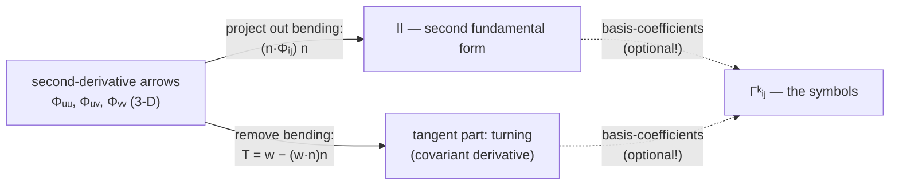

# 2️⃣ How tangent arrows turn — the tangential projection

> **Goal.** Express everything in **pure vector calculus**: the derivative of
> any surface-bound arrow is an ordinary 3-D arrow, and the *surface-visible*
> part is obtained by the tangential projection $T w = w - (w\cdot n)\,n$.
> Coefficients — the Christoffel symbols — appear only as the *coordinate
> bookkeeping* of that projection (§2.6), because that is what the Lean code
> stores.

---

## 2.1 The problem: basis arrows turn as you walk

In the $xy$-plane the basis arrows $e_1=(1,0)$, $e_2=(0,1)$ are the same
everywhere, so differentiating a vector field is component-wise. On a
parameterized surface, the tangent basis arrows are the *columns of the
Jacobian*, $\Phi_u$ and $\Phi_v$, and these genuinely change from point to
point. Differentiate them: each derivative $\Phi_{ui},\Phi_{vi},\dots$ (more
generally $\Phi_{ij}$) is again a 3-D arrow in $\mathbb{R}^3$.

Here is the central **vector** move. At any point, 3-space decomposes into the
tangent plane plus the normal arrow $n$, so every 3-D arrow splits uniquely:

```math
\boxed{\;
\Phi_{ij} \;=\; \underbrace{T\,\Phi_{ij}}_{\text{stays in the surface}}
\;+\; \underbrace{(n\cdot\Phi_{ij})\, n}_{\text{bending out of the surface}},
\qquad
T w \;=\; w - (w\cdot n)\,n
\;}
```

$T$ — *tangential projection* — is a linear map from 3-D arrows back onto the
tangent plane. Everything in the discretized differential geometry of this
chapter is one of exactly two statements about the arrows $\Phi_{ij}$:

- the **normal part** $(n\cdot\Phi_{ij})$ is the second fundamental form $II$
  (Chapter 1 — surface bending);
- the **tangent part** $T\Phi_{ij}$ is how much the surface-bound derivative
  of an arrow *unexpectedly* turns. That is the subject of this chapter.

No coefficients yet — these are honest arrows. Keep it that way as long as
possible.

---

## 2.2 Why not Christoffels? (and why our chapters use vectors)

You will meet $\Gamma^k_{\;ij}$ everywhere in textbooks, and it is fair to ask
why this track relegates them to a sub-role.

**Why the literature is symbol-heavy.** Classical surface theory and general
relativity grew up with *intrinsic* geometry: work with a quantity that lives
on a manifold with no ambient space at all. Inside a manifold with only
coordinates, there is nothing to project onto — no ambient derivative exists
— so you *must* track how the coordinate basis itself twists, and that means
carrying a 3-index array of correction numbers, $\Gamma^k_{\;ij}$, into every
derivative. They are the price of computing without an embedding. Index
gymnastics ($\nabla_i V^k = \partial_i V^k + \Gamma^k_{\;ij}V^j$ and the
higher contractions) is then a full telescope for that correction.

**Why vectors are preferable here.** This course always has the embedding
$\Phi : \mathbb{R}^2 \to \mathbb{R}^3$ in hand, and for embedded surfaces the
covariant derivative has a **one-line vector formula**:

```math
\boxed{\;\nabla_v \, w \;=\; D_v w - \bigl((D_v w)\cdot n\bigr)\,n \;=\; T(D_v w)\;}
```

i.e. differentiate the ambient arrows with the ordinary $\mathbb{R}^3$
derivative, then drop the normal piece. “Tangent + projection” replaces every
$\Gamma$ contraction. Concretely:

| | symbol route | vector route (this course) |
|---|---|---|
| what you differentiate | coordinate *coefficients* $V^k$ | the arrows $V$ themselves |
| correction mechanism | the $\Gamma$ terms (3-index bookkeeping) | subtract the normal part (`T(w) = w − (w·n)n`) |
| geometry read out | after summing repeated indices | directly, by looking at arrows |
| works without embedding | ✅ (its super-power) | needs $\Phi$ (fine — we have it) |
| code cost | build $\Gamma$ array, then contract | project + dot with basis arrows |

Where the symbols *are* the right tool, this track says so honestly: when you
only have the ruler $I$ (an abstract surface, a higher-dimensional manifold,
relativity), or when the textbook source you are following (Eberly's notes)
exploits the pure-$I$ formulas. And — since the Lean code does implement
`Surface.christoffel` — its job in the code is precisely to *store the
coordinates of $T\Phi_{ij}$* (§6, and see `Geodesia/Curvature.lean`). The
vector statement stays primary; the symbol array is a derived container.

---

## 2.3 The covariant derivative is the correction-free rate of turn

Take a surface-bound arrow field $V = V^u\,\Phi_u + V^v\,\Phi_v$. Its
ambient derivative in direction $i$ is ordinary calculus:

```math
\frac{\partial V}{\partial u_i}
= \frac{\partial V^u}{\partial u_i}\Phi_u
+ \frac{\partial V^v}{\partial u_i}\Phi_v
+ V^u\,\Phi_{ui} + V^v\,\Phi_{vi}.
```

The first two terms are expected changes of the arrow; the last two are the
surprise — *the basis arrows themselves turn* as the field's coefficients
move with the point. The surface-visible rate of turn is project the whole
thing back:

```math
\boxed{\;\nabla_i V \;=\; T\!\left(\frac{\partial V}{\partial u_i}\right)\;}
```

Since $V^u\Phi_u+V^v\Phi_v$ is already tangent ($T$ passes through it
unchanged), the correction is exactly “differentiate the arrows, project”.
In pencil-and-paper coordinates the same statement becomes the familiar
textbook pair

```math
\nabla_i V^k \;=\; \frac{\partial V^k}{\partial u_i}
+ \Gamma^k_{\;ij}\,V^j,
```

with the $\Gamma$-correction terms coming straight from
$T(\Phi_{ki}) = \Gamma^\cdot_{ki}\Phi_u + \cdots$ (i.e., from expanding
$T\Phi_{ij}$ in $\{\Phi_u,\Phi_v\}$). On a flat plane in standard coordinates
the basis arrows never turn: $\Gamma^k_{\;ij}=0$ and every $\nabla$ is an
ordinary partial. The same plane *in polar coordinates* does need
corrections; on a sphere every direction needs them (§2.5–2.6). This is the
whole narrative of the Christoffel story — but written in arrow-language it
is simply $T(\partial\text{-derivative})$, with the $\Gamma$ terms surfacing
only when a pencil demands them.

---

## 2.4 The Gauss formula, in arrow form

The one-sentence motto of the whole chapter: 
*the second-derivative arrows split into tangent part $+$ normal part, and
every formula is one of those two projections.*



Both routes — the “project-out” route and the “differentiate-the-metric”
route of §6 — measure the same arrows and agree numerically; they are the
same computation with and without coordinates.

---

## 2.5 Example: the flat plane in polar coordinates

Flat plane, wrapped geometry — the perfect test that tangent parts are about
the *basis arrows*, not about bending:

```math
\Phi(r,\theta) = (r\cos\theta,\ r\sin\theta,\ 0).
```

Basis arrows and Gram matrix:

```math
\Phi_r = (\cos\theta,\ \sin\theta,\ 0),\quad
\Phi_\theta = (-r\sin\theta,\ r\cos\theta,\ 0),\quad
I = \begin{bmatrix}1&0\\0&r^2\end{bmatrix}.
```

Differentiate the arrows (all ordinary $\mathbb{R}^3$ calculus):

```math
\frac{\partial\Phi_r}{\partial r}=0,\qquad
\frac{\partial\Phi_r}{\partial\theta}=\frac{1}{r}\,\Phi_\theta,\qquad
\frac{\partial\Phi_\theta}{\partial r}=\frac{1}{r}\,\Phi_\theta,\qquad
\frac{\partial\Phi_\theta}{\partial\theta}=-r\,\Phi_r.
```

The plane's normal is a constant vector $n=(0,0,1)$, so these derivatives are
*entirely tangent*: $T(\text{each row}) = $ each row. Two consequences worth
pausing over:

- the *basis arrows turn* — $\Phi_r$ turns into a $\Phi_\theta$ arrow when
  pushed around $\theta$ — despite the *plane being flat*;
- and the *arrow turning is exactly what cancels a curve's own turning*:
  for a trajectory that stays geometrically straight, the coordinate parts
  $\ddot r$, $\ddot\theta$ must push against these turning arrows so that
  the *surface arrow* $\gamma''$ ends up purely normal (Chapter 3 makes
  this precise).

For comparison, in coordinates: these arrow equations *are*
$\Gamma^\theta_{\;\theta r} = \Gamma^\theta_{\;r\theta} = 1/r$ and
$\Gamma^r_{\;\theta\theta}=-r$ — read off the same three displayed rows, with
coefficients recorded in the basis. The vector statement comes first; the
coefficients are nothing more than these rows written as slips of paper.
The cross-check with the pure-$I$ Gram-derivative formula (§6) gives the same
numbers, as it must.

---

## 2.6 Example: the unit sphere

Sphere $\Phi(\theta,\varphi)=
(\sin\theta\cos\varphi, \sin\theta\sin\varphi,\cos\theta)$,
normal $n = \Phi$ (the radial arrow), and Gram matrix
$I = \operatorname{diag}(1, \sin^2\theta)$.

Now differentiate the basis arrows — keeping the split intact:

```math
\frac{\partial\Phi_\theta}{\partial\theta}
= -\Phi \;=\; -\,n\quad (\text{entirely normal — } T\text{-part is 0}),
```

```math
\frac{\partial\Phi_\varphi}{\partial\theta}
= \cot\theta\,\Phi_\varphi\quad (\text{purely tangent}),
\qquad
\frac{\partial\Phi_\varphi}{\partial\varphi}
= -\sin\theta\cos\theta\,\Phi_\theta - \sin^2\theta\,n.
```

(Run the dot-product check yourself: $n\cdot\Phi_\theta = 0$ shows the first
split is clean, and $n\cdot \partial_\varphi\Phi_\varphi = -\sin^2\theta$
agrees with $-sin^2\theta\,n$.)

This single row-set explains all the geometry the $\Gamma$ table used to
mumble about:

- a **meridian** ($\varphi$ fixed): its second-derivative arrow is
  $\Phi_{\theta\theta} = -n$ — normal only, tangent part zero → geodesic.
- around the **equator** ($\theta = \pi/2$):
  $\partial_\varphi\Phi_\varphi = -n$ too, so latitude circles at $\pi/2$
  are geodesics but no other latitudes are: at $\theta\ne\pi/2$ the tangent
  part $-\sin\theta\cos\theta\,\Phi_\theta$ is nonzero (the circle must
  accelerate inward, and the surface can only supply the normal fraction).
- general great circles are combinations, in the ordinary sense.

---

## 2.7 Example: the paraboloid

For $z = 0.3(x^2+y^2)$ at $(x,y)=(1,0)$ the code prints

```math
I=\begin{bmatrix}1.36&0\\0&1\end{bmatrix},
\qquad
\Gamma^u_{\;uu}=0.2647,\quad\Gamma^u_{\;uv}=0,\quad\Gamma^u_{\;vv}=0.2647.
```

Vector reading: the $v$-coordinate curve $x=\text{const}$ has second-derivative
arrow $(0,0,0.6)$, while the normal there is
$n=(-0.6,0,1)/\sqrt{1.36}$. Since $(0,0,0.6)$ is **not** parallel to $n$,
exactly the leftover — the tangent part $T(0,0,0.6)$ — has a nonzero
$\Phi_u$ component, and $0.2647$ is that arrow's coefficient in the user
direction (the coefficient of $\Phi_u$ inside $T\Phi_{vv}$, which in
coordinates is labelled $\Gamma^u_{\;vv}$). The same arrow's *normal*
coefficient is the $II_{22}$ entry from Chapter 1. One arrow, two
projections — that split pattern is the *entire subject*.

---

## 2.8 The coordinate bookkeeping (what the code stores)

Everything above was arrow language. When you (or the Lean code) want actual
**numbers to feed an ODE**, the tangent parts have to be expressed in the
basis $\{\Phi_u,\Phi_v\}$ and the *coefficients* recorded. That's what the
following code computes — the coefficients are what tradition calls the
Christoffel symbols:

```lean
Surface.dPhi  s i x y   -- the basis arrows Φ_i
Surface.d2Phi s i j x y -- the second-derivative arrows Φ_ij
Surface.dMetricEntry s u i j x y
                        -- exact Gram-matrix derivative ∂_u (Φ_i·Φ_j)
Surface.metricI s x y   -- the Gram matrix I
Surface.christoffel s x y
                        -- coordinates of T(Φ_ij) in {Φ_u, Φ_v}:
                        -- Fin 2 → Fin 2 → Fin 2 → Float
```

Two equivalent coordinate formulas, both implemented exactly:

**(a) Direct projection.** For an unknown expansion
$T\Phi_{ij} = a\,\Phi_u + b\,\Phi_v$, dot each row with the basis arrows;
the normal-part drops, and the Gram matrix $I=J^{\mathsf T}J$ remains:

```math
I\begin{bmatrix}a\\b\end{bmatrix} =
\begin{bmatrix}\Phi_u\cdot\Phi_{ij}\\ \Phi_v\cdot\Phi_{ij}\end{bmatrix}
\;\;\Longrightarrow\;\;
\Gamma^k_{\;ij}=\bigl(I^{-1}\bigr)^{k\ell}
\bigl(\Phi_\ell\cdot\Phi_{ij}\bigr).
```

**(b) From the ruler alone.** Differentiate $I_{ij} = \Phi_i\cdot\Phi_j$,
cancel shared terms cyclically, and get the pure-$I$ formula

```math
\Gamma^k_{\;ij}
= \tfrac12\bigl(I^{-1}\bigr)^{k\ell}
\bigl(\partial_i I_{j\ell}+\partial_j I_{i\ell}-\partial_\ell I_{ij}\bigr),
```

which `Curvature.lean` computes with **exact** second partials
(`Surface.dMetricEntry`):

```math
\partial_u\,(\Phi_j\cdot\Phi_k)
= \Phi_{uj}\cdot\Phi_k + \Phi_j\cdot\Phi_{uk}.
```

This bare-$I$ route is the one the historical notes favor, since it works for
absolutely-intrinsic data (a metric alone, no embedding).

> One sentence to keep both views in place: *the Christoffel symbols are the
> coordinates of the tangent part of the second-derivative arrows: numbers
> read off by whichever formula is convenient, never required by the vector
> story itself.*

---

## 2.9 Exercises

1. **Polar, both ways.** From §2.5's arrow rows read
   $T(\partial_\theta\Phi_r) = (1/r)\Phi_\theta$ and
   $T(\partial_\theta\Phi_\theta) = -r\,\Phi_r$; then check the same numbers
   via the pure-$I$ formula of §2.8 with $I=\mathrm{diag}(1,r^2)$.
2. **Standard coordinates.** Show that every tangent-part coefficient
   vanishes for the plane in standard $(x,y)$ coordinates — and explain why
   that matches §2.5's nonzero polar numbers: the *plane* is flat in both;
   the *arrows* turn only after polar wrapping.
3. **Symmetry.** Use $\Phi_{uv}=\Phi_{vu}$ to show the tangent-part
   coordinates are symmetric in $i,j$: $\Gamma^k_{\;ij}=\Gamma^k_{\;ji}$.
4. **First-kind identity.** Prove
   $\partial_k\,(\Phi_i\cdot\Phi_j)
    = \Phi_{ik}\cdot\Phi_j + \Phi_i\cdot\Phi_{jk}$
   and use it to derive the pure-$I$ formula of §2.8(b) in full.
5. **Cylinder.** For $\Phi(\theta,z)=(R\cos\theta,R\sin\theta,z)$, compute
   each of $\partial_\theta\Phi_\theta=(-R\,n)$,
   $\partial_\theta\Phi_z = 0$-type rows and deduce that *every* tangent
   part vanishes. Is that consistent with the cylinder being flat?
6. **Sphere check.** Verify the three arrow splits of §2.6 from
   $I=\mathrm{diag}(1,\sin^2\theta)$ and the pure-$I$ route.
7. **Conserved pairing.** Show that on the sphere
   $\sin^2\theta\,\dot\varphi$ stays constant along any curve whose tangent
   part of $\gamma''$ vanishes (Chapter 3). Hint: differentiate
   $\sin^2\theta\,\dot\varphi$ in $s$ and substitute the two component
   equations.
8. **Code experiment.** Evaluate `Surface.christoffel` on the paraboloid at
   $(0,0)$ and $(2,0)$; translate the printed numbers back into
   *which arrow turned how much*, using §2.7's vector reading.
