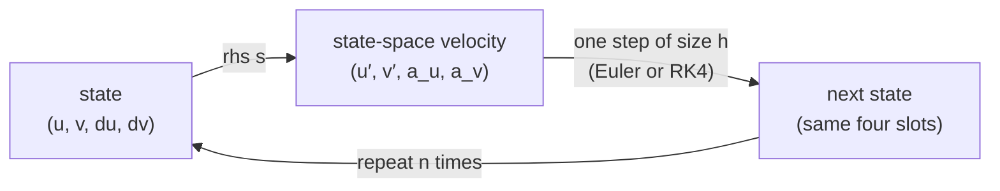

# 4️⃣ Ordinary differential equations and Runge–Kutta

> **Goal.** Read the geodesic equation as a first-order ODE, understand what
> an integrator actually computes, and know why RK4 is the default in
> `Geodesic.lean` while Euler is only the teaching baseline.

---

## 4.1 From one ODE to a state vector

A first-order ODE is

```math
y'(s)=f\bigl(s,y(s)\bigr),
\qquad y(s_0)=y_0.
```

Here $y$ can be a vector. The **state** is everything you need to know to
continue the solution; $f$ is the **vector field** that says how the state
changes.

The geodesic equation is second order:

```math
q''=F(q,q'),
\qquad F^k(q,q')=-\Gamma^k_{\;ij}(q)\,q'^i q'^j.
```

Introduce velocities $p=q'$:

```math
\boxed{
\begin{aligned}
q' &= p,\\
p' &= F(q,p).
\end{aligned}}
```

In components, write $q=(u,v)$ and $p=(p_u,p_v)$ for the two rates:

```math
u'=p_u,\quad
v'=p_v,\quad
p_u'=F^u(u,v,p_u,p_v),\quad
p_v'=F^v(u,v,p_u,p_v).
```

This is the `GeoState` in the code:

```lean
structure GeoState where
  u : Float
  v : Float
  du : Float
  dv : Float
```

The four fields are the complete state:

| Slot | Meaning | Code field |
|---|---|---|
| 1 | parameter $u$ | `st.u` |
| 2 | parameter $v$ | `st.v` |
| 3 | rate $p_u = u'$ | `st.du` |
| 4 | rate $p_v = v'$ | `st.dv` |

The independent variable $s$ is the parameter along the curve. For a
geodesic we usually choose it affinely (constant ruler-speed), but the
integrator never checks that: it only needs a vector field
$f(s,\text{state})$. Here $f$ is autonomous — it does not depend on $s$
explicitly — which is why `rhs` takes a `Surface` and a `GeoState`, not a
separate time argument.

`Geodesic.rhs` returns a `GeoState` whose four slots hold
`(u', v', u'', v'')` — the two rates, then the two accelerations.

The code separates the *packaging* from the *physics*. `rhsWith` is the
generic first-order wrapper: it takes an acceleration function as an
argument, copies the two velocity slots unchanged, and puts the acceleration
into the last two slots. `rhs` and `rhsVector` are two instantiations:

```lean
def rhsWith (accel : Surface → GeoState → Vec2) (s : Surface)
    (st : GeoState) : GeoState :=
  let a := accel s st
  ⟨st.du, st.dv, a.x, a.y⟩

def rhs (s : Surface) (st : GeoState) : GeoState :=
  rhsWith accelChristoffel s st

def rhsVector (s : Surface) (st : GeoState) : GeoState :=
  rhsWith accelVector s st
```

Read the four fields of the result as three questions: what are the
parameter rates? (the state's own `du`, `dv`); what is the acceleration in
the $u$ direction? (`a.x`); in the $v$ direction? (`a.y`). Nothing in
`rhsWith` knows about surfaces or Christoffel symbols — an integrator only
ever sees a state-space velocity. The record type
`GeoState` is reused for the state and for its derivative; only the
interpretation of the four fields changes. That reuse is what keeps
`rk4Step` short: `avg` is a sum of four *derivatives*, and the last line adds
it to the *state* with the same two componentwise helpers — no conversion
step.



Two accelerations, one interface: the `Vec2` returned by
`accelChristoffel` or `accelVector` (Chapter 3 §3.2) is the `a` in that
picture. `rhsWith` is the adapter that turns any such acceleration into a
state-space velocity. Euler adds $h$ times that velocity directly; RK4
averages four such velocities (§4.3).

At the start state $\langle 1,0,1,0\rangle$ on the paraboloid, both RHS
functions print the same state-space tangent vector:

```text
the two right-hand sides at the same state
  rhs       = (u = 1.000000, v = 0.000000, du = -0.264706, dv = -0.000000)
  rhsVector = (u = 1.000000, v = 0.000000, du = -0.264706, dv = -0.000000)
```

Here the first two printed fields are the rates $(u',v') = (1,0)$ and the
last two are the accelerations $(u'',v'') = (-0.264706,-0.000000)$. The
`ToString` labels are the four slot names, not their current meaning.

> **Order reduction** is the standard trick, and it is not a trick. A step is
> only ever a rule "given the whole solution now, produce it a moment later",
> and a second-order equation does not answer that on its own: two curves
> through the same point with different velocities part company immediately.
> Promoting the velocity into the state makes the rule a single map
> $y\mapsto f(y)$ — the only shape an integrator takes. An $n$-th order ODE
> in $m$ components becomes a first-order system of dimension $n\,m$; a
> geodesic in two parameters has a 4-dimensional state.

---

## 4.2 Euler’s method

The simplest integrator is

```math
y_{n+1}=y_n+h\,f(s_n,y_n),
\qquad s_{n+1}=s_n+h.
```

It reads the current velocity $f(s_n,y_n)$ and walks in a straight line with
it for a time $h$.

Geometrically: at the current state, draw the velocity vector $f(s_n,y_n)$;
step a distance $h$ along it; then recompute the velocity at the new state.
The method never looks at how the velocity itself is turning. That is
why it is first order: it is a tangent-line approximation.

- Local truncation error per step: $O(h^2)$ — the size of the bit of
  curvature the straight line missed.
- Global error over a fixed interval: $O(h)$ (first order) — there are
  $L/h$ steps, so the per-step slips add up to about $L\,h$.
- It is explicit and cheap, but it drifts badly and is not accurate enough
  for geodesics except as a teaching tool.

In code, the single step and the loop are both tiny:

```lean
def eulerStep (s : Surface) (h : Float) (st : GeoState) : GeoState :=
  GeoState.add st (GeoState.smul h (rhs s st))

def eulerIntegrate (s : Surface) (h : Float) (n : Nat) (st : GeoState) : GeoState :=
  match n with
  | 0 => st
  | n + 1 => eulerIntegrate s h n (eulerStep s h st)
```

`eulerStep` is exactly the formula above with `rhs s` in place of $f$;
`eulerIntegrate` repeats it. `GeoState.add` and `GeoState.smul` are
componentwise, so these lines *are* the vector formula — no hidden loops.

**Euler vs RK4 on the paraboloid.** From the same start state, one step of
size `0.1`:

```text
Euler         = (u = 1.100000, v = 0.000000, du = 0.973529, dv = 0.000000)
RK4           = (u = 1.098681, v = 0.000000, du = 0.973668, dv = 0.000000)
```

Over the full interval with 100 steps of size `0.01`:

```text
RK4 endpoint  = (1.879182, 0.000000, 1.059398)
Euler endpoint= (1.880145, 0.000000, 1.060483)
E(0)          = 0.680000
E RK4, Euler  = 0.680000, 0.679768
```

Euler is cheap but visibly different after one step: its $u$ is larger
because it carries the *initial* rate $\dot u = 1$ across the whole step,
while RK4 averages slopes sampled inside the step and finishes with
$\dot u = 0.973668$. Over the interval Euler overshoots in $u$ and loses
about $2.3\times10^{-4}$ of $E$, while RK4 holds $E$ at `0.680000` to
printed precision.

---

## 4.3 Midpoint and fourth-order Runge–Kutta

The midpoint method samples the vector field halfway along the Euler step:

```math
k_1=f(s_n,y_n),
```

```math
k_2=f\bigl(s_n+\tfrac h2,\ y_n+\tfrac h2 k_1\bigr),
```

```math
y_{n+1}=y_n+h\,k_2.
```

It is second order: global error $O(h^2)$.

**Classical RK4** uses four samples:

```math
\begin{aligned}
k_1&=f(s_n,y_n),\\
k_2&=f\bigl(s_n+\tfrac h2,\ y_n+\tfrac h2 k_1\bigr),\\
k_3&=f\bigl(s_n+\tfrac h2,\ y_n+\tfrac h2 k_2\bigr),\\
k_4&=f\bigl(s_n+h,\ y_n+h k_3\bigr),
\end{aligned}
```

```math
\boxed{\;
y_{n+1}=y_n+\frac h6\bigl(k_1+2k_2+2k_3+k_4\bigr).
\;}
```

It is fourth order: global error $O(h^4)$. The weights
$(1,2,2,1)/6$ are Simpson’s rule in disguise: RK4 matches the Taylor
expansion of the exact solution through $h^4$.

**Implementation.** Verbatim from `Geodesia/Geodesic.lean`:

```lean
def rk4Step (s : Surface) (h : Float) (st : GeoState) : GeoState :=
  let k1 := rhs s st
  let k2 := rhs s (GeoState.add st (GeoState.smul (h / 2) k1))
  let k3 := rhs s (GeoState.add st (GeoState.smul (h / 2) k2))
  let k4 := rhs s (GeoState.add st (GeoState.smul h k3))
  let avg :=
    GeoState.add (GeoState.add k1 (GeoState.smul 2 k2))
      (GeoState.add (GeoState.smul 2 k3) k4)
  GeoState.add st (GeoState.smul (h / 6) avg)
```

Line by line: `k1` is the slope at the start; `k2` and `k3` are two
estimates of the *same* midpoint slope, the second built from the first;
`k4` samples at the far end. `avg` is the weighted sum
$k_1+2k_2+2k_3+k_4$, and the last line multiplies by $h/6$ and adds it to
the state. Four `rhs` calls per step buy fourth-order accuracy — still
cheap, and the reason RK4 is the default.

The formulas above show the general non-autonomous case; the geodesic
right-hand side is autonomous, so the code has no explicit $s_n$ argument —
the state is the only thing that moves between samples.

`rk4Step` calls `rhs`, so the bundled integrators run the Christoffel
acceleration. The step machinery itself is agnostic: the four sample states
and the weighted average do not care which acceleration produced the
velocity. The bundle is a default, not a constraint — renaming `rhs` to
`rhsVector` inside `rk4Step` (four occurrences) or inside `eulerStep` (one)
switches the route, and nothing else in either loop changes.

The repeated integration is the same loop as Euler, with `rk4Step` in place
of `eulerStep`:

```lean
def integrate (s : Surface) (h : Float) (n : Nat) (st : GeoState) : GeoState :=
  match n with
  | 0 => st
  | n + 1 => integrate s h n (rk4Step s h st)
```

### A quick accuracy check

For $y'=y$, $y(0)=1$, integrating to $s=2$ (exact $e^2=7.389056$):

| step $h$ | Euler | midpoint | RK4 |
|---:|---:|---:|---:|
| $0.5$ | $5.0625$ | $6.9729$ | $7.38397$ |
| $0.25$ | $5.9605$ | $7.2622$ | $7.38867$ |

Halving $h$ reduces the Euler error by about a factor $2$, the midpoint
error by about $4$, and the RK4 error by about $16$ — roughly the predicted
orders $1,2,4$.

---

## 4.4 Stability and step size

Apply a method to the test equation

```math
y'=\lambda y,
\qquad \lambda\in\mathbb{C}.
```

The numerical solution is $y_n=R(z)^n y_0$ with $z=\lambda h$. For RK4,

```math
R(z)=1+z+\frac{z^2}{2}+\frac{z^3}{6}+\frac{z^4}{24}.
```

The method is stable when the modulus of $R(z)$ is at most $1$. For real
negative $\lambda$, RK4 is stable for roughly $-2.8\le \lambda h\le 0$. This
is a **conditional** stability limit: too large a step makes the numerical
solution explode even though the exact solution decays.

For geodesics:

- The ODE is usually not stiff, but near high curvature, a nearly singular
  metric, or a coordinate singularity (e.g. the poles of spherical
  coordinates), the effective $\lambda$ can be large.
- The step must resolve the *smallest* length scale of the surface, not just
  the total path length.
- Check convergence by halving the step; a well-resolved RK4 solution changes
  by a factor of about $16$ in the error.
- For very long integrations, monitor the conserved quadratic form
  from Chapter 3. A drift is a warning sign.

### Adaptive steps and symplectic methods

Production codes often use an embedded RK45 pair: two estimates of different
order give a local error estimate, and the step is accepted/rejected
accordingly. For systems with conserved quadratic forms, **symplectic**
integrators (Störmer–Verlet, implicit midpoint, Gauss–Legendre) preserve the
phase-space structure and show much better long-term conservation of the
quadratic form.

---

## 4.5 The geodesic ODE in code

`Geodesia/Geodesic.lean` contains the whole pipeline. Signatures only, with
the bodies elided:

```lean
def accelChristoffel (s : Surface) (st : GeoState) : Vec2 :=
  -- −Γ^k_ij q′ⁱ q′ʲ : the Christoffel route

def accelVector (s : Surface) (st : GeoState) : Vec2 :=
  -- −I⁻¹ g : the vector route (gVector, then metricI.inv)

def rhsWith (accel : Surface → GeoState → Vec2) (s : Surface)
    (st : GeoState) : GeoState :=
  -- (du, dv, a_u, a_v)

def rhs (s : Surface) (st : GeoState) : GeoState :=
  rhsWith accelChristoffel s st

def rhsVector (s : Surface) (st : GeoState) : GeoState :=
  rhsWith accelVector s st

def eulerStep (s : Surface) (h : Float) (st : GeoState) : GeoState :=
  -- one forward-Euler step

def eulerIntegrate (s : Surface) (h : Float) (n : Nat) (st : GeoState) : GeoState :=
  -- n Euler steps of size h

def rk4Step (s : Surface) (h : Float) (st : GeoState) : GeoState :=
  -- the four k's above

def integrate (s : Surface) (h : Float) (n : Nat) (st : GeoState) : GeoState :=
  -- n RK4 steps of size h
```

Which function should you call?

| Task | Function |
|---|---|
| acceleration from the Christoffel symbols | `accelChristoffel` |
| acceleration from the vector condition | `accelVector` |
| state-space RHS, Christoffel route | `rhs` |
| state-space RHS, vector route | `rhsVector` |
| one Euler step / $n$ Euler steps | `eulerStep` / `eulerIntegrate` |
| one RK4 step / $n$ RK4 steps | `rk4Step` / `integrate` |

`integrate` is the default used by `shootState` and `shoot`; `eulerIntegrate`
exists for comparison and teaching. The acceleration route and the
integrator are *separate* choices:

- **Which acceleration?** `accelChristoffel` if you want the $\Gamma$ table —
  the literature's route, and the one the shipped loops call; `accelVector`
  if you want the code to mirror §3.2's box using dot products only. As
  real-number formulas they are identical: `learn-geodesia/Proofs.lean`
  proves the identity over `ℝ`. In `Float` the two routes can differ in the
  last displayed digit, which is why the demo prints both.
- **Which integrator?** `rk4Step`/`integrate` for any number you would quote;
  `eulerStep`/`eulerIntegrate` to watch an error grow, or to read one line of
  arithmetic at a time.

They compose because `rhsWith` already factored the acceleration out: an
integrator loop only ever sees a map `GeoState → GeoState`. The bundled
`eulerStep` and `rk4Step` both call `rhs`, so out of the box both run the
Christoffel route; replacing `rhs` with `rhsVector` at its call sites is the
whole change.

Because the tangent-part coefficients (`Surface.christoffel`, which is the
coordinate form of the vector projection of Chapter 2) use exact
derivatives, the only numerical error in an integrated geodesic is the
integrator's. The demo reports

```text
RK4 endpoint  = (1.879182, 0.000000, 1.059398)
Euler endpoint= (1.880145, 0.000000, 1.060483)
E(0)          = 0.680000
E RK4, Euler  = 0.680000, 0.679768
```

for the paraboloid. The conserved quadratic form
$\tfrac12\,\dot q^{\mathsf T} I\, \dot q$ is held at `0.680000` by RK4 to
the printed precision; Euler drifts to `0.679768`, the first-order symptom
from §4.2. `rhsVector` is the vector-route twin of `rhs`;
`learn-geodesia/Proofs.lean` shows the two accelerations agree over `ℝ`,
and the demo prints the same pair to six decimals.

### Choosing initial conditions

To integrate a geodesic you need a point and a direction. A convenient way to
specify the direction is a unit vector in the tangent plane:

```math
w=\cos\alpha\,e_1+\sin\alpha\,e_2,
```

where $(e_1,e_2)$ is an orthonormal tangent frame (`Geodesic.tangentFrame`).
Then convert to the tangent-basis coordinates $(\dot u, \dot v)$ with the
normal-equations formula from Chapter 1:

```math
\xi=I^{-1}J^{\mathsf T}w
\qquad\text{(`Geodesic.tangentVecToParams`)}.
```

This is exactly the conversion in Eberly’s *Geodesics on a Parameterized
Surface*: $J^{\mathsf T}J=I$, so $I^{-1}J^{\mathsf T}J\xi=\xi$.

`Geodesic.shoot` does this for a given angle and length. Chapter 5 turns it
into a boundary-value solver.

---

## 4.6 Preview: the variational equation

For shooting we need to know how the final point changes when the starting
direction changes. If $y(s;v)$ solves

```math
y'=f(s,y),
\qquad y(0)=y_0,
```

then the matrix

```math
Y(s)=\frac{\partial y(s;v)}{\partial v}
```

solves the **variational equation**

```math
Y'=f_y(s,y(s;v))\,Y,
\qquad
Y(0)=\begin{bmatrix}0\\ \mathrm{Id}_2\end{bmatrix}
```

(the top block is zero because the starting position is fixed; the bottom
block is the $2\times2$ identity on the starting direction). This is just the
chain rule applied to the ODE. It is a
linear matrix ODE that can be integrated alongside the original one. Chapter 5
shows how it produces the Jacobian for Newton’s method.

---

## 4.7 Exercises

1. **Order reduction.** Write the third-order ODE $y'''=f(y,y',y'')$ as a
   first-order system. How many state components?
2. **Euler error.** For $y'=y$, $y(0)=1$, show by induction that Euler gives
   $y_n=(1+h)^n$. Expand to prove first-order accuracy.
3. **RK4 weights.** Verify that the RK4 weights $(1,2,2,1)/6$ reproduce the
   Taylor expansion of $e^h$ through $h^4$.
4. **Stability boundary.** For $y'=\lambda y$ with real $\lambda<0$, find the
   approximate boundary of the RK4 stability region. What happens for
   $\lambda h=-3$?
5. **Energy check.** Integrate the paraboloid geodesic with $h=0.1,0.05,0.025$
   and compare the drift of the conserved quadratic form. Estimate the
   observed order.
6. **Adaptive idea.** Suppose you have two RK4 solutions with steps $h$ and
   $h/2$. How could you estimate the error of the finer one? (This is the
   idea behind Richardson extrapolation.)
7. **Tangent frame.** Show that `tangentFrame` produces an orthonormal basis
   when $\Phi_u,\Phi_v$ are linearly independent.
8. **Tangent-basis coordinates.** Derive $\xi=I^{-1}J^{\mathsf T}w$ from $w=J\xi$ and
   $I=J^{\mathsf T}J$.
9. **Euler drift.** Run `Geodesic.eulerIntegrate` and `Geodesic.integrate`
   with the same step count on the paraboloid. Compare the energy loss and
   the endpoint. Which integrator would you trust inside the shooting loop of
   Chapter 5, and why?
