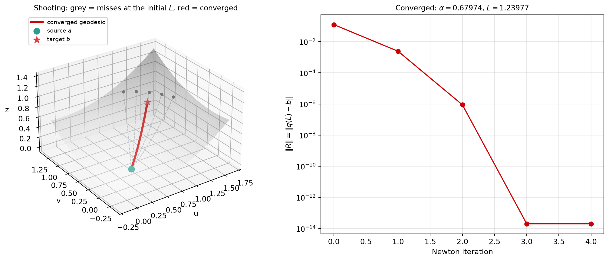

# 5️⃣ Shooting methods — hitting a target with geodesics

> **Goal.** Understand the shooting method as *“integrate an initial-value
> problem, measure the miss, adjust the initial velocity, repeat”*, see where
> the Jacobian comes from, and learn why the unknown geodesic length makes the
> naive version tricky (Eberly §2).

The shooting method is the numerical version of archery:

1. Stand at the source $a$.
2. Choose an initial direction and speed (the *shot*).
3. Integrate the geodesic ODE to see where you land.
4. Measure the miss relative to the target $b$.
5. Adjust the shot and repeat.

Everything else is bookkeeping: what “direction”, “miss” and “adjust” mean
precisely.

---

## 5.1 The boundary-value problem

The geodesic equation is a second-order ODE. An **initial-value problem**
(IVP) specifies position and velocity:

$$
q(0)=a,\qquad q'(0)=v.
$$

A **boundary-value problem** (BVP) specifies two positions:

$$
q(0)=a,\qquad q(L)=b,
$$

with the total length $L$ generally **unknown**. The BVP is harder: you are
not allowed to choose the velocity; it is determined by the requirement of
hitting $b$. Shooting turns the BVP into a root-finding problem for the
initial velocity.

Write the solution of the IVP as

$$
q(s;a,v),
$$

emphasising its dependence on the initial data. For a fixed $L$, the miss is

$$
\boxed{\;R(v)=q(L;a,v)-b.\;}
$$

We want $R(v)=0$. This is a nonlinear equation in $v\in\mathbb{R}^2$ (for a
surface). The function $R$ is only available through numerical integration,
but that is enough for Newton’s method.

---

## 5.2 Standard shooting with a known length

Newton’s method is

$$
\boxed{\;v_{k+1}=v_k-\bigl[DR(v_k)\bigr]^{-1}R(v_k).\;}
$$

The only hard part is the **Jacobian** $DR=\partial R/\partial v$. Formally,

$$
DR(v)=\frac{\partial q(L;a,v)}{\partial v}.
$$

Let $Y(s)=\partial q(s;a,v)/\partial v$ be the $2\times2$ matrix of
derivatives with respect to the initial velocity. Differentiate the ODE
$q''=F(q,q')$ with respect to $v$:

$$
\boxed{\;
Y''=F_q(q,q')\,Y+F_{q'}(q,q')\,Y'.
\;}
\tag{first variational equation}
$$

The initial conditions follow from $q(0)=a$ (independent of $v$) and
$q'(0)=v$:

$$
Y(0)=0,\qquad Y'(0)=I.
$$

Then $DR(v)=Y(L)$. This is a **linear matrix ODE**; integrate it together
with the geodesic (or after it) using RK4, and you have an exact (up to RK4
error) Jacobian. This is the standard algorithm in Eberly §2.1.

### The geodesic variational equation explicitly

For

$$
F^i(q,q')=-\Gamma^i_{\;jk}(q)\,q'^j q'^k,
$$

we have

$$
\frac{\partial F^i}{\partial q'^j}
=-2\Gamma^i_{\;jk}q'^k,
\qquad
\frac{\partial F^i}{\partial q^m}
=-\partial_m\Gamma^i_{\;jk}\,q'^j q'^k.
$$

Therefore each column $Y_{\cdot j}$ of $Y$ satisfies

$$
\boxed{\;
(Y^i)''+2\Gamma^i_{\;jk}q'^k\,(Y^j)'
+\partial_m\Gamma^i_{\;jk}q'^j q'^k\,Y^m=0.
\;}
$$

In vector notation this is
$Y''+2\Gamma(q)[q',Y']+(\partial\Gamma(q)[q',q'])Y=0$, where the brackets
denote the obvious contractions. This is the **Jacobi equation** in disguise. Its solutions are **Jacobi
fields**: they measure how a nearby geodesic separates from the original one.
The columns of $DR$ are precisely Jacobi fields with initial data
$Y(0)=0$, $Y'(0)=I$.

---

## 5.3 The unknown length problem

The standard algorithm assumes $L$ is known. For a geodesic between two
points, $L$ is exactly what we are trying to find. Eberly §2.2 explains why
you cannot simply guess it:

- If $L$ is **too small**, no shot can reach $b$: every curve of length $L$
  falls short.
- If $L$ is **too large**, the geodesic may pass through $b$ before the end;
  forcing the endpoint at $s=L$ to equal $b$ is then impossible.

### Fix 1: overestimate and minimise the miss

Choose an overestimate $L'>L$ (for example, the length of the straight chord
from $a$ to $b$). For each initial velocity $v$, integrate to
$c(v)=q(L';a,v)$. The true geodesic passes through $b$ at some $s=L<L'$, so
$b$ lies on the curve even though the endpoint is not $b$. Minimise the
distance from $b$ to the endpoint:

$$
\ell(v)=\operatorname{dist}\bigl(b,c(v)\bigr).
$$

Eberly uses a line-segment distance weighted by the metric along the segment
(his eq. 18):

$$
\ell(v)=\int_0^1
\sqrt{(c-b)^{\mathsf T}G\bigl((1-t)b+tc\bigr)(c-b)}\,dt.
$$

The gradient $\ell_v$ involves $c_v=\partial c/\partial v$, i.e. the same
variational matrix $Y$ as before. Use steepest descent or conjugate gradients
to minimise $\ell$. This is robust but requires a good overestimate and a
minimiser.

### Fix 2: solve for angle and length together

On a 2-D surface there is a cleaner formulation. Parameterise the initial
velocity by a **unit** tangent direction and an unknown length:

$$
v=\cos\alpha\,e_1+\sin\alpha\,e_2,
\qquad (e_1,e_2)\text{ orthonormal in }T_aS.
$$

The unknowns are $(\alpha,L)$, and the equations are

$$
q(L;a,\alpha)-b=0
\qquad (2\text{ equations}).
$$

So $2$ unknowns for $2$ equations. This is the version used in the worked
example below and in the figure script. It is the $n=2$ case of the general
statement “unit direction on $S^{n-1}$ ($n-1$ angles) plus length $L$ gives
$n$ unknowns, matching $n$ boundary equations.”

Initial guesses:

- $\alpha_0$: direction of the chord $b-a$, projected into the tangent plane;
- $L_0$: the chord length (or $1.1$–$1.3$ times it).

Then run damped Newton on $(\alpha,L)$.

### Fix 3: reparameterise to $t\in[0,1]$

Eberly §2.3 writes $q(s)=y(t)$ with $t\in[0,1]$ and derives an ODE for
$y(t)$ involving $s'=ds/dt$ and $s''=d^2s/dt^2$. The boundary conditions
become $y(0)=a$, $y(1)=b$, so the standard shooting method can be applied
with a known parameter interval. The price is a more complicated ODE (eq. 24
in the PDF) because the unknown length is hidden in $s'$.

---

## 5.4 Which unknowns, which equations?

| Situation | Unknowns | Equations |
|---|---|---|
| target is a point, $L$ known | initial velocity $v\in\mathbb{R}^2$ | $q(L)-b=0$ (2) |
| target is a point, unit speed | angle $\alpha$, length $L$ | $q(L)-b=0$ (2) |
| general $n$-D manifold, unit speed | $n-1$ angles + $L$ | $n$ endpoint eqs |
| target is a curve (e.g. boundary) | angle $\alpha$ (or $v$ modulo tangent to curve) | one scalar condition |

For a point target on a surface, the ambient residual $q(L)-b\in\mathbb{R}^3$
has only two independent components because the endpoint is constrained to
the surface. Working in parameter coordinates avoids the redundancy.

---

## 5.5 The full Newton algorithm (angle + length)

```
shoot(alpha, L):
    e1, e2 = orthonormal tangent frame at a
    w = cos(alpha) e1 + sin(alpha) e2
    xi = I(a)^{-1} J(a)^T w        # unit parameter velocity
    q = integrate_geodesic(a, xi, L)
    return q

residual(x = (alpha, L)):
    return shoot(alpha, L) - b

Newton:
    x = (alpha0, L0)
    repeat:
        r = residual(x)
        if ||r|| < tol: break
        J = finite-difference Jacobian of residual
        solve J * dx = -r
        choose step t (backtracking line search)
        x = x + t * dx
```

The finite-difference Jacobian costs two extra integrations per iteration
(one per unknown). For larger systems, use the variational equation instead:

```
augmented state = (q, p, Y, Y')      # Y is n x n
integrate the geodesic and Y'' = F_q Y + F_p Y' together
DR = Y(L)
```

This costs one integration of a larger system, and is more accurate.

### Damping and safeguards

- **Backtracking line search:** accept a step only if it reduces $\|R\|$.
- **Bounds:** keep $\alpha\in[0,2\pi)$; require $L>0$.
- **Multiple seeds:** geodesics are not unique. Try several angles, especially
  for targets near the cut locus.
- **Continuation:** solve a sequence of targets moving gradually from an easy
  one to the desired one.
- **Rescale:** work in units where the surface’s typical length is $O(1)$.

---

## 5.6 Why shooting fails: conjugate points and caustics

The Jacobian $DR=Y(L)$ can be singular. A nonzero Jacobi field $Y$ with
$Y(0)=0$ and $Y(L)=0$ is a **conjugate point** of $a$ at parameter $L$.
Geometrically, nearby geodesics launched from $a$ refocus at $b$; the map
“initial direction $\mapsto$ endpoint” is not invertible.

Examples:

- **Sphere, antipodal points.** Every great circle from the north pole reaches
  the south pole. The target is reachable by a continuum of initial
  directions, and $DR$ is singular. Newton has no unique answer.
- **Ellipsoid.** There can be several geodesics between two points; shooting
  converges to the one selected by the initial guess.
- **Near the cut locus.** Even when $DR$ is invertible, it is ill-conditioned;
  small changes in the shot produce large changes in the endpoint. Use
  damped Newton, better initial guesses, or switch to relaxation.

This is not a bug in the implementation; it is geometry. Relaxation methods
(Chapter 6) are often more robust precisely because they do not rely on
inverting the endpoint map.

---

## 5.7 Worked example: paraboloid

Take

$$
\Phi(u,v)=\bigl(u,v,0.3(u^2+v^2)\bigr),
\qquad
a=(0.4,0.2),\quad b=(1.2,0.9).
$$

The straight chord has length $1.2281$. Start with the chord direction and
$L_0=1.15\times\text{chord}=1.4123$. Damped Newton on $(\alpha,L)$ gives:

| iteration | $\alpha$ | $L$ | $\|R\|$ |
|---:|---:|---:|---:|
| 0 | 0.67857208 | 1.41231284 | $1.26\times10^{-1}$ |
| 1 | 0.67976725 | 1.23649445 | $2.44\times10^{-3}$ |
| 2 | 0.67974028 | 1.23976961 | $8.87\times10^{-7}$ |
| 3 | 0.67974028 | 1.23977080 | $2.02\times10^{-14}$ |

The geodesic length is $1.23977$, slightly longer than the chord, as it must
be on a curved surface. The final unit tangent direction is about
$\alpha=0.6797$ rad ($38.9^\circ$).



The Lean function `Geodesic.shoot` computes one shot:

```lean
Geodesic.shoot s u v angle length steps   -- ambient endpoint Vec3
```

It is the IVP half of the method. A root finder around it (in Lean or in a
host script) is the other half.

---

## 5.8 Exercises

1. **Variational equation.** Derive
   $Y''=F_qY+F_{q'}Y'$ from $q''=F(q,q')$ by differentiating with respect to
   the initial velocity. What are $Y(0)$ and $Y'(0)$?
2. **Jacobi equation.** Substitute
   $F^i=-\Gamma^i_{\;jk}q'^jq'^k$ and derive the explicit second-order
   equation for $Y$ in §5.2.
3. **1-D shooting.** Fix $L$ and target a curve (e.g. the circle
   $u^2+v^2=1$). Reduce the residual to one scalar equation and implement
   bisection or secant. Why is no 2-D Jacobian needed?
4. **Underestimate.** Explain geometrically why an underestimated $L$ can
   never hit a target farther than $L$ away. What happens numerically?
5. **Overestimate objective.** Write the gradient of Eberly’s line-segment
   distance $\ell(v)$ in terms of $c_v=Y(L')$. (You may differentiate under
   the integral.)
6. **Antipodal sphere.** Show that for $a=$ north pole and
   $b=$ south pole, every unit initial direction reaches $b$ at $s=\pi R$.
   What does $DR$ look like?
7. **Nearby geodesics.** Integrate two geodesics from $a$ with initial angles
   differing by $10^{-3}$ and plot their separation vs $s$. Where does it
   grow fastest?
8. **Code.** Use `Geodesic.shoot` to tabulate the residual for
   $\alpha\in[0.6,0.8]$ at the converged $L$, and implement a secant method
   to find the zero.
