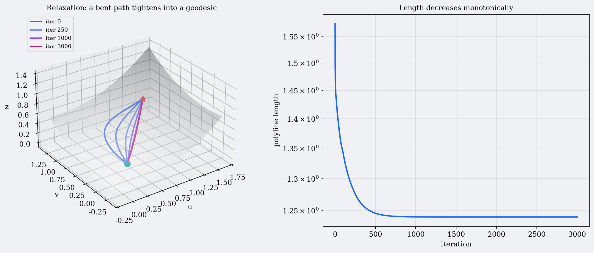

# 6️⃣ Relaxation — deform the whole path at once

> **Goal.** Understand the second major strategy: instead of guessing an
> initial direction, guess an entire curve and let it “flow” downhill until it
> becomes a geodesic. This is the relaxation method in Eberly’s
> *Computing Geodesics on a Riemannian Manifold*, §3–§5.

Shooting is local in the initial data and global in the integration.
Relaxation is the opposite: it keeps the endpoints fixed, discretises the
whole path, and moves the interior points until the path stops changing.

The picture is a rubber band: pin both ends on the surface and let it
contract. A band under tension settles into the shortest path — a geodesic.

---

## 6.1 The continuous relaxation PDE

Start from the geodesic equation

```math
q''^k+\Gamma^k_{\;ij}q'^i q'^j=0.
```

Introduce an artificial “time” $t$ and let the curve evolve:

```math
\boxed{\;
\frac{\partial q^k}{\partial t}
=\frac{\partial^2 q^k}{\partial s^2}
+\Gamma^k_{\;ij}\frac{\partial q^i}{\partial s}
\frac{\partial q^j}{\partial s}
\;}
\tag{relaxation PDE}
```

At steady state $\partial_t q=0$, so the right-hand side is zero — exactly the
geodesic equation. This is a **parabolic PDE**, like the heat equation plus a
transport term. The initial condition is any curve connecting the endpoints:

```math
q(s,0)=c(s),\qquad 0\le s\le L',
```

and the boundary conditions pin the ends:

```math
q(0,t)=a,\qquad q(L',t)=b.
```

If the true geodesic length $L$ is unknown, use an overestimate $L'>L$ and
let the endpoint move; Eberly calls this a **moving boundary**. In practice
you can also rescale the parameter after each step so the endpoints stay at
$s=0$ and $s=1$.

> **Why this works.** The right-hand side is minus the covariant acceleration
> (with a sign convention), so the flow pushes the curve in the direction that
> reduces bending. A geodesic is a fixed point.

---

## 6.2 Finite differences in space and time

Discretise the curve into a polyline

```math
q_i \approx q(i\,\Delta s),\qquad i=0,\dots,N,
```

with $q_0=a$ and $q_N=b$ fixed. Use central differences in $s$:

```math
q' \approx\frac{q_{i+1}-q_{i-1}}{2\Delta s},
\qquad
q'' \approx\frac{q_{i+1}-2q_i+q_{i-1}}{(\Delta s)^2}.
```

Replace the PDE by an explicit Euler step in $t$:

```math
\boxed{
\begin{aligned}
q_i^{\,n+1}
={}&q_i^{\,n}
+\frac{\Delta t}{(\Delta s)^2}\Bigl[
q_{i+1}^{\,n}-2q_i^{\,n}+q_{i-1}^{\,n}\\
&+\tfrac14\,\Gamma^k_{\;ij}(q_i^{\,n})
\bigl(q_{i+1}^{\,i}-q_{i-1}^{\,i}\bigr)
\bigl(q_{i+1}^{\,j}-q_{i-1}^{\,j}\bigr)
\Bigr].
\end{aligned}}
```

This is Eberly’s finite-difference update (his eq. 32). The factor
$1/4$ comes from $(1/(2\Delta s))^2$. The interior points are updated into a
temporary array, then copied back; the endpoints never move.

### Stability and resolution

- The scheme is explicit, so it is conditionally stable. A good rule of
  thumb is to keep $\dfrac{\Delta t}{(\Delta s)^2}$ small; halve $\Delta t$
  when you halve $\Delta s$.
- If neighbouring points drift far apart, $\Delta s$ no longer represents
  the geodesic distance between them. **Resample** the polyline (insert
  points or redistribute by arc length) when segments become too long.
- Start with a **coarse** polyline. Eberly observed that starting with many
  vertices makes the polyline stiff: each vertex can move only a little, and
  convergence is very slow. Subdivide *after* the coarse path has relaxed.
- The PDE is not a gradient flow of the exact length functional, but its
  fixed points are geodesics. It is a smoothing/curve-shortening flow.

---

## 6.3 Discrete length minimisation (the tidy version)

Instead of the PDE, write a discrete length functional for the polyline and minimise it.

### Polyline length

```math
L(q_0,\dots,q_N)
=\sum_{i=0}^{N-1}\bigl|\Phi(q_{i+1})-\Phi(q_i)\bigr|
```

(the ambient Euclidean length of each chord; for a fine polyline this
approximates the surface length). The gradient with respect to an interior
node is

```math
\nabla_{q_i}L
=J(q_i)^{\mathsf T}\bigl(\tau_i^{-}-\tau_i^{+}\bigr),
```

where

```math
\tau_i^{-}
=\frac{\Phi(q_i)-\Phi(q_{i-1})}{|\Phi(q_i)-\Phi(q_{i-1})|},
\qquad
\tau_i^{+}
=\frac{\Phi(q_{i+1})-\Phi(q_i)}{|\Phi(q_{i+1})-\Phi(q_i)|}
```

are the unit chord directions. Gradient descent is

```math
\boxed{\;q_i\leftarrow q_i-\varepsilon\,\nabla_{q_i}L
=q_i+\varepsilon\,J(q_i)^{\mathsf T}
\bigl(\tau_i^{+}-\tau_i^{-}\bigr).\;}
```

At a minimum, $\tau_i^{-}=\tau_i^{+}$: consecutive chords are parallel. In
the Euclidean plane this is exactly a straight line; on a surface it is the
polyline analogue of a geodesic.

### The quadratic alternative (Dirichlet functional)

Another useful discrete functional is

```math
E=\sum_{i=0}^{N-1}
\tfrac12\,\Delta q_i^{\mathsf T}I(\bar q_i)\,\Delta q_i,
\qquad
\Delta q_i=q_{i+1}-q_i,
```

with $\bar q_i$ a midpoint or endpoint. Its gradient is a metric Laplacian:
in Cartesian coordinates, minimising it gives the discrete Laplace equation,
and the update is the familiar smoothing

```math
q_i\leftarrow \tfrac12(q_{i-1}+q_{i+1}).
```

Polyline length and the Dirichlet functional have the same stationary curves (geodesics),
but different parameterisations and convergence behaviour. Length is
geometrically natural; Dirichlet is smoother and easier to solve with linear
algebra.

### Newton and sparse linear algebra

For faster convergence, linearise the gradient:

```math
\nabla L(q+\delta)\approx \nabla L(q)+H_L(q)\delta,
```

and solve $H_L\delta=-\nabla L$. The Hessian is **block tridiagonal** because
node $i$ couples only to $i-1,i,i+1$. A banded solver costs $O(N)$ time
instead of $O(N^3)$. Add a small regularisation (or use Levenberg–Marquardt)
when the Hessian is singular, which happens when a segment has zero length.

After every few iterations, **reparameterise by arc length**: redistribute
the nodes uniformly along the current polyline. This prevents clustering and
keeps the finite-difference formulas well conditioned.

---

## 6.4 Hierarchical relaxation (Eberly §5)

Eberly’s practical algorithm is multiscale. It avoids both the stiffness of a
fine initial polyline and the cost of a global solve.

### Subdivide one segment

Given endpoints $a$ and $b$, choose a midpoint $m$ that shortens the path:

```math
L(m)=\operatorname{len}(a,m)+\operatorname{len}(m,b),
```

where $\operatorname{len}$ is the geodesic length of the (straight) segment,
approximated by the metric integral

```math
\operatorname{len}(p,q)
=\int_0^1
\sqrt{(q-p)^{\mathsf T}G\bigl((1-t)p+tq\bigr)(q-p)}\,dt.
```

Minimise $L(m)$ by steepest descent:

```math
m\leftarrow m-r\,\nabla L(m),
```

with a one-dimensional line search for $r$. The gradient is Eberly’s eq. 36;
it involves the Gram-matrix derivatives $\partial_k I_{ij}$ and the same
Christoffel identity

```math
\partial_\ell I_{ij}=\Gamma_{i\ell j}+\Gamma_{j\ell i}.
```

### The multiscale loop

1. Start with the single segment $a\to b$ (or a rough initial polyline).
2. **Subdivide** each segment: insert a midpoint, relax it once (or a few
   times) by steepest descent. This doubles the number of vertices.
3. Repeat until the desired resolution.
4. **Sweep** over all interior vertices and relax each one with its two
   neighbours held fixed. Repeat sweeps until the change is below tolerance.
5. Optionally resample and refine again.

The coarse levels move quickly and capture the global shape; the fine levels
polish. This is much more robust than starting with a fine, stiff polyline.

---

## 6.5 Dijkstra on a grid (for completeness)

Another robust-but-expensive approach:

- Sample the parameter domain on a grid (or the surface on a mesh).
- Build a weighted graph: nodes are samples, edges connect neighbours, edge
  weights approximate geodesic distance.
- Run Dijkstra’s algorithm to find the minimum-weight path.
- Use the result as an initial guess for relaxation or shooting.

Dijkstra gives a **global** shortest path on the graph, so it handles
multiple geodesics and bad initial guesses. But the path is limited by the
grid resolution (staircase artifacts), and the graph grows exponentially with
dimension. It is a good seed, not usually the final answer.

---

## 6.6 Shooting vs relaxation

| | Shooting | Relaxation |
|---|---|---|
| Unknowns | starting direction (and length) | all interior nodes |
| Problem size | small (2–4) | large ($2N$) |
| Jacobian | $2\times2$ or $n\times n$ | block tridiagonal, $O(N)$ solve |
| Good initial guess | crucial | helpful, but not as crucial |
| Multiple geodesics | picks one by initial guess | can converge to one depending on initial path |
| Conjugate points | Jacobian singular; fails | unaffected by endpoint-map singularity |
| Accuracy | high (ODE + root find) | limited by discretisation; can refine |
| Best use | accurate BVP on a smooth surface | robust path-finding, graphics, bad guesses |

In practice: use relaxation/hierarchical/Dijkstra to get a good path, then
use shooting or a Newton solve of the discrete equations to polish it to high accuracy.

---

## 6.7 Worked example: paraboloid

Use the same paraboloid and endpoints as Chapter 5:
$a=(0.4,0.2)$, $b=(1.2,0.9)$. Start with a deliberately bent path in
parameter space: the straight chord plus a perpendicular bump of amplitude
$0.45$,

```math
q_i^{(0)}
=\operatorname{lerp}(a,b,t_i)
+0.45\sin(\pi t_i)\,\frac{(b-a)^\perp}{|b-a|}.
```

This path has length $1.5741$. Run length-gradient descent with $N=24$
segments and backtracking line search:

| iteration | polyline length |
|---:|---:|
| 0 | 1.5741 |
| 250 | 1.2751 |
| 500 | 1.2454 |
| 1000 | 1.23987 |
| 2000 | 1.23974 |
| final | 1.23974 |

The final length agrees with the shooting result $1.23977$ to polyline
accuracy. The final path is not exactly the parameter-space chord: the
maximum deviation from the chord is about $0.0915$, because the geodesic
curves to stay “straight” on the paraboloid.



This example shows the typical behaviour: most of the length reduction
happens in the first few hundred iterations; the last digits converge slowly
because the polyline has finite resolution. Refining the mesh and
re-relaxing finishes the job.

---

## 6.8 Practical checklist

- **Pin the endpoints.** Never update $q_0$ or $q_N$.
- **Start coarse.** Subdivide after the global shape is right.
- **Resample.** Keep segment lengths comparable; otherwise finite differences
  and gradients become inaccurate.
- **Line search.** A fixed step either crawls or oscillates; backtracking is
  cheap and reliable.
- **Regularise.** Add $\epsilon I$ to the Hessian if segments collapse.
- **Check the length.** It must decrease monotonically (for gradient
  descent with a proper line search).
- **Polish.** Once relaxation has found the right basin, use Newton on the
  discrete equations or shooting on the ODE for high accuracy.

---

## 6.9 Exercises

1. **Heat equation limit.** Set $\Gamma=0$ in the relaxation PDE and show
   that the steady state is a straight line. What is the explicit
   finite-difference update?
2. **Stability.** Apply the scheme to the heat equation and derive the
   condition $\Delta t/(\Delta s)^2\le 1/2$ in one dimension.
3. **Gradient of length.** Derive
   $\nabla_{q_i}L=J(q_i)^{\mathsf T}(\tau_i^{-}-\tau_i^{+})$
   from the chord-length formula.
4. **Dirichlet functional.** Show that in Cartesian coordinates the gradient
   descent update for $E=\sum\frac12|\Delta q_i|^2$ is
   $q_i\leftarrow q_i+\varepsilon(q_{i-1}-2q_i+q_{i+1})$.
5. **Ladder path.** On a cylinder, start with a path that winds around the
   cylinder and relax it. How many geodesics connect the endpoints? Which
   one does relaxation find?
6. **Hierarchical midpoint.** Derive Eberly’s gradient eq. 36 for $L(m)$ in
   the simple case $G=I$. Interpret the result geometrically.
7. **Conjugate points.** Explain why relaxation is less sensitive to
   conjugate points than shooting.
8. **Code.** Implement the length-gradient update for the paraboloid and
   reproduce the table in §6.7. Try different bump amplitudes and mesh
   sizes.
