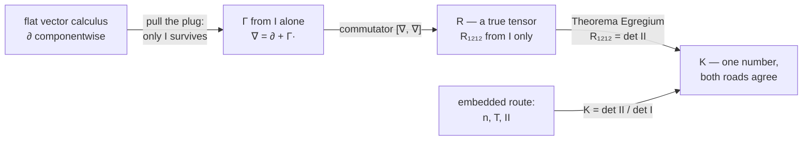

# 8️⃣ Why intrinsic? — vector calculus when the outside is taken away

> **Goal.** Chapters 1–7 never paid for Christoffel symbols: the ambient
> $\mathbb{R}^3$ handed us the normal $n$, the projection $T$, and the second
> fundamental form $II$ for free. This chapter pulls the ambient space away
> and audits what breaks. It explains — starting from ordinary vector
> calculus — why the classical literature leads with Christoffel symbols and
> tensors, why *Gaussian curvature* survives the audit while *mean curvature*
> does not (Gauss's *Theorema Egregium*), and what the `Surface.christoffel`
> array in the Lean code is really for.

---

## 8.1 An audit of flat-space vector calculus

Every tool from vector calculus in $\mathbb{R}^3$ silently uses one of two
facts:

1. **The basis is the same everywhere.** In Cartesian coordinates the basis
   arrows $e_1, e_2, e_3$ are constant, so differentiating a vector field is
   component-wise:

   ```math
   \partial_i V = (\partial_i V^1)\,e_1 + (\partial_i V^2)\,e_2 + (\partial_i V^3)\,e_3,
   ```

   and there is nothing else to track.
2. **The dot product is available at every point.** Gradients, angles,
   Hessians, divergence, curl — `Geodesia/Calculus.lean` implements them all
   as dot products against derivative arrows.

On a parameterized surface we kept both superpowers *by borrowing from the
ambient space*: the surface's own basis arrows $\Phi_u, \Phi_v$ turn from
point to point, but the ambient derivative $D$ is honest $\mathbb{R}^3$
calculus, and the normal $n$ lets us project back down with
$T w = w - (w\cdot n)\,n$ (Ch. 2). Inventory of what the embedding paid for:

| Tool (Ch. 1–3) | What it needs | Supplied by |
|---|---|---|
| ambient derivative $D_v w$ | a surrounding $\mathbb{R}^3$ | the embedding $\Phi$ |
| tangential projection $T$ | the normal $n$ | $\Phi_u\times\Phi_v$ |
| $II$, shape operator $S$, $H$ | the normal $n$ | the embedding |
| geodesic test $T\gamma''=0$ | $T$, hence $n$ | the embedding |
| $I$, lengths, angles, area | dot products of arrows of $\Phi$ | *nothing ambient* |

The last row is the crack in the wall. Gaussian curvature is *computed* from
$II$ — which needs $n$ — yet Chapter 1's cylinder panel showed $K=0$
precisely where the cylinder is a rolled-up plane. Gauss asked the obvious
question: *is $K$ really about the embedding, or only about the surface?*

---

## 8.2 The thought experiment: you are handed only $I$

Imagine a cartographer who lives *inside* the surface and can measure with
string and protractor: lengths of curves, angles between directions, areas
of patches. All of those come from the ruler alone — a tiny displacement
$dq$ has surface arrow $J\,dq$ and squared length $dq^{\mathsf T}I\,dq$.
The cartographer has no $n$, no $T$, no $II$, no cross product: those are
sentences about an outside world she cannot see.

What can she still do? The decisive test is **bending without stretching**.
Roll a flat sheet of paper into a cylinder of radius $R$:

```math
\Phi(s,y) = \Bigl(R\cos\tfrac{s}{R},\; y,\; -R\sin\tfrac{s}{R}\Bigr),
\qquad
\Phi_s = \Bigl(-\sin\tfrac{s}{R},\,0,\,-\cos\tfrac{s}{R}\Bigr),
\quad |\Phi_s| = 1.
```

```math
I = \begin{bmatrix}1&0\\0&1\end{bmatrix},
\qquad
II = \begin{bmatrix}-1/R&0\\0&0\end{bmatrix}.
```

The ruler is the *identity* — the same as the flat plane the paper came
from; that is what "without stretching" means, and it is why every geodesic
of the sheet unrolls to a straight line (Ch. 3, the cone example). The
bending matrix is different, and so are the two curvature summaries:

| | flat plane | rolled cylinder |
|---|---|---|
| $I$ | identity | identity (same!) |
| $II$ | $0$ | $\operatorname{diag}(-1/R,\,0)$ |
| $K$ | $0$ | $0$ (same!) |
| $H$ | $0$ | $-1/(2R)$ (changed!) |

So $I$ and $K$ are properties of the surface *itself*, while $II$ and $H$
are properties of the surface *together with its embedding*. A quantity
computable from $I$ alone — unchanged by any bending — is called
**intrinsic**. Three situations make that notion load-bearing, not
pedantic:

- **No embedding exists.** In general relativity the manifold is spacetime;
  nobody hands you an $\mathbb{R}^3$ (or $\mathbb{R}^4$) to project into.
- **The data is a metric.** A triangle mesh stores edge lengths; a map
  atlas stores charts; neither stores an embedding.
- **You want embedding-proof statements.** "Shortest path", "sum of angles
  of a triangle", "can this be flattened without distortion" must not
  depend on how a modeler happened to place the surface in space.

The rest of the chapter rebuilds, from $I$ alone, each tool that the audit
of §8.1 thought was lost.

---

## 8.3 Rebuilding the derivative: Christoffel symbols from $I$ alone

Chapter 2 introduced the covariant derivative *from the outside in*:
$\nabla_i V = T(\partial_i V)$, and the Christoffel symbols appeared as the
coordinates of the tangent parts $T\Phi_{ij}$. One of its two formulas for
those coordinates never mentions $n$, $\Phi_{ij}$, or any arrow — only the
ruler and its derivatives:

```math
\boxed{\;
\Gamma^k_{\;ij} = \tfrac12\bigl(I^{-1}\bigr)^{k\ell}
\bigl(\partial_i I_{j\ell}+\partial_j I_{i\ell}-\partial_\ell I_{ij}\bigr),
\qquad
(\nabla_i V)^k = \partial_i V^k + \Gamma^k_{\;ij}\,V^j.
\;}
```

The intrinsic move is to **flip the logic**: define $\Gamma$ *by* this
formula, and define $\nabla$ *by* the correction term. Two facts say this is
the right rebuild, not just *a* rebuild:

- **It is forced.** Demanding that the derivative respect the ruler,
  $\nabla_k I_{ij} = 0$ (cyclically in $k,i,j$), and be symmetric in $i,j$,
  gives three linear equations whose unique solution *is* the boxed
  formula. Geometrically $\nabla_k I_{ij} = 0$ says: *parallel-transported
  arrows keep their dot products* — lengths and angles of transported
  arrows do not drift.
- **It agrees with the projection.** On any embedded surface, the $\Gamma$
  built from $I$ equals the coordinates of $T\Phi_{ij}$ from Chapter 2.
  That agreement is a theorem (Gauss–Codazzi, §8.5), not an assumption.

Quick numerical faithfulness checks (both verified):

- **Paraboloid** $z=0.3(x^2+y^2)$ at $(1,0)$: from
  $I=\operatorname{diag}(1.36,1)$ and its exact first derivatives, the
  formula gives $\Gamma^u_{\;uu}=\Gamma^u_{\;vv}=0.264706$ and every other
  entry $0$ — exactly Chapter 2 §2.7's table.
- **Polar plane** ($I=\operatorname{diag}(1,r^2)$): the formula gives
  $\Gamma^r_{\;\theta\theta}=-r$, $\Gamma^\theta_{\;r\theta}=1/r$ — nonzero
  symbols on an *absolutely flat* plane. $\Gamma$ counts how the
  *coordinates* twist, not how the surface bends; keep that distinction,
  it becomes structural in §8.5.

---

## 8.4 Straightest and parallel, without an outside

With $\nabla$ defined, the two workhorse notions of Chapters 2–3 rebuild
verbatim, no normal required:

**Geodesics.** "Tangent part of $\gamma''$ vanishes" becomes

```math
\ddot q^k + \Gamma^k_{\;ij}\,\dot q^i \dot q^j = 0,
```

which is Chapter 3's $I\ddot q + g = 0$ in coefficient clothing. This is
not decoration: `Geodesic.accelChristoffel` in the Lean code contracts exactly this
$\Gamma$ array (`Surface.christoffel`) with the direction numbers, so the
integrator runs entirely in the $(u,v)$-plane and never forms $n$ at
runtime. The intrinsic equation is the code's runtime feed. The vector
route `Geodesic.accelVector` reaches the same acceleration without the
$\Gamma$ array at all; `learn-geodesia/Proofs.lean` proves the two formulas
agree over `ℝ`.

**Parallel transport.** "Keep pointing the same way" becomes
$\nabla_{\dot q} W = 0$ along the curve. Chapter 3 §3.4's conserved
pairings are its corollary: on the sphere, $\sin^2\theta\,\dot\varphi$
stays constant because $\Phi_\varphi$ is a symmetry direction and
$\dot q$ is parallel-transported — a statement a surface-dweller can make
without ever seeing an ambient space.

---

## 8.5 Curvature without an outside: the commutator and the Theorema Egregium

In flat Cartesian coordinates, differentiating twice is order-independent:
$[\partial_i,\partial_j] = 0$. The rebuilt $\nabla$ generally does **not**
commute, and the failure — measured on tangent fields $V$ — is the surface's
curvature seen from inside. With the convention

```math
\bigl[\nabla_i,\nabla_j\bigr]V^k
= \Bigl(\partial_i\Gamma^k_{\;jm}-\partial_j\Gamma^k_{\;im}
+\Gamma^k_{\;i\ell}\Gamma^\ell_{\;jm}
-\Gamma^k_{\;j\ell}\Gamma^\ell_{\;im}\Bigr)V^m
=: R^k{}_{mij}\,V^m,
```

define the numbers $R^k{}_{mij}$ (the *Riemann tensor*; lowering the first
index with $I$ gives $R_{lmij}$). Three verifications on surfaces we
already know, all numerically checked:

- **Polar plane:** the commutator matrix is identically $0$, so
  $R_{r\theta r\theta}=0$ — flatness is coordinate-independent, even though
  $\Gamma\neq0$ there. $\Gamma$ was chart-twist; $R$ is curvature.
- **Unit sphere** ($I=\operatorname{diag}(1,\sin^2\theta)$): the commutator
  has single independent entry $C^\theta{}_\varphi=\sin^2\theta$, i.e.
  $R_{\theta\varphi\theta\varphi} = \sin^2\theta$, and
  $K = R_{\theta\varphi\theta\varphi}/\det I = 1$. ✓
- **Paraboloid at $(1,0)$:** computing the commutator directly on arrows
  (differentiate the tangent fields, project with $T$, no symbols at all)
  gives

  ```math
  [\nabla_x,\nabla_y]\,\Phi_u = -0.264706\,\Phi_v,
  \qquad
  [\nabla_x,\nabla_y]\,\Phi_v = +0.194637\,\Phi_u,
  ```

  and the pure-$I$ $\Gamma$ route reproduces both numbers exactly.

Now the theorem. On an embedded surface, the *same* commutator can be
computed with Chapter 1–2 tools in four short moves:

1. **Split the derivative** (Ch. 2): for a tangent field $V$,
   $\;\partial_i V = \nabla_i V + II(V,\Phi_i)\,n$.
2. **Weingarten** (Ch. 1): the normal tips at the shape operator's rate,
   $\;\partial_i n = -S^k{}_i\,\Phi_k$ with $S = I^{-1}II$.
3. **Commute and project.** Ambient second partials commute,
   $\partial_i\partial_j V = \partial_j\partial_i V$; projecting that
   symmetry with $T$ (the normal pieces cancel through Weingarten) leaves

   ```math
   \bigl[\nabla_i,\nabla_j\bigr]V
   = II(V,\Phi_j)\,S(\Phi_i) - II(V,\Phi_i)\,S(\Phi_j),
   ```

   i.e. $R^k{}_{mij} = II_{jm}S^k{}_i - II_{im}S^k{}_j$.
4. **Contract.** With $R_{1212} := I_{1k}\,R^k{}_{2\,1\,2}$ and
   $I\,S = II$:

   ```math
   \boxed{\;R_{1212} = II_{11}II_{22}-II_{12}^2 = \det II
   \;=\; K\,\det I.\;}
   ```

Read the box from right to left: $K\,\det I$ is built from $II$ (extrinsic,
needs $n$); $R_{1212}$ is built from $\Gamma$ (intrinsic, only $I$). They
are *the same number* — on the paraboloid at $(1,0)$:
$R_{1212}=0.264706=\det II$, so
$K = 0.264706/1.36 = 0.194637$, matching Chapter 1's `gaussK`. That is
Gauss's **Theorema Egregium** ("remarkable theorem"): Gaussian curvature is
intrinsic. It is why the audit of §8.1 ends well — the surface-dweller can
measure curvature with string and protractor:

- parallel-transport an arrow around a small closed loop: it comes back
  rotated by $K \times(\text{enclosed area})$;
- sum the angles of a small geodesic triangle: the excess over $\pi$ is
  $K\times(\text{area})$ (unit sphere, three right angles: excess
  $\pi/2$, area $\pi/2$, $K=1$ ✓).



And the negative result is just as instructive: $H$ satisfies no such
identity (the cylinder: $K=0$ but $H=-1/(2R)$), because $H$ is genuinely a
statement about the embedding.

---

## 8.6 Tensors: bookkeeping that survives coordinate changes

You already own tensors; they just were not named. Two examples from
ordinary vector calculus:

- **The ruler.** Reparametrize $q \mapsto q'$ with $M = \partial q/\partial q'$.
  New tangent arrows are old ones composed with $M$, so the Gram matrix
  transforms as $I' = M^{\mathsf T} I\, M$ — the defining law of a
  $(0,2)$ **tensor**. The chain rule *is* the transformation law.
- **The gradient.** Its components transform by the inverse-transposed
  Jacobian for exactly the same chain-rule reason: a **covector**.

A tensor is any object whose components transform linearly under chart
changes (with $M$ for covariant slots, $M^{-1}$-type factors for
contravariant ones). The payoff: an equation whose terms are tensors, all
contracted, is **true in every chart once true in one**. That is what makes
"the tangential part of $\gamma''$ vanishes" a geometric statement rather
than a coordinate accident: its component form
$\ddot q^k + \Gamma^k{}_{ij}\dot q^i\dot q^j = 0$ holds in *every*
parametrization.

The Christoffel symbols are pointedly **not** tensors. Under
reparametrization they obey

```math
\Gamma'^k{}_{ij} = (M^{-1})^k{}_\ell\,\Gamma^\ell{}_{mn}\,M^m{}_i M^n{}_j
\;+\;(M^{-1})^k{}_\ell\,\partial^2_{ij}q^\ell,
```

and the second, inhomogeneous term is exactly the "grid twist" of Chapter 2
§2.5. Verification on the flat plane, Cartesian $\to$ polar
($\Gamma_{\text{cart}} = 0$): the extra term alone produces
$\Gamma^r_{\;\theta\theta}=-r$, $\Gamma^\theta_{\;r\theta}=1/r$,
$\Gamma^\theta_{\;\theta\theta}=0$ ✓. So $\Gamma=0$ in one chart and
$\Gamma\neq0$ in another is no contradiction — the correction terms are
chart-dependent by design; the curvature $R$ they build up *is* a tensor,
which is why $R=0$ (flat) holds in both.

| Object | Type | From $I$ alone? |
|---|---|---|
| $I$, $I^{-1}$ | $(0,2)$ / $(2,0)$ tensor | ✅ |
| $II$, $S = I^{-1}II$, $H$ | $(0,2)$ / $(1,1)$ / scalar | ❌ needs $n$ |
| $\Gamma^k{}_{ij}$ | connection coefficients — *not* a tensor | ✅ formula, chart-dependent values |
| $R^k{}_{mij}$, $R_{1212}$ | $(1,3)$ / $(0,4)$ tensor | ✅ |
| $K$ | scalar | ✅ (Theorema Egregium) |

This is the honest answer to "is this about tensors?": tensors are the data
format in which "computable from $I$ alone" becomes checkable line by line.
Intrinsic geometry without tensors is a slogan; with them, it is algebra
that any chart agrees on.

---

## 8.7 Where this lands in the code (and when you actually need it)

```lean
Surface.christoffel s x y  -- Γ^k_ij by the pure-I formula (exact ∂I via dMetricEntry)
Surface.metricI s x y      -- the ruler I
Surface.gaussK s x y       -- K = det II / det I  (extrinsic road to an intrinsic number)
Geodesic.accelChristoffel s st  -- q̈ = -(Γ·q̇)q̇ : the ODE feed runs in the (u,v)-plane
Geodesic.accelVector s st       -- the same q̈ from gVector and I⁻¹ (no Γ array)
```

Two code-level remarks worth noticing:

- `Surface.christoffel` needs only $I$ and its *first* partials — and
  $\partial_k I_{ij} = \Phi_{ik}\cdot\Phi_j + \Phi_i\cdot\Phi_{jk}$ needs
  only *second* partials of $\Phi$, which `Smooth2` stores exactly. The
  geodesic ODE therefore runs on exact derivatives end to end.
- The Riemann route to $K$ needs $\partial\Gamma$, i.e. second partials of
  $I$ — which involve *third* partials of $\Phi$. `Smooth2` stops at second
  order, which is a practical reason the code computes
  $K = \det II/\det I$ instead: an extrinsic expression for an intrinsic
  number, justified by the Theorema Egregium (see Exercise 7).

When the embedded vector route suffices — this whole track, since $\Phi$ is
always in hand — prefer arrows and $T$: fewer symbols, the geometry stays
visible. When the intrinsic machinery is unavoidable:

- **no embedding exists** (general relativity, abstract manifolds);
- **the input is metric data** (mesh edge lengths, chart atlases);
- **the statement must be bending-proof** (isometry invariants;
  "can this surface be flattened?" is answered by $K$ alone);
- **you generalize** to dimensions where there is no picture to lean on.

One sentence to close the loop with Chapter 2 §2.2: *Christoffel symbols
are the price of computing without an ambient space, and tensors are the
guarantee that what you compute does not depend on where you paid.*

---

## 8.8 Exercises

1. **Polar flatness.** From $I=\operatorname{diag}(1,r^2)$ compute all
   $\Gamma$'s, assemble the commutator matrix of §8.5, and show
   $R\equiv 0$. Then say in one sentence why "nonzero $\Gamma$ on a flat
   plane" is not a contradiction.
2. **Sphere.** With $I=\operatorname{diag}(1,\sin^2\theta)$ compute
   $\Gamma^\theta{}_{\varphi\varphi}=-\sin\theta\cos\theta$ and
   $\Gamma^\varphi{}_{\theta\varphi}=\cot\theta$, form the commutator, and
   verify $R_{\theta\varphi\theta\varphi}=\sin^2\theta$, i.e. $K=1$.
3. **Paraboloid by hand.** Reproduce §8.5's commutator arrows at $(1,0)$
   using the $\Gamma$ table of §8.3 and the derivatives of $I$ — or do it
   the arrow way (differentiate $T\partial_i\Phi_j$ numerically) and
   confirm $R_{1212} = 0.264706$.
4. **$\Gamma$ is not a tensor.** For $q = (r\cos\theta, r\sin\theta)$ and
   $M = \partial(x,y)/\partial(r,\theta)$, check that the inhomogeneous
   term alone reproduces $\Gamma^r{}_{\theta\theta}=-r$,
   $\Gamma^\theta{}_{r\theta}=1/r$, $\Gamma^\theta{}_{\theta\theta}=0$
   from $\Gamma_{\text{cart}}=0$.
5. **Paper cylinder.** Verify $I=\mathrm{Id}$ and $II_{ss}=-1/R$ for
   $\Phi(s,y) = (R\cos(s/R), y, -R\sin(s/R))$; conclude $K=0$ as for the
   plane but $H=-1/(2R)$, and explain which of the two survives re-rolling.
6. **Angle excess.** On the unit sphere take the triangle bounded by the
   equator and two meridians $90^\circ$ apart: three right angles, area
   $\tfrac18\cdot 4\pi = \pi/2$, excess $\pi/2$; check
   $K = \text{excess}/\text{area} = 1$ against §8.5.
7. **Intrinsic $K$ in code.** In Python (NumPy), compute $R_{1212}$ for the
   paraboloid from `christoffel`-style $\Gamma$ values (finite-difference
   the $\Gamma$'s) and check $K = R_{1212}/\det I = 0.194637$ at $(1,0)$.
   Then explain why extending this to the Lean code would require third
   partials of $\Phi$ (§8.7).
8. **Codazzi (the other half).** Differentiate $II_{ij} = n\cdot\Phi_{ij}$,
   insert Weingarten $\partial_i n = -S^k{}_i\Phi_k$, and show
   $\nabla_k II_{ij} = \nabla_j II_{ik}$: the bending field has no
   intrinsic divergence. Together with §8.5's step 3 this completes the
   Gauss–Codazzi pair that ties $\Gamma$, $II$ and $\partial n$ into one
   consistent story.
