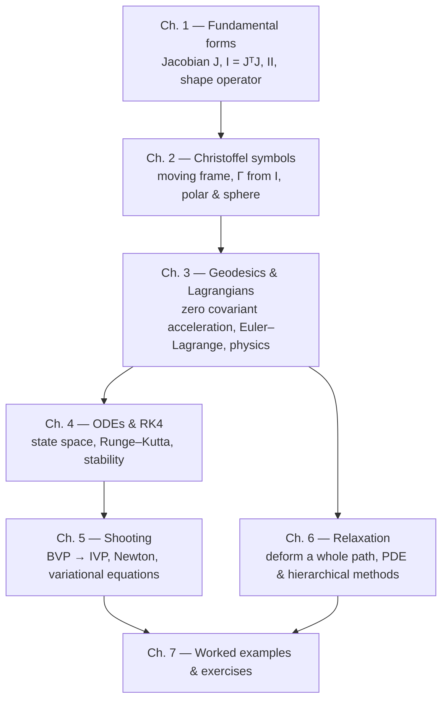

# 🌐 Geodesia → fundamental forms, geodesics, shooting & relaxation

This is the learning track for `projects/geodesia`. The Lean code gives you an
exact differential-geometry sandbox; these notes explain **why** the formulas
look the way they do, with a bias toward *pictures, Jacobians and physics*.

The central object is a **parameterized surface**

```math
\Phi : \mathbb{R}^2 \to \mathbb{R}^3,
\qquad (u,v) \mapsto \Phi(u,v) = \big(x(u,v),\,y(u,v),\,z(u,v)\big).
```

Everything else is built from two derivatives of $\Phi$:

| Object | Formula | What it measures |
|---|---|---|
| Jacobian | $J = [\Phi_u\ \ \Phi_v]$ | how parameter velocity becomes 3-D velocity |
| First fundamental form | $I = J^{\mathsf T}J$ | lengths, angles, area — the *ruler* |
| Second fundamental form | $II = [\,n\cdot\Phi_{ij}\,]$ | how the surface bends — the *bending* |
| Christoffel symbols | tangent part of $\Phi_{ij}$ | how the coordinate grid twists |
| Geodesic | zero covariant acceleration | inertial / shortest path |

The one equation that ties it all together is the **Gauss formula**

```math
\boxed{\;\Phi_{ij} = \Gamma^k_{\;ij}\,\Phi_k + II_{ij}\,n\;}
```

The second derivative of the embedding has a **tangent part** (the Christoffel
symbols) and a **normal part** (the second fundamental form). Geodesics keep
only the tangent part and set it to zero.

---

## 🧭 Reading map



Suggested paths:

- **“I want to understand the code’s first/second fundamental forms.”**
  Read Ch. 1, then the code map at the end of it.
- **“I never understood shooting.”**
  Read Ch. 3 (the ODE), Ch. 4 (RK4), then Ch. 5 slowly.
- **“I want the relaxation algorithm.”**
  Read Ch. 1–3, then Ch. 6.
- **“I want the physics/Lagrangian view.”**
  Read Ch. 3 and the Hamiltonian section of Ch. 4.

---

## 📚 Sources

The numerical algorithms and conventions follow David Eberly’s Geometric Tools
notes (Creative Commons Attribution 4.0):

- [*Geodesics on a Parameterized Surface*](https://www.geometrictools.com/Documentation/GeodesicsOnSurface.pdf)
  — metric, Christoffel symbols, the geodesic ODE, $J^{\mathsf T}J=G$,
  $\xi = G^{-1}J^{\mathsf T}y'$.
- [*Computing Geodesics on a Riemannian Manifold*](https://www.geometrictools.com/Documentation/RiemannianGeodesics.pdf)
  — §2 shooting methods (standard, modified for unknown length, alternate
  parameterization), §3 continuous relaxation by PDEs, §4 Dijkstra, §5
  hierarchical relaxation.
- [*Principal Curvatures of Surfaces*](https://www.geometrictools.com/Documentation/PrincipalCurvature.pdf)
  — quadratic forms, graph curvature $II = \operatorname{Hess} f/\sqrt{1+|\nabla f|^2}$.
- [*Mesh Differential Geometry*](https://www.geometrictools.com/Documentation/MeshDifferentialGeometry.pdf)
  — $I=J^{\mathsf T}J$, $II=[N\cdot P_{ij}]$, generalized eigenproblem
  $II\,y=\kappa\,I\,y$.

The notes below are an independent explanation; the PDFs are the primary
source for the algorithms.

---

## 🗺️ Code map

| File | What lives there |
|---|---|
| `Geodesia/Diff.lean` | `Diff` (unary function + derivatives) and `Smooth2` (bivariate function + all first/second partials). **Derivatives are data, not finite differences.** |
| `Geodesia/Vec.lean` | `Vec2`, `Vec3`, dot/cross/norm. |
| `Geodesia/Surface.lean` | `Surface`, `ofHeight`, exact `dPhi`, `d2Phi`, normals. |
| `Geodesia/Calculus.lean` | gradient, Hessian, Laplacian, divergence, curl, Jacobian determinant, directional derivative along a curve. |
| `Geodesia/Curvature.lean` | `I`, `II`, Christoffel symbols, shape operator, `K`, `H`, principal curvatures. |
| `Geodesia/Geodesic.lean` | geodesic RHS, RK4, energy, tangent frame, `shoot`. |
| `Main.lean` | a small exact demo on a paraboloid and the unit sphere. |

Run it:

```bash
cd projects/geodesia
lake build
lake exe geodesia
```

The demo should print exact-looking numbers (they are ordinary `Float`
rounding, not finite-difference noise), including `K = 1` on the unit sphere
and constant geodesic energy.

---

## 🔤 Notation

- Indices $i,j,k,\ell,m$ run over the two parameters $\{u,v\}$, i.e. $\{1,2\}$.
- $\Phi_i = \partial\Phi/\partial q^i$, $\Phi_{ij} = \partial^2\Phi/\partial q^i\partial q^j$.
- $q(s) = (u(s),v(s))$ is a curve in parameter space; $\gamma(s)=\Phi(q(s))$ is the curve on the surface.
- $\dot q = dq/ds$, $\ddot q = d^2q/ds^2$.
- $g_{ij} = I_{ij} = \langle \Phi_i,\Phi_j\rangle$, $g^{ij}$ is the inverse matrix.
- $n$ is the unit normal; $II_{ij} = \langle n,\Phi_{ij}\rangle$.
- Repeated indices are summed.

A useful mental dictionary:

| Differential geometry | Physics / mechanics |
|---|---|
| parameter coordinates $q^i$ | generalized coordinates |
| metric $g_{ij}$ | mass matrix / inertia tensor |
| Christoffel $\Gamma^k_{\;ij}$ | fictitious force (centrifugal, Coriolis) |
| geodesic | free-particle trajectory with no external force |
| covariant derivative | derivative corrected for rotating basis |
| $II$ | bending / normal force needed to stay on the surface |
| shape operator | linear map “bend in direction $v$” |

---

## 🖼️ The three pictures to keep in mind

1. **The ruler.** $I$ is what you measure *inside* the surface: a tiny
   displacement $dq=(du,dv)$ has length squared
   $ds^2 = E\,du^2 + 2F\,du\,dv + G\,dv^2$.
2. **The bending.** $II$ is what an outside observer sees: how fast the
   normal tilts as you walk, or equivalently how much the surface leaves its
   tangent plane.
3. **The twist.** $\Gamma$ is what makes a *coordinate grid* curve. On a flat
   plane in polar coordinates the grid lines are straight in space, yet the
   basis vectors $e_r,e_\theta$ rotate as you move — $\Gamma$ records exactly
   that rotation. A geodesic is a curve whose own acceleration is pure
   bending, with no “grid twist” left over.

Chapters 1–2 make pictures 1–3 precise. Chapters 3–6 turn them into
algorithms.
