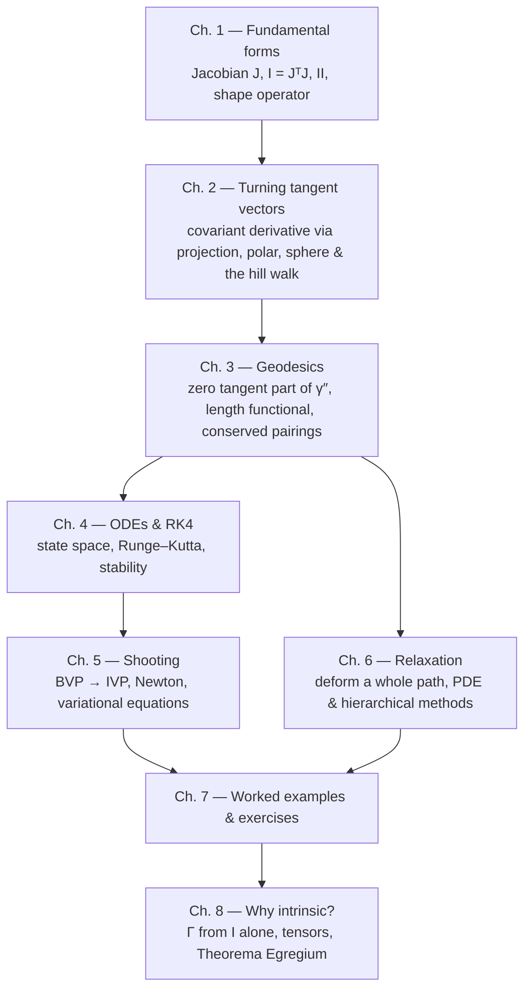

# 🌐 Geodesia → fundamental forms, geodesics, shooting & relaxation

This is the learning track for `projects/geodesia`. The Lean code gives you an
exact differential-geometry sandbox; these notes explain **why** the formulas
look the way they do, in plain *vector math*: dot products, matrices and
concrete vectors — no hidden vocabulary.

The central object is a **parameterized surface**

```math
\Phi : \mathbb{R}^2 \to \mathbb{R}^3,
\qquad (u,v) \mapsto \Phi(u,v) = \big(x(u,v),\,y(u,v),\,z(u,v)\big).
```

Everything else is built from two derivatives of $\Phi$:

| Object | Formula | What it measures |
|---|---|---|
| Jacobian | $J = [\Phi_u\ \ \Phi_v]$ | turns a 2-D parameter direction into the actual 3-D tangent vector |
| First fundamental form | $I = J^{\mathsf T}J$ | lengths, angles, area — the *ruler* |
| Second fundamental form | $II = [\,n\cdot\Phi_{ij}\,]$ | how the surface bends — the *bending* |
| Tangential projection | $T w = w-(w\!\cdot\! n)\,n$ | the *surface part* of any 3-D vector |
| Geodesic | $T\gamma'' = 0$ | locally straightest / shortest path |

The one equation that ties it all together is the **Gauss split** — an
everyday fact about one vector in three parts:

```math
\boxed{\;\Phi_{ij} \;=\; \underbrace{T\,\Phi_{ij}}_{\text{tangent part (turning)}} \;+\; \underbrace{II_{ij}\,n}_{\text{normal part (bending)}}\;}
```

The second derivative of the embedding has a **tangent part** — an honest
3-D vector, the *covariant derivative* of Chapter 2 — and a **normal part**
(the second fundamental form). Geodesics keep only the tangent part and set
it to zero. Should you ever want the tangent part *in numbers*, expand it in
the basis $\{\Phi_u,\Phi_v\}$; those expansion coefficients are what
textbooks call **Christoffel symbols** — a coordinate bookkeeping of one
projection, not the subject itself (see Ch. 2 §2.2 for why the literature
leads with them).

> **Why vector calculus first?** Christoffels dominate the classical
> literature because intrinsic geometry (relativity, abstract manifolds) has
> *no ambient space to project onto* — coefficients and their must-track
> corrections are all you get. Here we always have the embedding $\Phi$, so
> every derivative is an ordinary $\mathbb{R}^3$ vector and every correction
> is one subtraction (`T w = w - (w·n)n`). Fewer symbols, no index
> gymnastics, and the geometry stays visible in the object itself. Christoffels
> reappear only where they are genuinely useful: intrinsic-only data, and as
> the arrays the Lean code stores to feed ODEs.

---

## 🧭 Reading map



Suggested paths:

- **“I want to understand the code’s first/second fundamental forms.”**
  Read Ch. 1, then the code map at the end of it.
- **“I never understood shooting.”**
  Read Ch. 3 (the ODE), Ch. 4 (RK4), then Ch. 5 slowly.
- **“I want the relaxation algorithm.”**
  Read Ch. 1–3, then Ch. 6.
- **“I want the variational view.”**
  Read Ch. 3 (length functional and conserved pairings) and Ch. 6 (discrete
  minimisation).
- **“I want the vectors made into honest algebra.”**
  Read [**GA_VIEW.md**](GA_VIEW.md) — a side supplement, no chapter: the same
  surfaces in the geometric algebra $\mathrm{Cl}_3$, where the tangential
  projection is half a sandwich product, the tangent plane is one blade, the
  geodesic test is a single wedge $\gamma''\wedge n = 0$, and Darboux
  scalars are the coefficients of one rotor's rate. Read it after Ch. 3.
- **“Why do textbooks insist on Christoffel symbols and tensors?”**
  Read Ch. 8 — it audits what breaks when the ambient space is taken away
  and rebuilds vector calculus from the ruler $I$ alone.

---

## 📚 Sources

The numerical algorithms and conventions follow David Eberly’s Geometric Tools
notes (Creative Commons Attribution 4.0):

- [*Geodesics on a Parameterized Surface*](https://www.geometrictools.com/Documentation/GeodesicsOnSurface.pdf)
  — the Gram matrix, Christoffel symbols, the geodesic ODE, $I=J^{\mathsf T}J$,
  $\xi = I^{-1}J^{\mathsf T}y'$.
- [*Computing Geodesics on a Riemannian Manifold*](https://www.geometrictools.com/Documentation/RiemannianGeodesics.pdf)
  — §2 shooting methods (standard, modified for unknown length, alternate
  parameterization), §3 continuous relaxation by PDEs, §4 Dijkstra, §5
  hierarchical relaxation.
- [*Principal Curvatures of Surfaces*](https://www.geometrictools.com/Documentation/PrincipalCurvature.pdf)
  — quadratic forms, graph curvature $II = \operatorname{Hess} f/\sqrt{1+|\nabla f|^2}$.
- [*Mesh Differential Geometry*](https://www.geometrictools.com/Documentation/MeshDifferentialGeometry.pdf)
  — $I=J^{\mathsf T}J$, $II=[N\cdot P_{ij}]$, generalized eigenproblem
  $II\,y=\kappa\,I\,y$.

The notes below are an independent explanation; the PDFs are the primary
source for the algorithms.

---

## 🗺️ Code map

| File | What lives there |
|---|---|
| `Geodesia/Diff.lean` | `Diff` (unary function + derivatives) and `Smooth2` (bivariate function + all first/second partials). **Derivatives are data, not finite differences.** |
| `Geodesia/Vec.lean` | `Vec2`, `Vec3`, dot/cross/norm. |
| `Geodesia/Surface.lean` | `Surface`, `ofHeight`, exact `dPhi`, `d2Phi`, normals. |
| `Geodesia/Calculus.lean` | gradient, Hessian, Laplacian, divergence, curl, Jacobian determinant, directional derivative along a curve. |
| `Geodesia/Curvature.lean` | `I`, `II`, tangent-part coordinates (`Surface.christoffel`), shape operator, `K`, `H`, principal curvatures. |
| `Geodesia/Geodesic.lean` | geodesic RHS, RK4, energy, tangent frame, `shoot`. |
| `Main.lean` | a small exact demo on a paraboloid and the unit sphere. |

Run it:

```bash
cd projects/geodesia
lake build
lake exe geodesia
```

The demo should print exact-looking numbers (they are ordinary `Float`
rounding, not finite-difference noise), including `K = 1` on the unit sphere
and constant geodesic energy.

---

## 🔤 Notation

- Indices $i,j,k,\ell,m$ run over the two parameters $\{u,v\}$, i.e. $\{1,2\}$.
- $\Phi_i = \partial\Phi/\partial q^i$, $\Phi_{ij} = \partial^2\Phi/\partial q^i\partial q^j$.
- $q(s) = (u(s),v(s))$ is a curve in parameter space; $\gamma(s)=\Phi(q(s))$ is the curve on the surface.
- $\dot q = dq/ds$, $\ddot q = d^2q/ds^2$.
- $I = J^{\mathsf T}J$ is the Gram matrix of the tangent vectors, with entries
  $I_{ij} = \Phi_i\cdot\Phi_j$; $I^{-1}$ is its inverse.
- $n$ is the unit normal; $II_{ij} = \langle n,\Phi_{ij}\rangle$.
- Repeated indices are summed.

A useful dictionary in the other direction (older books use these):

| Older name | Meaning here |
|---|---|
| first fundamental form $E, F, G$ | the Gram matrix entries $I_{ij}=\Phi_i\cdot\Phi_j$ |
| second fundamental form $e, f, g$ | the normal dot products $II_{ij}=n\cdot\Phi_{ij}$ |
| metric tensor | the Gram matrix $I=J^{\mathsf T}J$ |
| Christoffel $\Gamma^k_{\;ij}$ | coordinates of the *tangent part* $T\Phi_{ij}$ (a derived view of one projection) |
| covariant derivative | derivative corrected for the rotating basis vectors |
| shape operator | the linear map $S=I^{-1}II$ |
| Riemann tensor (2-D) | the one curvature number $R_{1212}=K\,\det I$, built from $\Gamma$ alone (Ch. 8) |

---

## 🖼️ The three pictures to keep in mind

1. **The ruler.** $I$ is what you measure *inside* the surface: a tiny
   displacement $dq=(du,dv)$ has 3-D tangent vector $J\,dq$ and length squared
   $ds^2 = dq^{\mathsf T} I\, dq$.
2. **The bending.** $II$ is what an outside observer sees: how fast the
   normal tilts as you walk, or equivalently how much the surface leaves its
   tangent plane.
3. **The twist.** What makes a *coordinate grid* tricky: on a flat plane in
   polar coordinates the grid lines are straight in space, yet the basis
   arrows rotate as you move — the tangent parts of the second-derivative
   arrows (equivalently, their coordinate bookkeeping $\Gamma$) record
   exactly that rotation. A geodesic is a curve whose own acceleration is
   pure bending, with no “grid twist” left over.

Chapters 1–2 make pictures 1–3 precise. Chapters 3–6 turn them into
algorithms. Chapter 8 explains why the intrinsic, coefficients-first
viewpoint (Christoffel symbols, tensors, curvature from $I$ alone) exists
at all — by auditing exactly what breaks when the ambient space is taken
away.
