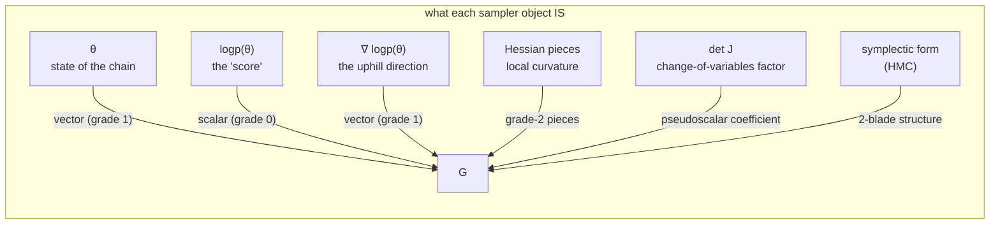
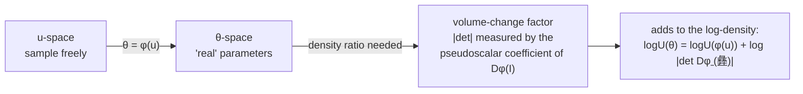
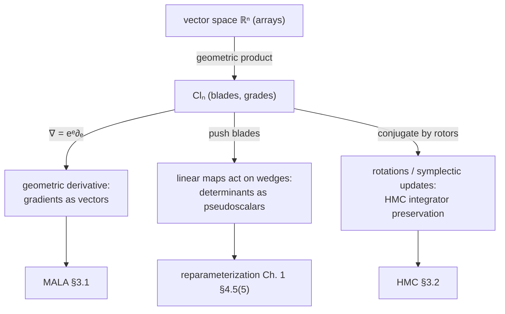

# Geometric Algebra view — derivatives and Jacobians as blades

*A supplement to [TUTORIAL.md](TUTORIAL.md) (Ch. 1) and [SAMPLERS.md](SAMPLERS.md) (Ch. 2).
Nothing in the code changes; this chapter re-reads the same objects through the lens
of geometric algebra (GA) to see what the samplers are *touching*.*

> Motivation: Ch. 1 already showed the sampler works on **differences of scalars**
> and the coin flip `log u < Δ`. GA asks a sharper question: *what kind of object
> is each thing in the sampler — a vector, a scalar, a bivector?* Gradients turn
> out to be honest vectors, change-of-variables Jacobians turn out to be
> pseudoscalar coefficients, and the "shape" of parameter space stops being a
> numbers-in-a-row and starts being directed geometry.

---

## §1 The sampler's cast of objects, graded

GA upgrades a vector space to an **algebra**: you have unit basis vectors
`e₁ … eₙ`, and taking *geometric products* of them produces higher-grade
elements — oriented planes (`eᵢeⱼ`, a *bivector*), oriented volumes
(`eᵢeⱼeₖ` …), up to the top-grade **pseudoscalar** `I = e₁e₂⋯eₙ`.



Samplers don't *need* this grading — but a surprising amount of their correct
behavior becomes *legible* through it, and (§5) the change-of-variables story
we hand-waved in Ch. 1 §4.5 item 5 becomes mechanical.

---

## §2 Quick GA toolbelt (just 4 laws)

Everything below uses only these, with `a, b` vectors and `α` a scalar:

| # | Law | Meaning |
|---|---|---|
| 1 | `eᵢ eᵢ = 1` | parallel vectors multiply like numbers (norm lives here) |
| 2 | `eᵢ eⱼ = −eⱼ eᵢ` (i ≠ j) | orthogonal directions *anticommute* |
| 3 | `a·b = ½(ab + ba)`, `a∧b = ½(ab − ba)` | geometric product splits into inner (symmetric) + outer (antisymmetric) |
| 4 | `a∧b` is a **bivector**: an oriented, scaleable plane element — `a∧b = −b∧a`, so parallel vectors wedge to zero | orientation now lives in the object, not in your head |

Products of unit vectors assemble into a basis: `{1, e₁, e₂, e₁e₂}` — a
`2 + 2` decomposition of the plane. Grade filtering (`⟨M⟩ₖ`) picks out exactly
the grade-`k` parts of a multivector `M`.

---

## §3 Grades that Ch. 1's sampler runs on

### 3.1 logp(θ) is grade-0 — and that's *why* only Δ matters

`logPosterior : ℝⁿ → ℝ` outputs a pure scalar (grade 0, i.e. `⟨logpost⟩₁ = 0`).
Ch. 1 §5's *entire proof* (`diff_shift_rat` → `decision_shift_rat`) is the
statement:

> **adding the same scalar to a grade-0 field does not change grade-0 differences.**

GA grades don't change that — they make the *type distinction* visible: the
sampler's coin flip takes `Δ`, a `grade-0` object, and turns it into a Boolean.
`log u` is also grade-0. No vectors ever cross the accept threshold directly,
which is also why `θ` and `ν` live "on the left" of the coin flip and never get
compared with each other.

### 3.2 ∇logp is a *geometric derivative*, not a coordinate sweep

Ch. 2 said MALA/HMC need `∇ logp`. In GA, the derivative operator is

```text
∇ = eᵉ ∂ₑ               (sum over basis directions, Einstein-style)
```

a **vector-valued differentiation operator**. Applying it to the scalar field
`f = logp` gives:

```text
∇f = eᵉ ∂ₑ f          ← the gradient, a grade-1 element by construction
```

This is a cleaner story than "n items of partial derivatives stacked in a row":
the gradient is a *direction* — the vector whose `·`-inner product with any
unit direction `u` you could, if you wanted to walk along `u` afterwards. That
is literally MALA's proposal (`θ' = θ + h·∇f + √(2h)·ε`): the drift is the
gradient *vector*, the noise is an isotropic random vector, and the two get
added as honest GA sums.

**Directional derivatives are free:** for any direction `n`,
`n·∇f` is one scalar. So "what does moving along n do to my posterior *score*"
— a matrix free-arithmetic operation in classical Hessian-Jacobian land — is
just an inner product with the gradient vector.

### 3.3 The Hessian: symmetric part = grade-2 bookkeeping

The second derivative `∇∇f` is a linear map (matrix, if you must). GA's
distinction-free view:

```text
⟨∇∇f⟩ₛᵧₘ   — the symmetric part   ← curvature along each direction
⟨∇∇f⟩ₐₙₜᵢ   — the antisymmetric part — irrelevant for scalar f: it is
                                necessarily zero (∂ᵢ∂ⱼf = ∂ⱼ∂ᵢf), which is
                                the GA way of saying the Hessian is symmetric
```

The GA framing surfaces a real algorithmic consequence used in Ch. 2 §3
(momentum-shaped HMC): the *mass matrix* `M` you mix in is also symmetric —
so pre-conditioning HMC is "rewrite the coordinates by a symmetric map",
not "arbitrary matrix soup".

---

## §4 Change of variables: the Jacobian emerges as a pseudoscalar

This is where GA is at its best. Recall Ch. 1 §4.5 item 5 (reparameterization):
sample `u = log σ` freely, get `σ = exp(u)`, and "the model's log-density
carries the Jacobian correction". Textbooks then say "add `+ log σ`" with a
citation to matrix algebra. Here's the non-memory version.

A coordinate change in `d` dimensions is a map `φ : u ↦ θ`. Its differential
`Dφ` at each point is a linear map on tangent vectors. **In GA every linear map
acts on everything by "pushing" through it, especially on blades:**

```text
Dφ(eᵤ ∧ eᵥ) = Dφ(eᵤ) ∧ Dφ(eᵥ)        (fun fact: always true for linear maps)
```

Now push the *pseudoscalar* — the volume element — through `Dφ`:

```text
Dφ(I) = Dφ(e₁ ∧ ⋯ ∧ e_d) = (Dφ e₁) ∧ ⋯ ∧ (Dφ e_d)
      = (det Dφ) · I        ◄── pseudoscalar picks up exactly one scalar
```

**That scalar is the Jacobian determinant.** Not an abuse of notation — the
*entire role* of the top-grade coefficient in a change of variables is to tell
you how oriented volume transforms. And since volumes are unoriented in
distributions, the measure correction is the *magnitude* of that coefficient.



For the running example `σ = exp(u)` (1-D), `Dφ = e` (the one-direction
linear map "multiply by eᵘ"), so `Dφ(I₁) = eᵘ I₁`, the coefficient is `eᵘ`,
and `log |…| = u = log σ` — precisely the "+log σ" you'd have quoted by
memory before. GA turns the *memory trick* into a *one-line computation pattern*
that works every time: **push the volume blade, read off the scalar.**

### Honest audit

In 1-D and diagonal-friendly reparameterizations the pseudoscalar coefficient is
the whole story (Ch. 1's model: `μ ~ N(0,25)` unconstrained — no correction
needed, exactly because `Dφ = identity` reduces `Dφ(I) → I`, coefficient 1).
For *constrained and entangled* reparameterizations (e.g. sampling a
correlation parameter) the machinery is identical, only the map `φ` is more
interesting.

---

## §5 HMC's momentum and the symplectic 2-blade

Ch. 2 §3.2/3.3 introduced HMC: add a momentum `p`, then roll the ball. GA
points out something cute about the "ball":

- `(θ, p)` is now a `2d`-dimensional state — `θ` a position vector, `p` a
  *velocity-like* vector. The Hamiltonian `H(θ,p) = −logp(θ) + ½ pᵀ M⁻¹ p` puts
  the kinetic term as the symmetric-norm of `p` (grade-0, from law 1: `p·p`).
- The rule that leapfrog integrators conserve (`"I dp ∧ dθ"`) is literally a
  **2-blade invariant**: the symplectic form `dθ ∧ dp` is preserved by the
  flow. In GA language: *the update map is a rotor-like transformation with
  respect to the symplectic structure*, and the reason leapfrog "conserves
  energy up to roundoff" over long trajectories is that it stays inside the
  symmetry group of that blade.
- This is why MALA (one cousin of HMC done step-by-step, §3.1) trades
  dimension badly and leapfrog HMC does not — MALA applies partial rotation
  per coordinate while leapfrog keeps the blade intact across a whole
  trajectory.

This is perspective, not new math: it explains *what the integrator is
preserving*, which classical presentations bury in "symplectic" jargon.

---

## §6 What GA does *not* help with (honesty section)

- It does **not** change the correctness story. Ch. 1's proofs
  (`diff_shift_rat` etc.) need only scalars; GA adds nothing there, and the
  proofs remain the load-bearing correct-ness of the whole project. Think of
  GA as an *explanatory layer*, not a new sampler.
- Core Lean 4 has no GA library; Mathlib has bits of exterior algebra (which
  is the grade-2+ skeleton of GA). A real GA-in-Lean project would define
  multivectors as arrays of coefficients over the `2ⁿ` basis blades and the
  geometric product with the `Clₙ` structure laws — very doable, very
  off-syllabus here.
- Gaussian random vectors (the noise `ε` in every proposal) in GA have a
  deeper story (their density lives in the *even subalgebra*, and sampling a
  "rotated radial blade" via `R(σ)`-rotors is genuinely different machinery).
  That's beautiful but is Ch. 5+ territory when we get to SMC.

---

## §7 Exercise: build `Cl₂` (algebra of the plane) in core Lean

Everything in §2 for the 2-D case is implementable with zero dependencies —
multivectors are just `(1, e₁, e₂, e₁₂)` 4-tuples:

```lean
-- GA in Lean 4, the plane case
structure Cl2 where
  s  : Float   -- ⟨M⟩₀ : scalar part
  e1 : Float   -- ⟨M⟩₁ : e₁ coefficient
  e2 : Float   -- ⟨M⟩₁ : e₂ coefficient
  e12: Float   -- ⟨M⟩₂ : bivector (pseudoscalar) part
```

Geometric product of two multivectors uses the four laws of §2 (for the plane:
the only cross terms of interest are `e₁e₂ = e₁₂` and `e₂e₁ = −e₁₂`):

```lean
def gmul (a b : Cl2) : Cl2 where
  s := a.s*b.s + a.e1*b.e1 + a.e2*b.e2 − a.e12*b.e12   -- sign from e₁₂e₁₂ = −1
  e1 := a.s*b.e1 + a.e1*b.s − a.e2*b.e12 + a.e12*b.e2
  e2 := a.s*b.e2 + a.e2*b.s + a.e1*b.e12 − a.e12*b.e1
  e12 := a.s*b.e12 + a.e12*b.s + a.e1*b.e2 − a.e2*b.e1
```

Then check the two headline claims:

1. **Rotor:** `R = cos(θ/2) + e₁₂ sin(θ/2)` (θ from `Float`), and check
   `e₁' = R e₁ R⁻¹ = cos θ e₁ + sin θ e₂` — rotating a vector by conjugation.
2. **Jacobian-as-pseudoscalar:** given a `2×2` matrix `[[a,b],[c,d]]` encoded
   as the map `A(e₁) = a e₁ + c e₂`, `A(e₂) = b e₁ + d e₂`, compute
   `A(e₁) ∧ A(e₂)` via `gmul` on the wedge formula and confirm the `e₁₂`
   coefficient equals `a*d − b*c`. You've now *derived* the determinant.

That exercise is small but real: you'd be re-implementing the heart of §4 in
the exact language the samplers are written in. (Stretch: wrap it with a
`#eval`-friendly `deriving Repr` and try a nontrivial reparameterization.)



---

## §8 Where this view plugs into the course

| Chapter idea | GA reading |
|---|---|
| Ch. 1 §4 coin flip | everything crossing the threshold is grade-0 |
| Ch. 1 §4.5(5) reparameterization | `det Dφ` = top-grade coefficient of `Dφ(I)` (§4 here) |
| Ch. 2 §3 MALA/HMC | gradient as blunt honest vector (§3.2), symplecticity as blade conservation (§5) |
| Ch. 3 (second solver) | decide *which* grades each new solver touches — e.g. Gibbs touches one axis blade at a time |
| Ch. 4 (diagnostics) | R̂/ESS remain grade-0 statistics; but **covariance** (=linear map) becomes a blade-pair structure worth a revisit |
| Proofs.lean | unchanged — scalar logic stays scalar logic |
