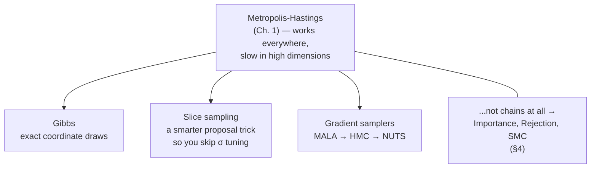
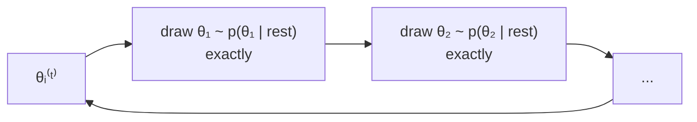

# Chapter 2 — The sampler zoo

Status: **survey** (deep dives come after you pick one).

> Ch. 1 ([TUTORIAL.md](TUTORIAL.md)) built one sampler — random-walk Metropolis —
> and proved it correct. This chapter answers the landscape questions:
> *what else exists, and why would anyone bother?*



---

## §1 The three knobs every chain sampler tunes

All chain samplers are the Ch. 1 loop with different values for three knobs:

| Knob | Metropolis (Ch. 1) | Trade-off when you change it |
|---|---|---|
| **Propose** | `θ + N(0, σ²)` (blind random walk) | Smarter proposals accept more, move further, but cost more per step. |
| **Gradients** | none — only log-density *values* | Gradients point uphill: dramatically better moves, but the model must be differentiable. |
| **Conditionals** | nothing known — `logU` is a black box | If some full conditionals are analytically known, you can sample *exactly* along them, no accept/reject needed. |

Two truths to keep in mind through the whole chapter:

- **All valid MCMC satisfies detailed balance** (or generalizations) — the
  mathematics that guarantees the *stationary distribution is the posterior*.
  What differentiates samplers is mixing speed, not correctness. Inefficiency
  shows up as autocorrelation, and Ch. 4 (planned) measures it.
- **Nothing is universally best.** A sampler is "better" only relative to
  (model shape × dimension × budget for gradients × how much you trust).

---

## §2 Direct samplers — when you don't need to propose

Metropolis needs a coin flip because it doesn't know what the density looks
like locally. Direct samplers replace the coin flip with exact draws over
sub-regions they understand.

### 2.1 Gibbs sampling

**Idea.** If, for each coordinate `i`, you can *draw exactly* from the full
conditional `p(θᵢ | θ₋ᵢ, data)`, cycle through coordinates. No proposals, no
coin flips, no rejections — every move is accepted by construction.



**Why nice.** Zero tuning, zero rejections, and typically excellent mixing
per coordinate. For our normal-mean model (`μ ~ N(0, 25)`, `xᵢ ~ N(μ,1)`)
the posterior is `N(..., ...)` in closed form — one Gibbs draw is a whole
"good sample".

**Why not always.** (i) Most real models *don't* have conjugate conditionals;
there it degrades to "Metropolis-within-Gibbs", i.e. nested Metropolis steps
inside the coordinate loop — same tuning problems, more nesting. (ii) Even
when conditionals exist, strongly *correlated* coordinates are slow: the chain
creeps along a diagonal ridge one tiny axis-aligned step at a time, while a
joint mover (HMC) slides along the ridge in one move. (iii) Each coordinate
draw needs its own math — `d` coordinates means deriving `d` conditionals.

### 2.2 Slice sampling

**Idea.** For each coordinate: (1) draw an auxiliary height `y` below the
density curve; (2) walk an interval around the current point until bracketing
the slice `{θ : logp(θ) ≥ log y}`; (3) sample uniformly from that interval.

**Why nice.** You never tune a proposal step size; the interval adjusts to
local scale automatically. Also (unlike Metropolis proposals) the window can
*grow to cross valleys* the random walker would have missed.

**Why not always.** Stepping out / shrinkage loops are more bookkeeping than a
single Metropolis step, and still coordinate-wise (so correlated dimensions
struggle the same way Gibbs does).

---

## §3 Gradient samplers — making moves *informed*

The log-posterior defines a landscape; `∇ logp(θ)` is the uphill direction.
Ch. 1's sampler explores like a drunkard's walk; gradient samplers walk with a
compass. This is the family that modern PPLs (Stan, PyMC, NumPyro) default to.

### 3.1 MALA (Metropolis-adjusted Langevin algorithm)

**Idea.** Propose `θ' = θ + h·∇logp(θ) + √(2h)·ε` — drift uphill by `h`
(a known *Euler step on the Langevin SDE*), noise for exploration. Keep the
Ch. 1 coin flip, but with a *Hastings correction* because the proposal is now
asymmetric: the forward and reverse proposal densities differ, so accept with

```
min(1, exp( logp(θ') − logp(θ) + log q(θ | θ') − log q(θ' | θ) ))
```

where `q(θ' | θ) = N(θ + h·∇logp(θ), 2h)` — i.e. the Ch. 1 `Δ` plus two
correction terms from the drifted proposal. The math rests on the same
shift-invariance story as Ch. 1 §5 — the `Z` argument carries over verbatim.

**Why nice.** Better dimension scaling: random-walk Metropolis needs ~O(d)
transitions to traverse the posterior in `d` dimensions (optimal-scaling
result); MALA mixing drops to ~O(d^(1/3)) because the drift does the
long-haul work toward high probability instead of blind diffusion.

**Why not always.** One Euler step per proposal is short-sighted; to move you
must either take small steps (slow mixing) or specialize (Ch. 3, HMC fixes
this by chaining many steps).

### 3.2 HMC (Hamiltonian Monte Carlo)

**Idea.** Introduce a momentum `p` and simulate *Hamiltonian dynamics* on the
landscape `L(θ) = logp(θ) - p·M⁻¹p/2` for `L` leapfrog steps, then Metropolis
flip on total energy error. Physically: a ball rolling on the *negative*
log-density surface, with momentum carrying it through flat regions.

**Why nice.** Per-move acceptance ~1, moves hundreds of step-sizes per
proposal, dramatically lower autocorrelation — for smooth posteriors this is
usually the best bang per gradient.

**Why not always.** Needs gradients (SciLean would supply) and smooth
dynamics; non-smooth or discrete parameters rule it out.
Sharp curvature ridges lead to energy errors and rejections; and two knobs
(`L`, `h`) need tuning.

### 3.3 NUTS (No-U-Turn Sampler)

**Idea.** HMC with an *automatic* trajectory stopping criterion (the "no U
turn" rule) plus recursive doubling/step-size adaptation during warm-up.
This is Stan's default "best out-of-the-box" sampler.

**Why nice.** Removes the `L` tuning knob, harvests the adaptation logic from
Ch. 1 §4.5 item 1 (dual averaging, multinomial trajectories),
so on a new model it "just works" an order of magnitude better than a tuned
random walk.

**Why not always.** Significantly more complex code (recursive doubling,
multinomial trajectory sampling); for our project the natural milestone is
MALA → fixed-L HMC → NUTS, with fixed-L HMC already showing the benefit.

---

## §4 Beyond chains — not "better samplers" but different *animals*

These do not satisfy detailed balance; they're not MCMC at all. But they solve
problems MCMC cannot (natural streaming, evidence, parallelism), so they belong
in the picture.

| Method | Idea | What it's uniquely good at | Main trap |
|---|---|---|---|
| **Importance sampling** | draw θ from a convenient `q`, weight by `w = p(θ)/q(θ)`; estimate expectations as `Σ wᵢθᵢ / Σ wᵢ` | parallel-friendly, streaming-friendly, gives you the *evidence* `Z` as a byproduct `mean(w)` (Ch. 1 §5 proved MCMC can't get this!) | weights degenerate in high dimension — ESS ∝ effective diversity of `q`, which collapses quickly |
| **Rejection sampling** | sample θ ∼ q, accept iff `u < p(θ) / (M q(θ))` | *i.i.d. exact* samples, no burn-in at all, `Z` knowable from the acceptance rate | requires knowing the ratio `p ≤ M` — impossible for general unnormalized models without a bound |
| **SMC (sequential MC)** | population of particles, reweighted + resampled + moved (each "move" is a few MCMC steps) through annealed targets | model comparison, streaming data, and *evidence estimates built-in*; embarrassingly parallel | resampling and badly spaced annealing collapse particle diversity | |

SMC deserves a note: it uses MCMC *as an inner loop* ("the same Ch. 1 solver") and inherits the whole `Solver` interface — good demonstration of the
architecture paying off.

---

## §5 Comparison / what to pick when

| | Gibbs | Slice | MALA | HMC | NUTS | Importance | SMC |
|---|---|---|---|---|---|---|---|
| gradients needed | no | no | yes | yes | yes | no | optional |
| tuning burden | low | low | step size `h` | `L` + `h` | none (auto-tunes) | a good `q` | particles + schedule |
| typical accept rate | n/a (no accept) | n/a (no accept) | ~0.57 (opt.) | ~1 | ~1 | n/a | n/a |
| dimension scaling | coordinate-correlated | coordinate-correlated | ~O(d^(1/3)) | ~O(√d) | ~O(√d) | collapses | ok w/ moves |
| our `Solver` interface fit | natural (`step`) | natural (`step`) | natural (`step`) | natural (multi-step `step`) | harder (recursive) | not a chain | loop of loops |
| best for | conjugate models | 1–5 dims, no tuning | cheap gradient models | smooth, moderate-d | "just works" defaults | evidence `Z`, streaming | evidence, parallel, streaming |

Rules of thumb (debatable, but useful):

- **Conjugate / closed-form conditionals?** → Gibbs first; it's free.
- **1–5 dims, small data, hate tuning?** → slice sampling or a tuned random walk.
- **Smooth differentiable model, ≥10 dims?** → HMC/NUTS; the payoff grows with dimension.
- **Need `Z` / streaming / parallelism?** → importance or SMC; MCMC fundamentally cannot give you the evidence.

---

## §6 Where each plug-in touches our architecture

Recall from Ch. 1: `Solver := { name, step }` with `step : Model → Array Float → StdGen → StepResult`.
Here's what each zoo member asks of that interface:

- **Gibbs / slice / MALA / fixed-L HMC**: implement `step`; HMC needs many internal
  sub-steps plus gradient calls, but the interface is unchanged.
- **NUTS**: `step` grows to a recursive trajectory builder — still *one* `step`,
  but it needs a recursive "grow one tree" helper underneath; also worth
  extending `StepResult` with an adaptation hook.
- **Importance**: not a `Solver` — it's a *different runner* (parallel over particles).
  Reuse `Model` and `randFloat` helpers but replace the loop.
- **SMC**: a runner containing inner `Solver`s (reusing Ch. 1's).

So the honest scorecard: 4 of the 6 are `step`-shaped, which was the design goal.

---

## §7 Next step: pick a deep dive

Good options, in the order the repo makes easiest:

1. **Gibbs** (§2.1) — lightest, exercises the conjugate normal posterior we can
   verify analytically; great first deep dive.
2. **Slice sampling** (§2.2) — moderate; stepping-out + shrinkage is a fine
   "algorithm engineering" exercise and drops the σ-knob entirely.
3. **MALA + fixed-L HMC** (§3) — the biggest step up (needs autodiff in Lean,
   which is the real Lesson 3 material), highest performance payoff.
4. **Importance/SMC** (§4) — a different *runner*; interesting if the `Model`
   reuse story appeals more than another `step`.

Tell me which one and we'll write its chapter — with the theory, the exact
`step` (or runner) code against `Solver.lean`, and a comparison run against
Ch. 1's Metropolis on the same seeded data.
