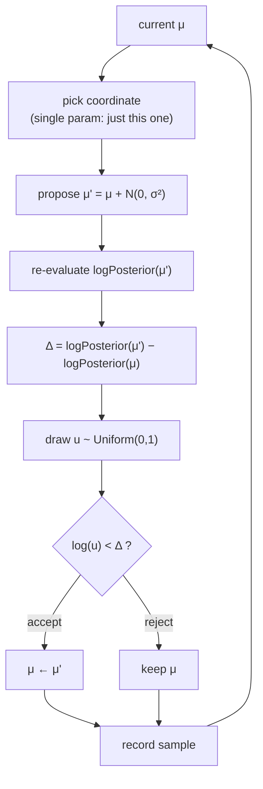
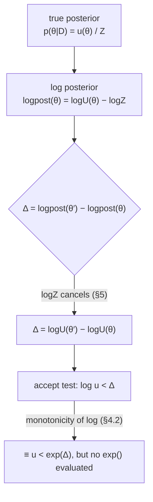
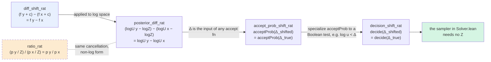

# Metropolis in Lean 4 — A Hands-On Tutorial

This project implements the simplest MCMC sampler — **Random-Walk Metropolis** — with the
goal of teaching you how the algorithm works and how Lean 4 code is structured.

This directory is the **learning material**: `Proofs.lean` proves why the sampler
never needs a normalizing constant, and this tutorial walks through the code.

> **The runnable code lives one level up:** the swappable-solver version is in
> `../Solver.lean` (generic `Solver` architecture) and `../Main.lean` (the concrete
> model and executable). Run it with `lake build && lake exe metropolis` from
> `/workspace/brane`.

---

## 1. What this program does

We pretend to observe 50 numbers drawn from `N(3.0, 1.0)` and ask:

> "What is the posterior distribution of the unknown mean `μ`?"

The sampler starts at `μ = 0.0` and wanders around, producing 5000 samples. We then
compute the mean and standard deviation of those samples as our estimate.

The scalar version shown below is from the original single-file sampler; in the
consolidated repo the same logic lives in the generic solver — `metropolis` in
[`../Solver.lean`](../Solver.lean) (it works on `Array Float`, picking a coordinate
at random to propose) — and the model/runner in [`../Main.lean`](../Main.lean).

(The "expected output" above comes from running the sampler; your numbers will match
exactly since the RNG is seeded deterministically.)

```
true μ            = 3.0
posterior mean     = 3.088918
posterior std      = 0.144190
acceptance rate    = 0.486143
num samples        = 5000
```

The posterior mean (~3.09) is close to the true value (3.0), and the std (~0.14)
reflects our uncertainty from only 50 data points. An acceptance rate near 0.44–0.50
is the sweet spot for 1-D Metropolis.

---

## 2. The algorithm you described, in one picture



See [`../Solver.lean`](../Solver.lean) (the `metropolis` solver, function `step`) for
the exact code — line ~57:

```lean
def metropolis (σ : Float) : Solver := {
  name := "metropolis"
  step := fun model θ gen =>
    let n := θ.size
    if n == 0 then { params := θ, gen, accepted := false }
    else
      let (iNat, gen) := randNat gen 0 (n - 1)
      let (eps, gen) := randNormal gen
      let θ' := θ.set! iNat (θ[iNat]! + eps * σ)
      ...
      let accept := Float.log u < (logp' - logp)
```

---

## 3. Walking through the code

### §1 — The model (log-density)

[`../Main.lean`](../Main.lean)

```lean
def model : Model := fun θ =>
  let μ := θ[0]!
  let prior := -(μ * μ) / (2.0 * 25.0)
  let ll := data.foldl (fun acc x => acc - 0.5 * (x - μ) * (x - μ)) 0.0
  prior + ll
```

- We work with **log-densities** (higher = more likely). Metropolis only needs
  *differences*, so the normalizing constant is irrelevant. §5 proves this claim
  in Lean — read it if you want to see exactly why `Z` never appears in the code.
- `data.foldl` sums the per-observation log-likelihoods.

> **Try it:** change `25.0` (the prior variance) to `1.0` and watch the posterior
> shrink toward 0.

### §2 — Random helpers

[`Solver.lean`, lines ~45–55](../Solver.lean)

```lean
def randFloat (g : StdGen) : Float × StdGen := ...
def randNormal (g : StdGen) : Float × StdGen := ...  -- Box-Muller
```

- `StdGen` is Lean's pure (deterministic) RNG. We thread it through manually —
  no global random state.
- `randNormal` turns two uniforms into one standard normal via Box-Muller
  (Lean's core has no built-in normal sampler).

### §3 — One Metropolis step

The scalar version of `step` looks like this:

```lean
def step (μ : Float) (σ : Float) (g : StdGen) : Float × Bool × StdGen :=
  let (eps, g) := randNormal g
  let μ'       := μ + eps * σ
  let (u, g)   := randFloat g
  let Δ        := logPosterior μ' - logPosterior μ
  let u        := if u == 0.0 then 0.000001 else u
  let accept   := Float.log u < Δ
  if accept then (μ', true, g) else (μ, false, g)
```

- `σ` scales the proposal noise. Tune it to hit ~0.44 acceptance.
- The coin flip is `Float.log u < Δ` — mathematically `u < exp(Δ)`, but log-space
  never overflows.

### §4 — The chain

[`Solver.lean`, `runChain` and `runChainDetailed`](../Solver.lean)

```lean
def runChain (solver : Solver) (model : Model) (init : Array Float)
    (nBurn nSamples : Nat) (gen : StdGen) : Array (Array Float) × StdGen :=
  let rec loop (k : Nat) (θ : Array Float) (g : StdGen) (acc : Array (Array Float)) :
      Array (Array Float) × StdGen :=
    if k = 0 then (acc, g)
    else
      let r := solver.step model θ g
      let acc := if k ≤ nSamples then acc.push r.params else acc   -- burn-in!
      loop (k - 1) r.params r.gen acc
    termination_by k
  loop (nBurn + nSamples) init gen #[]
```

- First `nBurn` (2000) samples are **discarded** (chain still warming up).
- `termination_by k` proves to Lean that `k - 1 < k`, so recursion terminates.

### §5 — Main

[`../Main.lean`](../Main.lean)

Calls `runChainDetailed`, then computes and prints posterior mean, std, acceptance
rate, and sample count.

---

## 4. Why log-posterior? (and how the log-space coin flip works)

### 4.1 The problem: Floats underflow

The true likelihood is a *product* of small numbers:

$$
p(\text{data} \mid \mu)
= \prod_{i=1}^{50} \mathcal N(x_i \mid \mu, 1)
= (2\pi)^{-25} \exp\!\Big(-\tfrac{1}{2}\sum_i (x_i - \mu)^2\Big).
$$

For 50 data points, $p(\text{data} \mid \mu)$ is on the order of $10^{-40}$ —
and for a big dataset ($10^6$ points) it dips below $10^{-400000}$. IEEE
`Float` can represent numbers only down to about $10^{-308}$: the likelihood
**underflows to exactly 0.0**, with no way to tell "goes to zero smoothly"
from "was zero all along" — which destroys any ratio or difference you might
compute.

The fix is to work in **log space**, because the log of a product is a sum of
logs:

$$
\log p(\text{data} \mid \mu)
= \sum_{i=1}^{50} \log \mathcal N(x_i \mid \mu, 1)
= -25 \log(2\pi) - \tfrac{1}{2}\sum_i (x_i - \mu)^2.
$$

Each term is a modest negative number ($-0.5 (x_i - \mu)^2$ is tens or
hundreds), and the sum stays representable no matter how many observations
there are. Look at the code in `../Solver.lean` / `../Main.lean`: everything
is a *sum* of logs (`prior + ll` where `ll` is a fold over
`- 0.5 * (x - μ) * (x - μ)`).

Two extra payoffs, for free:

| Benefit | Why |
|---|---|
| **Monotonicity** | `log` is increasing, so the *ranking* of parameter values is identical in log space. Comparisons (and ordering) don't change. |
| **Cancellation-friendly** | The Bayes constant `1/Z` — multiplicative in the density — becomes the *additive* constant `- log Z`, and subtracting one constant from another is exactly what cancels. §5 formalizes this. |

### 4.2 How the coin flip works in log space

The Metropolis accept probability is

$$
\alpha = \min\bigl(1, \exp(\Delta)\bigr),
\qquad \Delta = \log p(\theta') - \log p(\theta).
$$

We would love to just sample $w \sim \mathrm{Uniform}(0,1)$ and accept iff
$w < \alpha$. But computing $\alpha$ means evaluating $\exp(\Delta)$ — and
when $\Delta$ is a large negative number (e.g. $-700$),
$\exp(-700) = 0.0$ in `Float`, so $\alpha$ underflows to $0$ for *any*
downhill proposal, and every bad proposal would be rejected forever. So we
run the whole comparison in log space:

```lean
let (u, g) := randFloat g          -- u ~ Uniform(0, 1)
let accept := Float.log u < Δ      -- instead of: u < exp(Δ)
```

Why is `Float.log u < Δ` the same test? Because `log` is **strictly
increasing**:

$$
u < \exp(\Delta) \quad\Longleftrightarrow\quad \log u < \log(\exp \Delta) = \Delta.
$$

The equivalence holds only because log preserves `<`; that's the monotonicity
from 4.1 pulling its weight. So we never evaluate `exp` at all — no underflow, and the
two quantities being compared (`log u`, which is in `[-∞, 0)`, and `Δ`, which
is a moderate number) live comfortably in Float range.

Two practical details worth knowing:

1. **`u = 0` is banned.** Mathematically `log 0 = -∞`; IEEE `Float.log` returns
   `-∞` (signed infinity) for it, and no finite `Δ` is ever below `-∞`, so a
   zero draw would trick the test into *rejecting an uphill proposal*. The
   consumer of `randFloat` therefore does
   `let u := if u == 0.0 then 0.000001 else u` before logging. Without this
   guard, one unlucky draw gives a subtly wrong coin flip.
2. **Sign intuition.** `u ∈ (0,1)`, so `log u` is always *negative* — in fact
   `log u = -E` where `E ~ Exponential(1)`, so it's typically somewhere in
   `(-5, 0)`, straddling 0. Accepting iff `log u < Δ` thus means:
   - `Δ > 0` (uphill move): always accepted, since `log u` is negative and
     `Δ > 0 > log u`.
   - `Δ < 0` (downhill move): accepted only if `log u` is *even more negative*
     than Δ, which happens with probability `exp(Δ)` — exactly the α you wanted.

Quick sanity check: a proposal that is $\Delta = -2.3$ worse should be accepted
with probability $\exp(-2.3) \approx 0.1$. And indeed $\log u < -2.3$ means
$u < e^{-2.3}$; since $u$ is uniform, that has probability $e^{-2.3} \approx 0.1$. ✓

### 4.3 The whole picture



### 4.4 How the chain is built

The Metropolis *step* is one move. The *chain* is what turns one move into
inference — here is the distilled plan, four pieces in order:


A chain is "just" a **fold over steps whose state is `(θ, generator)`**, seeded
at a start point and rolled forward 7000 times in `Main.lean`:

```lean
loop (nBurn + nSamples) init gen #[]
```

Three structural points worth internalizing:

1. **The state tuple is everything.** A chain carries exactly two pieces of
   state — the parameter vector `θ` and a `StdGen`. There is no hidden "current
   position" elsewhere; even the ACCEPT/REJECT history is *not* held on to
   (only the running count matters). This is why we can memorize 5000 samples
   in a single accumulated `Array` without any bookkeeping: the chain is
   **memoryless** except for `(θ, gen)`.
2. **Burn-in happens at collection, not inside the loop.** The chain always
   executes `nBurn + nSamples` steps identically — it's the line
   `let acc := if k ≤ nSamples then acc.push r.params else acc` that does the
   filtering. The first `nBurn` (2000) iterations run exactly like all the
   others, but their outputs are dropped: at the beginning the chain hasn't
   forgotten its starting point (here `μ = 0.0`, which is very much NOT a
   plausible posterior mean), so early samples are "polluted" by the seed.
3. **`termination_by k` is what lets recursion stand in for `for` loops.**
   Lean has no while-loop: `loop (k-1) ...` on each call makes progress,
   and `termination_by k` is Lean's proof obligation that the decreasing
   measure is real — the take-home is simply "progress on a `Nat` argument"
   suffices, and Lean then compiles the recursion to an honest terminating
   function, not a lazily-thunked pseudo-loop.

`runChainDetailed` adds one accumulator field (`nAcc`) to track acceptances so
`Main.lean` can later report the acceptance rate — the chain loop is otherwise
character-for-character identical, which is the point: **metadata collection
must not affect the chain itself**.

#### Why burn-in at all?

The starting seed injects bias: your posterior estimate would be a mixture of
"the seed-related transient state" and "the actual posterior". That's why we
discard the first portion. Two ways of thinking about it:

| View | Interpretation |
|---|---|
| **Distributional** | "The chain has not yet converged to the posterior." Assess by plotting the running mean and see it stabilize. |
| **Mixing-time view** | "The chain's transition operator contracts slowly at first." Infinitely-long-ago initialization is irrelevant; a fresh walk starts far away, drifts in, then wobbles *near* the posterior forever after. |

There's no *detector* inside the loop — it's a fixed, pre-decided cut. If
you start at a wildly bad point, no fixed cutoff is enough; see the glimpse
below for what a principled "are we converged yet?" check looks like.

#### Ways to build the chain — variants of the same idea

Here's what concretely varies between chain implementations, once you've got
the core `(step, loop, collect)` shape:

**a) Where you start (`init`).** The chain's output is (asymptotically)
independent of the start; practically, a bad seed wastes burn-in. Common
choices: a guess (we used `0.0`), a MAP estimate, an overdispersed random
spread.

**b) How you propose (`step`).

- Our sampler perturbs a *single* coordinate per move (`randNat gen 0 (n-1)`)
  — cheap and dimension-robust.
- Random-walk Metropolis (scalar we teach here): propose all coordinates at
  once with one `N(0, σ²)`.
- Credit assignment is why per-coordinate updates scale better in high
  dimension — each try either helps (accept) or harms (reject) exactly one
  plane.

**c) How you collect.** Keep-every-sample (what we do here), **thinning**
(keep every 5th — see exercise §6C), or
**streaming statistics** (maintain running `sum` and `sum²`, never store
samples). Thinning trades variance for memory; streaming statistics means
you can afford basically any `nSamples` without RAM worries.

### 4.5 A glimpse of what professionals do with this loop

The structure `(step, loop, collect)` is *the* skeleton; what follows is a list
of knobs on it. If you want to "level up" from the tutorial sampler, this is
where the effort goes, in roughly the order you'd meet it in practice:

1. **Adaptive step size.** Instead of a fixed `σ`, adjust it *during burn-in*
   to land the acceptance rate near 0.44 (1-D) or 0.234 (high-D) — the classic
   rule: `if acceptance too low, shrink σ; if too high, grow σ`. What you
   must NOT do is keep adapting after burn-in — that breaks the
   memoryless property that makes the chain a valid posterior sampler. A
   principled version: dual-averaging / step-size tuning à la NUTS.
2. **Multiple chains, overdispersed starts.** Run 4 chains from far-apart
   starting points. Two reasons: (i) you can diagnose — if the chains agree
   *in location* you have decent evidence they've reached the same
   distribution; (ii) hand-waving about burn-in adequacy becomes a witnessed
   measurement instead. This is an embarrassingly-parallel job:
   each chain gets its own `StdGen` seed and they share a model.
3. **Convergence checks you can actually trust.**
   - **R̂ (split-R̂):** ratio of among-chain to within-chain variance when you
     halve each chain and shuffle halves. Target `R̂ < 1.01` (a 1.1 threshold
     is twenty-year-old news).
   - **ESS (effective sample size):** autocorrelated Metropolis samples are
     not 5000 independent draws — random-walk chains often deliver ESS of
     only a few hundred. ESS is what should drive `nSamples` budgeting.
4. **Faster samplers — same loop, smarter `step`.** The proposal distribution
   is where all the *actually different* algorithms live:
   - **Metropolis within-Gibbs** — cycle coordinate-wise *exact* draws when
     a full conditional is available in closed form (our normal-mean model
     with conjugate priors admits one).
   - **MALA** — propose $\theta' = \theta + h\,\nabla\log p(\theta)
     + \sqrt{2h}\,\varepsilon$: drift *toward* higher
     probability instead of a blind random walk. Needs the gradient of the
     log-posterior (finite differences, or AD in Lean via SciLean later).
   - **HMC / NUTS** — simulate Hamiltonian dynamics on the log-posterior
     surface for L leapfrog steps per proposal. Travels far *and* rejects
     rarely; NUTS self-tunes trajectory length. This is what Stan/PyMC run
     by default, and it's the natural "solver #2" for our `Solver`
     interface — the loop (`runChain`) does not change at all.
5. **Reparameterization.** When a model has a *constrained* parameter (scale
   `σ > 0`, correlation `ρ ∈ (-1,1)`), sample a *free* parameter instead
   (`log σ`, `tanh ρ`) and let the model's log-density carry the Jacobian
   correction. This kills the "random walk straddling a boundary" pathology
   and is a standard first-aid move before any fancier sampler.

Each of these slots cleanly into the architecture: 1–3 are *orchestration*
changes around `runChain`; 4–5 only swap out `solver.step`. When a change
requires touching `Model`, that's the smell that the model/solver separation
is leaking.

---

## 5. Why only differences? (a Lean proof)

The step function never mentions a normalizing constant:

```lean
let Δ := logPosterior μ' - logPosterior μ
```

Why is that allowed? Bayes' theorem says the posterior is the unnormalized
density divided by a constant `Z`. This section explains the cancellation and
walks through the machine-checked proof in [`Proofs.lean`](Proofs.lean).

### The proof chain at a glance

The five theorems in [`Proofs.lean`](Proofs.lean) are not independent — each one
rests on the previous step, from pure algebra all the way to the sampler's coin
flip:



`diff_shift_rat` is the seed: pure arithmetic, no probabilities involved.
`posterior_diff_rat` is the Bayes step (the log `Z` from the true posterior is
exactly the constant `c` of shift invariance, appearing on *both* sides). The
final two rewrap the unchanged $\Delta$ in "any function of $\Delta$" and then
"the Boolean the solver actually evaluates" — at which point the sampler's
omission of `Z` is fully justified. `ratio_rat` is the side branch: the same
cancellation stated for density *ratios* rather than log differences.

### The math in three lines

$$
\text{posterior}(\theta \mid D) = \frac{p(D \mid \theta)\, p(\theta)}{Z},
\qquad Z = \int p(D \mid \theta)\, p(\theta)\, d\theta,
$$

$$
\log \text{posterior}(\theta) = \log U(\theta) - \log Z,
\qquad \log U = \text{log-likelihood} + \text{log-prior},
$$

$$
\Delta = \log \text{posterior}(\theta') - \log \text{posterior}(\theta)
\;=\; \bigl(\log U(\theta') - \log Z\bigr) - \bigl(\log U(\theta) - \log Z\bigr)
\;=\; \log U(\theta') - \log U(\theta),
$$

with the last step being exactly the cancellation of $\log Z$.

The same cancellation happens at the level of the acceptance probability:

$$
\alpha(\theta \to \theta')
= \min\!\Bigl(1,\ \frac{\text{posterior}(\theta')}{\text{posterior}(\theta)}\Bigr)
= \min\!\Bigl(1,\ \frac{\text{unnorm}(\theta') / Z}{\text{unnorm}(\theta) / Z}\Bigr)
= \min\!\Bigl(1,\ \frac{\text{unnorm}(\theta')}{\text{unnorm}(\theta)}\Bigr).
$$

$Z$ is a single number that does not depend on $\theta$, so it is the *same*
constant in numerator and denominator. That is the entire reason MCMC can
work with unnormalized densities.

### Reading `Proofs.lean`

The file proves the cancellation over `Rat` (exact rational numbers). Each
theorem is stated in the same form as the math above.

**1. Shifting both values does not change a difference.**

```lean
theorem diff_shift_rat (f : Rat → Rat) (c x y : Rat) :
    (f y + c) - (f x + c) = f y - f x
```

Plain English: if you add the same `c` to both `f x` and `f y`, the `c`
cancels in the subtraction. This is the algebraic core of the whole story.

**2. Subtracting `log Z` from both log-densities does not change their difference.**

```lean
theorem posterior_diff_rat (logU : Rat → Rat) (logZ x y : Rat) :
    (logU y - logZ) - (logU x - logZ) = logU y - logU x
```

Plain English: the true log posterior is `logU θ - logZ`, but the
difference of log posteriors is exactly the difference of `logU` values.
This is the theorem that lets the sampler use the plain log-density as the
model (never computing `Z`).

**3. Any acceptance probability based on `Δ` is unchanged.**

```lean
theorem accept_prob_shift_rat (f : Rat → Rat) (c x y : Rat)
    (acceptProb : Rat → Rat) :
    acceptProb ((f y + c) - (f x + c)) = acceptProb (f y - f x)
```

Plain English: `acceptProb` stands for `fun Δ => min 1 (exp Δ)`. Since its
input is unchanged, the acceptance probability is unchanged.

**4. The accept/reject coin flip is unchanged.**

```lean
theorem decision_shift_rat (f : Rat → Rat) (c x y : Rat)
    (decide : Rat → Bool) :
    decide ((f y + c) - (f x + c)) = decide (f y - f x)
```

Plain English: whatever Boolean comparison the solver performs on `Δ`
(in `Solver.lean` it is `Float.log u < Δ`), the answer is the same with or
without the normalizing constant.

**5. The density ratio is unchanged.**

```lean
theorem ratio_rat (p : Rat → Rat) (x y Z : Rat) (hZ : Z ≠ 0) :
    (p y / Z) / (p x / Z) = p y / p x
```

Plain English: the non-log version of the same fact — dividing numerator
and denominator by the same nonzero `Z` cancels.

### Checking the proofs yourself

```bash
cd /workspace/brane
lake env lean learn-metropolis/Proofs.lean   # check just the proof file
```

The end of the output is:

```text
'Metropolis.diff_shift_rat' depends on axioms: [propext, Classical.choice, Quot.sound]
'Metropolis.posterior_diff_rat' depends on axioms: [propext, Classical.choice, Quot.sound]
'Metropolis.accept_prob_shift_rat' depends on axioms: [propext, Classical.choice, Quot.sound]
'Metropolis.decision_shift_rat' depends on axioms: [propext, Classical.choice, Quot.sound]
'Metropolis.ratio_rat' depends on axioms: [propext, Classical.choice, Quot.sound]
```

Those three axioms (`propext`, `Classical.choice`, `Quot.sound`) are Lean's
standard kernel axioms. The important part is that **no `sorry` or `admit`
appears**: the cancellation is fully proved.

### Why `Rat` and not `Float`?

Core Lean 4 has exact `Rat` but no `ℝ` (the reals live in Mathlib), and
`Float` is binary floating point, so equalities there are approximate. The
algebra is the same over `ℝ`; using `Rat` keeps the proof file self-contained
and exact.

### Exercise: prove the integer version

Add this to `Proofs.lean`:

```lean
theorem diff_shift_int (f : Int → Int) (c x y : Int) :
    (f y + c) - (f x + c) = f y - f x := by
  omega
```

(If `omega` does not fire in your setup, use
`rw [Int.add_sub_add_right]` instead.) Same theorem, different number type.

### Mapping back to the code

| Metropolis concept | Math | Lean |
|---|---|---|
| unnormalized log posterior | `logU(θ)` | `model θ` (root `Main.lean`) |
| log normalizing constant | `log Z` | never computed |
| log acceptance ratio | `logU(θ') − logU(θ)` | `logp' - logp` inside `metropolis` (`Solver.lean`) |
| coin flip | `log u < Δ` | `Float.log u < Δ` |

By `posterior_diff_rat`, the `Δ` computed by `step` is exactly the `Δ` of
the fully normalized posterior. So the chain targets the correct distribution
even though `Z` is never computed — which is essential, because for most
real models `Z` is an intractable integral.

---

## 6. Exercises (modify the code in `/workspace/brane`, then `lake build && lake exe metropolis`)

### A. Tune σ

Change `metropolis 0.3` to `metropolis 1.0` in `Main.lean`. Watch acceptance drop to
~0.18 and the chain mix worse. Find the σ that gives ~0.44.

### B. Add a second parameter

Make the state `#[μ, logσ]` (mean + log standard deviation). Extend `model` in
`Main.lean` to two dimensions: the prior on `logσ` is very broad, and the
likelihood uses `σ = exp σ'`. The sampler (`metropolis`) already handles
multi-dimensional state — it picks a coordinate at random. Note the acceptance
formula automatically becomes a 2-D log-posterior.

### C. Add thinning

Keep only every 5th sample: change `acc.push r.params` in `runChain` to push only
when a counter is divisible by 5. This reduces autocorrelation.

### D. Swap the model

Replace `data` and `model` with a linear regression `y = a + b·x` (state `#[a, b]`).
The sampler (`metropolis`, `runChain`) does **not change at all** — that's the power
of separating model from solver.

### E. Make it swappable

Already done in the consolidated repo: `step` is wrapped in a `Solver` struct
(see [`../Solver.lean`](../Solver.lean)) so you can later plug in Gibbs or HMC
without touching the loop. Exercise: write a second solver (e.g. Gibbs for the
normal-mean model) and run both through the same `runChain`.

---

## 7. Common Lean 4 pitfalls (we hit these)

| Symptom | Cause | Fix |
|---|---|---|
| "failed to prove termination" | Lean can't see `k-1 < k` | Add `termination_by k` |
| `Float.pi` unknown | Not in core | Define the constant yourself |
| `IO.rand` type errors | Only takes `Nat` | Build `randFloat` from `randNat` |
| `Array.set` needs a proof | Index proof obligation | Use `set!` (bounds-checked) |
| `if k == 0` leaves bad hypothesis | `==` is Bool, not Prop | Use `if k = 0` |
| RNG feels "global" | It isn't — Lean is pure | Thread `StdGen` in/out |

---

## 8. Next steps

1. **HMC** — needs a gradient of the model log-density. Start with finite differences:
   `(f(μ+h) - f(μ-h)) / (2h)`, then move to SciLean's AD.
2. **Multiple chains + R-hat** — run 4 chains, check `R̂ < 1.01`.
3. **Reparameterize** — sample `log σ` instead of `σ` to respect constraints.
4. **Write a new solver** in `Solver.lean` (e.g. Gibbs or HMC) — see `metropolis`
   for the interface.

---

## 9. File map

```
/workspace/brane/                 ← the Lean project (run from here)
├── Solver.lean                   ← generic Solver + metropolis + runChain
├── Main.lean                     ← model + executable
└── learn-metropolis/             ← the learning folder (this dir)
    ├── TUTORIAL.md               ← this file
    ├── Proofs.lean               ← formal proof that only log-density differences
    │                               matter (check with `lake env lean learn-metropolis/Proofs.lean`)
    └── images/                   ← figures + the script that makes them
```

Happy sampling! When you're ready to go deeper, ask about HMC, NUTS, or the
swappable-solver architecture.
