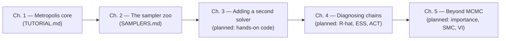

# 🎲 Metropolis → Samplers in Lean 4 — the learning plan

Welcome to the learning track for this project. The project code lives in
`projects/metropolis`: `Solver.lean` (generic solver architecture + Metropolis)
and `Main.lean` (a concrete Bayesian model). This folder contains the *course*.

## 🧭 How the chapters fit together



Each chapter has its own markdown file and builds on the previous one. Every
time a chapter introduces a new sampler, the goal is: **same `Model`, same
`Solver` interface, same `runChain` loop** — only the `step` changes. That is
the theme of the whole course.

---

## 1️⃣ Chapter 1 — Metropolis core ([TUTORIAL.md](TUTORIAL.md)) ✅ done

What one MCMC sampler is, and *why it is allowed to work*:

| § | Content |
|---|---------|
| §1–§3 | The model (`logPosterior`), the random helpers, one Metropolis `step`, the `runChain` loop |
| §4 | **Why log-posterior** (underflow, monotonicity) and **how the log-space coin flip** works (`log u < Δ ≡ u < exp Δ`) |
| §4.4 | How the chain is *built*: state tuple, burn-in at collection, `termination_by` replacing for-loops; variants (init / proposal / collection) |
| §4.5 | A glimpse of the professional state of the art (adaptive σ, multiple chains, R̂/ESS, Gibbs/MALA/HMC/NUTS, reparameterization) |
| §5 | The **Lean proofs** that the normalizing constant cancels: `diff_shift_rat` → `posterior_diff_rat` → `decision_shift_rat`, with a Mermaid proof-chain diagram |
| §6–§9 | Exercises, Lean pitfalls, next steps, file map |

Key invariant established in Ch. 1 (proved in `Proofs.lean`):
$\Delta = \log U(\theta') - \log U(\theta)$ is all the sampler ever needs —
$Z$ never computed.

## 2️⃣ Chapter 2 — The sampler zoo ([SAMPLERS.md](SAMPLERS.md)) → **next up** 👀

The landscape question: *if Metropolis works, why is there any other sampler?*
and *what makes each one "better"?*

Planned outline:
1. **The three knobs** every MCMC sampler tweaks — proposal shape, whose
   density derivatives it may touch, and how far it moves per accept.
2. **Direct samplers** — Gibbs sampling (exact conditionals), slice sampling;
   when "exact inside one coordinate" beats random walking.
3. **Gradient-based samplers** — Metropolis-adjusted Langevin (MALA), HMC,
   NUTS: what trading gradients buys you (dimension scaling, far moves,
   fewer autocorrelated samples) and what they cost (differentiability).
4. **Beyond pointwise samplers** — importance sampling, rejection sampling,
   sequential Monte Carlo: not chains at all, and when chains are the wrong
   tool.
5. **Comparison table** — dimension sensitivity, need for gradients, tuning
   burden, ESS-per-iteration, and how each one plugs into our `Solver`
   interface.

## 3️⃣ Chapter 3 + 🚧 — hands-on planned chapters
- **Ch. 3: Second solver** — implement Gibbs (then MALA) against the `Solver`
  interface and measure them on the same model.
- **Ch. 4: Diagnosing chains** — implement R̂ and ESS/closest-match ACT in
  Lean, run them on the Ch. 3 solvers.
- **Ch. 5: Beyond MCMC** — importance/SMC sketches and where they genuinely
  outperform all MCMC (model comparison, evidence, streaming data).

---

## 🏃 Running the code

```bash
cd projects/metropolis
lake build
lake exe metropolis                            # the sampler of Ch. 1
lake env lean learn-metropolis/Proofs.lean     # the proofs of Ch. 1 §5
```

The RNG is deterministically seeded (`StdGen.mk 12345 67890`) so you always
see the same numbers — great for verifying exercises by exact output match.
